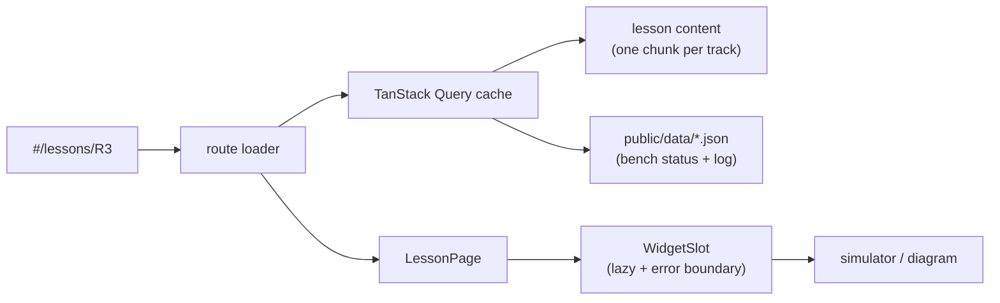

<div align="center">

# Pulsar C5 Labs

**Explore the UNIT PULSAR ESP32-C5HR8 board.**<br>
An interactive guide to the ESP32-C5HR8 and the UNIT PULSAR board, with a complete isometric model, a documented Nano-format pinout and a PDF-linked chip reference. Existing hands-on lessons, simulators and firmware reader remain labeled as ESP32-S3 material while C5 examples are being developed.

[](https://unit-electronics-mx.github.io/unit_fork_esp_c5_labs_web/)

[](https://react.dev)
[](tsconfig.app.json)
[](https://vite.dev)
[](docs/I18N.md)
[](https://github.com/UNIT-Electronics-MX/unit_fork_esp_c5_labs_web/actions/workflows/ci.yml)
[](CONTRIBUTING.md)
[](LICENSE)

[Live guide](https://unit-electronics-mx.github.io/unit_fork_esp_c5_labs_web/) ·
[Pulsar C5 hardware](https://github.com/UNIT-Electronics-MX/unit_pulsar_esp32_c5) ·
[Legacy ESP32-S3 firmware](https://github.com/agharsallah/esp-labs) ·
[Architecture](docs/ARCHITECTURE.md) ·
[Contributing](CONTRIBUTING.md) ·
[Report a bug](https://github.com/UNIT-Electronics-MX/unit_fork_esp_c5_labs_web/issues/new?template=bug-report.yml) ·
[Propose a lab](https://github.com/UNIT-Electronics-MX/unit_fork_esp_c5_labs_web/issues/new?template=new-lab.yml)


</div>

> [!IMPORTANT]
> **Migration status:** The Intro 00–02 and Pulsar C5 lessons are written for the ESP32-C5HR8 in Arduino and MicroPython. Other themes and their older firmware reader content still include ESP32-S3 material; check their wiring before using them on the Pulsar C5. The MicroPython examples have passed syntax checks but have not been verified on a physical board yet.

## Contents

- [What's inside](#whats-inside)
- [The labs](#the-labs)
- [Quick start](#quick-start)
- [How it is built](#how-it-is-built)
- [Contributing](#contributing)
- [Commands](#commands)
- [Configuration](#configuration)
- [Deploy to GitHub Pages](#deploy-to-github-pages)
- [Where things live](#where-things-live)
- [License](#license)

## What's inside

### Every lab runs in the browser first

Each lesson is one sheet: the goal, the pins it uses on a live pinout, the wiring, the command to flash it, the steps to tick off and a simulator of what you should see. Type a command into the simulated serial monitor and the board answers like the real firmware does.

<p align="center"></p>

### A code reader that never overwhelms

**Read the code** opens the real firmware the lab flashes, taken from [esp-labs](https://github.com/agharsallah/esp-labs) at build time. **Tour** walks it a few lines at a time and asks you to guess first. **Story** follows the program as it runs, from `setup()` into every call. **Explore** explains any line you tap. New C++ words come up three at a time, and the phrasebook remembers the ones you've already met.

<p align="center"></p>

### The datasheet, made for makers

The **Datasheet** section ([`#/datasheet`](https://unit-electronics-mx.github.io/unit_fork_esp_c5_labs_web/#/datasheet)) now covers the ESP32-C5HR8. It starts with the complete isometric Pulsar C5 model, then explains the two RISC-V CPUs, memory, board pins and on-chip peripherals. Each chip fact links directly to a page of the bundled [ESP32-C5 Series Datasheet v1.5](public/esp32-c5_datasheet_en.pdf). **Read PDF** offers chapter shortcuts, an embedded viewer and a link to Espressif's current publication. The new reference text is available in English and Spanish; other interface languages fall back to English for this section.

The board pinout follows UNIT's [Pulsar C5 hardware reference](https://github.com/UNIT-Electronics-MX/unit_pulsar_esp32_c5). D2/RGB is marked as unverified because the pinout artwork and schematic disagree about its GPIO.

### In your language, on your phone

The guide is in English, French, Spanish, Italian, German, Polish, Turkish, Chinese (Simplified and Traditional), Japanese and Arabic (right to left). Add `?lang=fr` to any link to share it in a language. It works on a phone at 390 px, in light and dark themes, and respects reduced motion.

<table>
  <tr>
    <td width="70%"></td>
    <td width="30%"></td>
  </tr>
</table>

### Also inside

- **Meet the board**: the Pulsar C5 in 3D with component descriptions and a Nano-format GPIO reference.
- **The bench log**: published board status and records come from plain JSON in `public/data/`. Serial, MicroPython editor and firmware actions performed in the browser are stored locally (up to 100 entries) and can be filtered by type. Commands, script source and serial output are not copied into the browser log.
- **Progress**: your ticks, the last lesson you opened and the variants you picked stay in your browser, with no account.
- **The parts library** at [`#/parts`](https://unit-electronics-mx.github.io/unit_fork_esp_c5_labs_web/#/parts): 42 isometric drawings of every component on the bench, coloured from design tokens only.

## The labs

| Theme             | Labs                                                                                       | What you build                                          |
| ----------------- | ------------------------------------------------------------------------------------------ | ------------------------------------------------------- |
| **Intro**         | 00 Setup · 01 Hello · 02 First circuit                                                     | The toolchain, your first program, an LED you command   |
| **Display & input** | 03 Display · 03b Showcase                                                                | The 1.9″ TFT and the buttons                            |
| **Wi-Fi**         | W1 Scan & join · W2 Phone control · W3 Internet & AI · *W4, W5 planned* · I1 C5 cloud     | Scanning, web pages, APIs and C5 sensor readings        |
| **RFID & NFC**    | R1 Wire PN532 → R8 Card friends                                                             | PN532 V3 over I²C, tag memory, a simulated door and friends |
| **Bluetooth LE**  | B1 Listen → B8 Host · I2 C5 touch                                                         | Advertising, pairing, a phone app and C5 touch events  |
| **Sound**         | S1 Hear → S8 Voice FX                                                                      | Loudness, clap control, a recorder, a spectrum, a speaker |
| **Sensors**       | *planned*                                                                                  | Temperature, air and motion over I2C                    |

The older S3 labs use standalone PlatformIO projects in [esp-labs](https://github.com/UNIT-Electronics-MX/unit_fork_esp_labs_c5). The Pulsar C5 examples I1 and I2 use the Arduino sketches in [`sketches/pulsar-c5`](sketches/pulsar-c5), with MicroPython versions in the Code tab. Wi-Fi W1–W3 and Bluetooth LE B1–B8 also have a MicroPython variant on the Pulsar C5. RFID R1–R8 now use PN532 V3 over I²C with MicroPython on the C5: the Code tab reads the scripts and installable `pn532.py` directly from `esp-labs/examples/micropython/pulsar-c5/`.

## Quick start

### Flash an ESP32-C5 from the browser

Open `#/flash` in Chrome or Edge on a desktop computer over HTTPS (or `localhost`). The guide uses Espressif's `esptool-js` and Web Serial directly; no server receives the firmware file.

Choose a compiled `.bin`. A merged flash image starts at `0x0`. For separate bootloader, partition table and application images, add each file and use the offsets reported by that firmware build. Connect the board with a USB data cable, close other serial monitors, then select its port and flash. The page checks that the connected chip is an ESP32-C5 before writing. The MicroPython profile includes `ESP32_GENERIC_C5-20260824-v1.29.0.bin` for Pulsar C5 at `0x2000`; `SPARKFUN_THINGPLUS_ESP32C5-20260824-v1.29.0.bin` can be selected for a SparkFun Thing Plus board. Each included image is verified before flashing.

If the connection does not enter download mode automatically, hold BOOT, press and release RESET, then release BOOT and try again. Writing erases only the flash sectors covered by the selected images unless **Erase entire flash before writing** is checked; keep the cable connected until the page reports completion. If you entered download mode manually over USB, press RESET after flashing to boot the new firmware. The ESP32-C5 ROM and firmware print startup messages again after every reset, even after a full flash erase.

The **Serial editor and monitor** on the same page lets you connect to the board, read its output and send text commands. Select the baud rate and line ending your firmware expects. If the terminal is connected, flashing closes it and reuses its port; otherwise the browser asks for a port. After flashing, connect the terminal again. The same erase, flash and REPL flow is embedded in Intro lesson 00's **Firmware & console** view for MicroPython.

The **MicroPython editor** on `#/flash` and the Intro, On-board hardware, O1 OLED and D2 sensor lessons' **Code** view loads Pulsar C5 examples from the sibling `esp-labs/examples/micropython/pulsar-c5/` checkout at build time. Choose Arduino or MicroPython once in the Labs navigation; the selection follows the 00–02, P1–P6, O1 and D2 examples. After installing the official ESP32-C5 MicroPython firmware at offset `0x2000`, connect the browser serial console. You can edit and run a script over the REPL, stop it with Ctrl-C, save the `.py` file to the board, or download it. A `.py` script is not flashed as a `.bin` image. Intro lesson 00 prepares Arduino without a sketch; 01–02, P1–P6, O1 and D2 provide matching Arduino sketches and MicroPython scripts. For P5, click **Install sdcard.py** in the code workspace before running `microsd.py`; this saves the MIT-licensed [UNIT SPI driver](https://github.com/UNIT-Electronics-MX/unit_devlab_micropython_libraries/blob/main/software/sdcard/sdcard.py) on the board. For Display lesson O1, click **Install ssd1306.py** before running `oled.py`; this saves the MIT-licensed [MicroPython SSD1306 driver hosted by UNIT](https://github.com/UNIT-Electronics-MX/unit_devlab_micropython_libraries/blob/main/software/ssd1306/ssd1306.py). O1 needs only the OLED. Sensors lesson D2 is a separate graph experiment that also needs a TEMT6000 DDP sensor. P2 and P6 accept commands in the serial terminal after you start their scripts.

The P6 MicroPython example is overridden locally to use A2/GPIO4 and A3/GPIO5. The official generic C5 firmware also enables a REPL on UART0; a jumper between TX0/GPIO11 and RX0/GPIO12 can feed its output back into its input and flood the console.

For the P4 on-board sensors, `esp-labs` supplies `p4_sensor_stream.py`. Install its five drivers and run it from the P4 MicroPython code view: a live 3D browser viewer opens on the same serial connection. Each of the five sensors changes a visible part of the scene, with its exact reading beside it. [The Processing sensor panel](sketches/processing/p4_sensor_lab/README.md) is an optional desktop version.

You need **Node 24.14+** and **pnpm 11** (`corepack enable` gives you the pinned version). The code reader shows the firmware from a sibling checkout of `esp-labs`, so clone both repos side by side:

```sh
git clone https://github.com/UNIT-Electronics-MX/unit_fork_esp_labs_c5.git esp-labs
git clone https://github.com/UNIT-Electronics-MX/unit_fork_esp_c5_labs_web.git
cd unit_fork_esp_c5_labs_web
pnpm install
pnpm dev              # http://localhost:5180
```

Without `../esp-labs`, the Arduino Intro sketches and lessons still build, but the MicroPython example editor and older firmware reader have no bundled source. Point `FIRMWARE_DIR` elsewhere if your checkout lives somewhere else ([Configuration](#configuration)).

## How it is built

React 19 with React Compiler, React Router 8 (data mode, hash URLs), TanStack Query 5, zod 4, i18next, three.js, CSS Modules and design tokens, built by Vite 8. Lessons are data, simulators are lazily loaded widgets, and the bench log combines JSON fetched at run time with this browser's saved actions.



The full picture: layers, the widget contract, the three simulator rules, the lab-screen engine and the code reader. It's all in **[docs/ARCHITECTURE.md](docs/ARCHITECTURE.md)**. How text and translations work is in **[docs/I18N.md](docs/I18N.md)**.

## Contributing

Contributions of every size are welcome. These need no React at all:

| You want to…                          | Start here                                                                                                         |
| ------------------------------------- | ------------------------------------------------------------------------------------------------------------------ |
| Report something broken               | [Bug report](https://github.com/UNIT-Electronics-MX/unit_fork_esp_c5_labs_web/issues/new?template=bug-report.yml)                       |
| Suggest a lab or a theme              | [Lab proposal](https://github.com/UNIT-Electronics-MX/unit_fork_esp_c5_labs_web/issues/new?template=new-lab.yml)                        |
| Fix or improve a translation          | [Translation issue](https://github.com/UNIT-Electronics-MX/unit_fork_esp_c5_labs_web/issues/new?template=translation.yml) or edit `src/locales/<lang>/` |
| Fix a typo or a confusing step        | Edit the lesson in `src/content/lessons/<track>.ts` and open a PR                                                  |
| Add a lab, a simulator or a language  | [CONTRIBUTING.md](CONTRIBUTING.md): step by step, with the checks to run                                          |

Issues labelled [`good first issue`](https://github.com/UNIT-Electronics-MX/unit_fork_esp_c5_labs_web/labels/good%20first%20issue) are a good place to start. Please read the [code of conduct](CODE_OF_CONDUCT.md); report security problems privately ([SECURITY.md](SECURITY.md)). How CI and the review rules work: [docs/MAINTAINING.md](docs/MAINTAINING.md).

## Commands

Run them from this folder.

```sh
pnpm install          # once
pnpm dev              # http://localhost:5180
pnpm check            # typecheck + lint + tests
pnpm i18n:extract     # regenerate the English content catalogues after editing lessons
pnpm build            # static bundle in dist/ (relative paths: serve it from any folder)
pnpm preview          # serve dist/ locally (browsers will not run module scripts from file://)
```

## Configuration

Copy `.env.example` to `.env` to override:

| Variable               | Default                                               | Meaning                                                       |
| ---------------------- | ----------------------------------------------------- | ------------------------------------------------------------- |
| `VITE_BENCH_DATA_URL`  | `./data/`                                             | Where `bench-status.json` and `bench-log.json` are read       |
| `VITE_FIRMWARE_URL`    | `./firmware/`                                         | Where the bundled lab code is read                            |
| `VITE_LABS_SOURCE_URL` | `https://github.com/UNIT-Electronics-MX/unit_fork_esp_labs_c5/tree/main/labs/` | Where each lesson's "code on GitHub" link points          |
| `VITE_LOG_LEVEL`       | `info`                                                | `debug`, `info`, `warn`, `error` or `silent`                  |
| `FIRMWARE_DIR`         | `../esp-labs`                                         | Build time only: the firmware checkout the code reader shows  |

## Deploy to GitHub Pages

<details>
<summary>Production deploys and GitHub releases</summary>

<br>

The app uses relative asset paths and a hash router, so it works under the repository's Pages path without rewrite rules. Every push to `main` starts the [Deploy](.github/workflows/deploy.yml) workflow. It checks out the guide and the sibling `esp-labs` firmware, runs typecheck, lint, citation checks and tests, builds with `pnpm build`, uploads `dist/` to GitHub Pages and publishes a GitHub release with the deployed URL. The deployment happens only after those checks pass. Other branches cannot deploy.

If GitHub asks you to enable Actions in this fork, do that on the **Actions** tab. In repository **Settings → Pages**, choose **GitHub Actions** as the build and deployment source once. To redeploy `main` manually, use **Actions → Deploy → Run workflow**, or:

```sh
gh workflow run Deploy --ref main
```

The workflow uses GitHub's built-in token; no Vercel account, token or project variables are needed. The deployed URL is [GitHub Pages](https://unit-electronics-mx.github.io/unit_fork_esp_c5_labs_web/). See [production deploys](docs/MAINTAINING.md#production-deploys) for environment protection and rollback instructions. GitHub Pages has no preview deployments in this workflow.

</details>

## Where things live

<details>
<summary>A map of the source tree</summary>

<br>

| Path                        | What                                                                                                                 |
| --------------------------- | -------------------------------------------------------------------------------------------------------------------- |
| `src/content/`              | Tracks (table of contents) and lessons, one file per track; `code/` holds the phrasebook and hand-written code tours |
| `src/domain/`               | Pure, tested logic: the lesson model, progress, the board, the C++ analyser and tour builder (`code/`)               |
| `src/labs/<track>/`         | That track's simulators and explainers, registered in `widgets.ts`                                                   |
| `src/labs/shared/`          | `Simulation` and the lab-screen engine (screen + buttons + serial)                                                   |
| `src/features/`             | App screens: labs map, lesson sheet and dock, navigation, board pinout, code reader, bench log, settings, progress   |
| `src/features/c5-datasheet/` | The visible C5 datasheet pages, source links and board viewer                                            |
| `src/features/chip/`, `src/content/chip/` | Legacy S3 reference source, no longer routed or bundled into the visible datasheet              |
| `src/features/reference/`   | Legacy S3 reference reader source, no longer bundled                                                                 |
| `src/ui/`                   | Design-system pieces: Panel, Button, Terminal, SequenceDiagram, RichText…                                            |
| `src/ui/parts/`             | The parts library: isometric illustrations of every component (`<PartIcon name="led" />`), gallery at `#/parts`      |
| `src/ui/stage3d/`           | The shared 3D stage (three.js): orbit camera, toolbar, leaders, ink outlines, toon materials                         |
| `src/i18n/`, `src/locales/` | Language setup and translations, one folder per language: see [docs/I18N.md](docs/I18N.md)                           |
| `src/lib/`                  | Logger, storage, theme, palette, animation loop, http, clipboard                                                     |
| `src/styles/tokens.css`     | Every colour, font and radius; light and dark themes                                                                 |
| `tools/firmware/`           | Reads `esp-labs` (or an old `test-esp`) and ships each env's code as JSON (Vite plugin)                              |
| `tools/reference/`          | Legacy S3 reference tooling, retained in source but not used by the C5 build                                         |
| `public/data/`              | Bench status and log (validated with zod when fetched)                                                               |
| `docs-llm/`                 | Offline React, React Router and TanStack Query docs used to build this (fetched, git-ignored)                        |

</details>

### Versions

All dependencies are pinned exactly (`savePrefix: ""`): React 19.3, React Router 8.4, TanStack Query 5.104, Vite 8.3, React Compiler 1.0, zod 4.6, three 0.186, i18next 26.4. TypeScript stays on 6.0 because typescript-eslint does not support TypeScript 7 yet.

## License

Open source under the [MIT License](LICENSE). In one line: **do what you like with it, just credit the original work.**

**You can**

- use it for anything: learning, teaching, workshops, your job, commercial products
- change it, fork it, build on it, mix it into your own projects
- deploy it, host it, share it, sell it

**You must**

- keep the copyright notice and the [LICENSE](LICENSE) text in any copy or substantial part of the code you pass on. That is how the original work stays credited.

**We ask (not required, but appreciated)**

- if you deploy a version of it, say where it comes from somewhere visible, such as the footer or an about page:

  ```text
  Based on ESP32 Labs by Abderrehmen Gharsallah: https://github.com/agharsallah/esp-labs-web
  ```

**Good to know**

- You don't need to ask permission or tell anyone.
- Your own changes can carry any license you choose, as long as the original notice stays with the original code.
- It comes as is: no warranty, and the authors aren't liable for what you do with it.
- Third-party libraries keep their own licenses, and the firmware in [esp-labs](https://github.com/agharsallah/esp-labs) has its own.
- Espressif, ESP32 and other product names are trademarks of their owners; the license covers this code, not those names.

This summary is a plain-language guide; the [LICENSE](LICENSE) file is the legal text and wins if they ever differ.

---

<sub>A learning project, not affiliated with Espressif. The Pulsar C5 pin layout follows UNIT's hardware reference V1.2.3; verify the labels and connections on your board.</sub>
