# ESP32-C5 Complete Reference

This file merges the sources for the UNIT PULSAR ESP32-C5 board and its chip into a single reference, with each fact kept once:

| Source | Covered in |
| --- | --- |
| UNIT PULSAR ESP32-C5 Product Reference v0.1.0, hardware V1.2.3 (`unit_pulsar_esp32_c5`, MIT) | Part A |
| ESP32-C5 Series Datasheet v1.5 (`esp32-c5_datasheet_en.pdf`) | Part C |
| ESP32-C5 Technical Reference Manual v1.1 (`esp32-c5_technical_reference_manual_en.pdf`) | Part T (pending) |

The parts go from the board to the chip, then to the register-level reference. The Pulsar board carries the ESP32-C5HR8 chip directly, so there is no module part (no Part M). Where two sources state the same fact, it appears once and the other places link to it. Where the sources disagree, both values are kept with their sources named. Figures are in `images/`. Datasheet chapters keep their numbers with a `C` prefix; board chapters keep the Product Reference numbers with an `A` prefix; TRM chapter numbers will match the original manual.

**Migration status:** this reference replaces `docs-llm/esp32-s3/ESP32-S3_REFERENCE.md`. Parts A and C are complete. Part T (the TRM, 1746 pages) and the appendices are not transcribed yet; until they are, follow the links to Espressif's TRM.

## Contents

- [Part A: UNIT PULSAR ESP32-C5 Board](#part-a-unit-pulsar-esp32-c5-board)
  - [A0 Description](#a0-description)
    - [A0.1 Applications](#a01-applications)
    - [A0.2 Hardware Features](#a02-hardware-features)
  - [A1 The Board](#a1-the-board)
    - [A1.1 Accessories](#a11-accessories)
    - [A1.2 Board Identification](#a12-board-identification)
    - [A1.3 Main Assemblies](#a13-main-assemblies)
    - [A1.4 Board Views](#a14-board-views)
    - [A1.5 Handling](#a15-handling)
  - [A2 Ratings](#a2-ratings)
    - [A2.1 Recommended Operating Conditions](#a21-recommended-operating-conditions)
    - [A2.2 Power Domains and Power Distribution](#a22-power-domains-and-power-distribution)
    - [A2.3 Digital Interfaces](#a23-digital-interfaces)
    - [A2.4 Confirmed Component Values](#a24-confirmed-component-values)
    - [A2.5 Application-Dependent and Uncharacterized Parameters](#a25-application-dependent-and-uncharacterized-parameters)
    - [A2.6 Electrical Precautions](#a26-electrical-precautions)
  - [A3 Functional Overview](#a3-functional-overview)
    - [A3.1 Block Diagram](#a31-block-diagram)
    - [A3.2 Board Topology](#a32-board-topology)
    - [A3.3 Processor](#a33-processor)
    - [A3.4 Memory Architecture: Flash and PSRAM](#a34-memory-architecture-flash-and-psram)
    - [A3.5 RF Path and Antenna Connector](#a35-rf-path-and-antenna-connector)
    - [A3.6 MicroSD Card Socket](#a36-microsd-card-socket)
    - [A3.7 LED Indicators](#a37-led-indicators)
    - [A3.8 BQ24074 and SGM6029 Power Management System](#a38-bq24074-and-sgm6029-power-management-system)
    - [A3.9 Power Tree](#a39-power-tree)
    - [A3.10 Environmental and Magnetic Sensors](#a310-environmental-and-magnetic-sensors)
    - [A3.11 MAX17048 Fuel Gauge](#a311-max17048-fuel-gauge)
    - [A3.12 I2C and QWIIC Expansion](#a312-i2c-and-qwiic-expansion)
    - [A3.13 Combined System Operation](#a313-combined-system-operation)
  - [A4 Connectors & Pinouts](#a4-connectors--pinouts)
    - [A4.1 General Pinout](#a41-general-pinout)
    - [A4.2 Interface Summary](#a42-interface-summary)
    - [A4.3 Analog Inputs](#a43-analog-inputs)
    - [A4.4 Board Resources and I2C Addresses](#a44-board-resources-and-i2c-addresses)
    - [A4.5 Arduino Nano Pinout Compatibility](#a45-arduino-nano-pinout-compatibility)
    - [A4.6 QWIIC Connector](#a46-qwiic-connector)
    - [A4.7 J20 SPI Connector](#a47-j20-spi-connector)
    - [A4.8 MicroSD Connector](#a48-microsd-connector)
    - [A4.9 Battery Connections](#a49-battery-connections)
    - [A4.10 RF Antenna Connector](#a410-rf-antenna-connector)
    - [A4.11 USB-C, BOOT, and Reset](#a411-usb-c-boot-and-reset)
    - [A4.12 Debug Interface](#a412-debug-interface)
  - [A5 Board Operation](#a5-board-operation)
    - [A5.1 Getting Started with Arduino IDE](#a51-getting-started-with-arduino-ide)
    - [A5.2 First Power-up and Inspection](#a52-first-power-up-and-inspection)
    - [A5.3 BOOT and Reset Workflow](#a53-boot-and-reset-workflow)
    - [A5.4 Recommended Bring-up Sequence](#a54-recommended-bring-up-sequence)
    - [A5.5 C++ Example Collection](#a55-c-example-collection)
    - [A5.6 Memory Planning](#a56-memory-planning)
    - [A5.7 Storage Operation](#a57-storage-operation)
    - [A5.8 Radio, Sensor, and Storage Coexistence](#a58-radio-sensor-and-storage-coexistence)
    - [A5.9 Troubleshooting Guide](#a59-troubleshooting-guide)
  - [A6 Mechanical Information](#a6-mechanical-information)
    - [A6.1 Component-side Envelope](#a61-component-side-envelope)
    - [A6.2 Bottom-side Envelope](#a62-bottom-side-envelope)
    - [A6.3 Board Dimensions](#a63-board-dimensions)
    - [A6.4 Mechanical Integration Considerations](#a64-mechanical-integration-considerations)
  - [A8 Reference Documentation](#a8-reference-documentation)
  - [A9 Appendix](#a9-appendix)
    - [A9.1 Schematic](#a91-schematic)
    - [A9.2 Technical References](#a92-technical-references)
    - [A9.3 Design and Application Notes](#a93-design-and-application-notes)
    - [A9.4 Document Control](#a94-document-control)
    - [A9.5 Source Notes](#a95-source-notes)
    - [A9.6 Hardware Errata](#a96-hardware-errata)
- [Part C: ESP32-C5 Chip Datasheet](#part-c-esp32-c5-chip-datasheet)
  - [C0 Product Overview](#c0-product-overview)
    - [C0.1 Features](#c01-features)
    - [C0.2 Applications](#c02-applications)
  - [C1 ESP32-C5 Series Information](#c1-esp32-c5-series-information)
    - [C1.1 Nomenclature](#c11-nomenclature)
    - [C1.2 Comparison](#c12-comparison)
    - [C1.3 Chip Revision](#c13-chip-revision)
  - [C2 Pins](#c2-pins)
    - [C2.1 Pin Layout](#c21-pin-layout)
    - [C2.2 Pin Overview](#c22-pin-overview)
    - [C2.3 IO Pins](#c23-io-pins)
    - [C2.4 Analog Pins](#c24-analog-pins)
    - [C2.5 Power Supply](#c25-power-supply)
    - [C2.6 Pin Mapping Between Chip and Flash/PSRAM](#c26-pin-mapping-between-chip-and-flashpsram)
  - [C3 Boot Configurations](#c3-boot-configurations)
    - [C3.1 Chip Boot Mode Control](#c31-chip-boot-mode-control)
    - [C3.2 SDIO Sampling and Driving Clock Edge Control](#c32-sdio-sampling-and-driving-clock-edge-control)
    - [C3.3 ROM Messages Printing Control](#c33-rom-messages-printing-control)
    - [C3.4 JTAG Signal Source Control](#c34-jtag-signal-source-control)
  - [C4 Functional Description](#c4-functional-description)
    - [C4.1 System](#c41-system)
    - [C4.2 Peripherals](#c42-peripherals)
    - [C4.3 Wireless Communication](#c43-wireless-communication)
  - [C5 Electrical Characteristics](#c5-electrical-characteristics)
    - [C5.1 Absolute Maximum Ratings](#c51-absolute-maximum-ratings)
    - [C5.2 Recommended Power Supply Characteristics](#c52-recommended-power-supply-characteristics)
    - [C5.3 VDD_SPI Output Characteristics](#c53-vdd_spi-output-characteristics)
    - [C5.4 DC Characteristics (3.3 V, 25 °C)](#c54-dc-characteristics-33-v-25-c)
    - [C5.5 ADC Characteristics](#c55-adc-characteristics)
    - [C5.6 Current Consumption](#c56-current-consumption)
    - [C5.7 Memory Specifications](#c57-memory-specifications)
    - [C5.8 Reliability](#c58-reliability)
  - [C6 RF Characteristics](#c6-rf-characteristics)
    - [C6.1 2.4 GHz Wi-Fi Radio](#c61-24-ghz-wi-fi-radio)
    - [C6.2 5 GHz Wi-Fi Radio](#c62-5-ghz-wi-fi-radio)
    - [C6.3 Bluetooth LE Radio](#c63-bluetooth-le-radio)
    - [C6.4 802.15.4 Radio](#c64-802154-radio)
  - [C7 Packaging](#c7-packaging)
  - [C8 Consolidated Pin Overview](#c8-consolidated-pin-overview)
  - [C9 Datasheet Versioning and Glossary](#c9-datasheet-versioning-and-glossary)
    - [C9.1 Datasheet Versioning](#c91-datasheet-versioning)
    - [C9.2 Glossary](#c92-glossary)
  - [C10 Related Documentation and Resources](#c10-related-documentation-and-resources)
    - [C10.1 Related Documentation](#c101-related-documentation)
    - [C10.2 Developer Zone](#c102-developer-zone)
    - [C10.3 Products](#c103-products)

# Part A: UNIT PULSAR ESP32-C5 Board

Source: UNIT PULSAR ESP32-C5 Product Reference, Version 0.1.0 (2026-09-24), hardware revision V1.2.3, SKU UE0134, MIT License, <https://github.com/UNIT-Electronics-MX/unit_pulsar_esp32_c5>. The board uses the ESP32-C5HR8 chip directly (no module), so this reference has no Part M; chip facts are in [Part C](#part-c-esp32-c5-chip-datasheet).

## A0 Description

The UNIT PULSAR ESP32-C5 is a multi-interface development board in the UNIT
DevLab ecosystem, built around the Espressif ESP32-C5HR8 SoC with 8 MB of
in-package PSRAM. The V1.2.3 design combines dual-band 2.4/5 GHz Wi-Fi 6,
Bluetooth LE, and IEEE 802.15.4 connectivity with external QSPI flash,
environmental and magnetic sensing, microSD, USB-C, Li-ion charging with fuel
gauging, an addressable RGB indicator, QWIIC I2C, and an RF coaxial antenna
connector.

### A0.1 Applications

- Dual-band Wi-Fi 6, Bluetooth LE, Zigbee, and Thread prototyping
- Environmental monitoring and data logging
- Battery-powered IoT nodes with fuel gauging
- Magnetometer and proximity-based user interfaces
- microSD data logging
- Education and subsystem validation

### A0.2 Hardware Features

- ESP32-C5HR8 SoC: 32-bit RISC-V up to 240 MHz, 384 KB HP SRAM, 8 MB PSRAM
- BY25Q64ES 64 Mbit (8 MiB) quad SPI NOR flash
- 2.4/5 GHz RF path through a diplexer to a coaxial antenna connector
- LPS22 pressure, FHT40 humidity/temperature, VCNL4040 proximity/light, and
  MMC5603NJ magnetometer sensors
- BQ24074 Li-ion charger with power path and MAX17048 fuel gauge
- SGM6029 1 A buck regulator for the 3.3 V rail
- microSD socket on SPI signals
- One WS2812 RGB LED plus power, charge, and user indicators
- USB-C, QWIIC, 6-pin SPI, battery, and Nano-style edge-pad connections

## A1 The Board
The UNIT PULSAR ESP32-C5 is a development board for evaluating the Espressif
ESP32-C5HR8 and building connected applications that combine dual-band Wi-Fi 6,
Bluetooth LE, and IEEE 802.15.4 radio with environmental sensing, removable
storage, battery operation, and general-purpose I/O. Schematic revision V1.2.3
places the SoC, flash, RF diplexer, power-management devices, sensors,
indicators, and user controls on a Nano-style board with two parallel edge-pad
rows.

### A1.1 Accessories
The following optional accessories are recommended for use with the UNIT
PULSAR ESP32-C5. Select accessories according to the interfaces and features
required by the application.

| Accessory | Purpose | Selection notes |
|---|---|---|
| Dual-band antenna with matching coaxial plug | Wi-Fi, Bluetooth LE, and 802.15.4 radio operation | Must cover 2.4 GHz and 4.9–5.95 GHz and mate with the J2 RF1-2626 connector; no onboard antenna is fitted |
| [QWIIC cable](https://uelectronics.com/producto/arnes-qwiic-4-pines-pitch-1mm/) | External I2C expansion | 4-pin, 1 mm pitch cable for connecting compatible 3.3 V QWIIC devices |
| USB-C data cable | Power, programming, and USB serial | Must support data; a charge-only cable cannot upload firmware |
| [MicroSD card](https://uelectronics.com/producto/memoria-micro-sd-kingston-16-64-gb-clase-10/) | Removable storage and data logging | Class 10 microSD card; FAT32 formatting is recommended |
| [LiPo 3.7 V 650 mAh Battery](https://uelectronics.com/producto/bateria-lipo-3-7v-650mah-802535/) | Battery-powered operation | Single-cell LiPo battery; verify polarity and connector orientation before connection |

Verify connector type, orientation, polarity, voltage domain, and pinout before
connecting accessories.

### A1.2 Board Identification
| Item | Value |
|---|---|
| Product | UNIT PULSAR ESP32-C5 |
| SKU | UE0134 |
| Product family | UNIT DevLab ecosystem |
| Product type | Multi-interface ESP32-C5 development board |
| Main component | Espressif ESP32-C5HR8, QFN-48 (6 × 6 mm) |
| Hardware revision | V1.2.3 (schematic) |
| Product Reference | Version 0.1.0 |
| Primary programming interface | USB-C / ESP32-C5 USB Serial/JTAG |
| Debug interface | USB Serial/JTAG through USB-C |

Hardware revision and documentation revision are identified independently.

### A1.3 Main Assemblies
| RefDes | Component | Function |
|---|---|---|
| IC1 | ESP32-C5HR8 | Main SoC with 8 MB in-package PSRAM and 2.4/5 GHz radio |
| IC3 | BY25Q64ESHIG | 64 Mbit (8 MiB) external quad SPI flash |
| IC2 | BQ24074RGTR | Single-cell Li-Ion charger with power path |
| U2 | SGM6029CYG | 1 A buck regulator for the 3.3 V rail |
| IC4 | MAX17048G+T10 | Battery fuel gauge |
| A2 | LPS22HBTR | Barometric pressure sensor |
| U$36 | FHT40-DD-TR | Humidity and temperature sensor |
| U3 | VCNL4040M3OE | Proximity and ambient-light sensor |
| U4 | MMC5603NJ | Three-axis magnetometer |
| U1 | LFD182G45DCHD277 | 2.4 GHz / 5 GHz RF diplexer |
| J2 | RF1-2626-125CE-CT | RF coaxial antenna connector |
| XTAL1 | SX0B48.000F0810F30 | 48 MHz main crystal |
| MICRO_SD-HOLDER | 47309-2651 | Removable microSD storage |
| LED1 | WS2812 1010 | Addressable RGB indicator |
| J1 | HCZZ0032-4 | Four-position QWIIC-style I2C connector |
| J20 | SM06B-SRSS-TB | Six-position, 1 mm SPI expansion connector |
| JP1, J3 | PH 2.0 mm 2P, 1.25 mm 2P | Parallel battery connections |
| S1, S2 | 1TS026A-1600-0553-CT | BOOT and RESET push buttons |

### A1.4 Board Views
Top-side and bottom-side board photographs for revision V1.2.3 are not yet
available. Refer to the schematic in [A9.1](#a91-schematic) for component designators.

### A1.5 Handling
Handle the board using normal ESD precautions. Avoid touching the RF
connector, sensor apertures, connector contacts, or exposed pads. Remove power
before connecting or removing the battery. Connect an antenna to J2 before
enabling radio transmission. Keep conductive objects away from the battery and
microSD areas when the board is energized.

## A2 Ratings
This chapter defines the recommended operating conditions and electrical
characteristics of the UNIT PULSAR ESP32-C5 hardware V1.2.3. Ratings apply to
the complete board unless otherwise stated.

### A2.1 Recommended Operating Conditions
The UNIT PULSAR ESP32-C5 can be powered from USB-C, VIN, or a single-cell LiPo
battery. The BQ24074 power-path charger feeds the onboard SGM6029 buck
regulator, which supplies the 3.3 V logic domain used by the ESP32-C5HR8 and
onboard peripherals.

| Parameter | Recommended operating condition | Notes |
|---|---:|---|
| USB-C input | 5 V nominal | Primary power and programming interface |
| VIN input | 5 V nominal | Joins USB VBUS through Schottky diode D4; board-level range not characterized |
| Battery input | 3.7 V nominal, 4.2 V maximum | Single-cell LiPo battery |
| Regulated logic rail | 3.3 V nominal | Generated by the onboard SGM6029 buck regulator |
| 3.3 V regulator output capability | Up to 1 A | SGM6029 component rating; shared by the SoC, peripherals, LEDs, and external 3.3 V loads |
| Battery charge current | 250 mA nominal | Set by R13 (3.57 kΩ) on the BQ24074 `ISET` pin |
| Input current limit | ≈1.4 A | Set by R12 (1.1 kΩ) on the BQ24074 `ILIM` pin |
| ESP32-C5 CPU clock | Up to 240 MHz | Firmware configurable |
| Main crystal | 48 MHz | XTAL1 |
| Internal SRAM | 384 KB HP SRAM, 16 KB LP SRAM | ESP32-C5 internal memory |
| External flash | 64 Mbit / 8 MiB | BY25Q64ESHIG |
| PSRAM | 8 MB | In-package, ESP32-C5HR8 |
| Logic level | 3.3 V | Applies to onboard digital interfaces and GPIO |

### A2.2 Power Domains and Power Distribution
The UNIT PULSAR ESP32-C5 uses separate power domains for external supply,
battery operation, system power, and regulated 3.3 V logic.

The main power domains are:

- **USB-C / VBUS:** provides the nominal 5 V USB supply used for board power,
  programming, and battery charging. VBUS reaches the `+5V` node through
  Schottky diode D1 (SDM2U30CSP-7B, 2 A).

- **VIN:** external supply input that reaches the `+5V` node through Schottky
  diode D4 (SDM2U30CSP-7B, 2 A).

- **+5V:** input of the BQ24074 charger and power-path controller.

- **VBAT:** battery domain intended for a single-cell LiPo battery with a
  nominal voltage of 3.7 V and a maximum fully charged voltage of 4.2 V.

- **BMS_OUT:** BQ24074 power-path output used as the system supply and as the
  input of the 3.3 V buck regulator.

- **3.3 V:** regulated logic supply generated by the SGM6029. This rail powers
  the ESP32-C5HR8, external flash, sensors, fuel gauge, microSD interface,
  QWIIC and J20 connectors, RGB LED, and indicators.

The SGM6029 is rated for up to 1 A output current. This current is shared
between the ESP32-C5HR8, onboard peripherals, LEDs, and any external device
powered from the 3.3 V rail. Radio transmission produces short current peaks,
so the current available to external loads depends on the active board
configuration and application workload.

The BQ24074RGTR manages single-cell LiPo battery charging. The schematic
annotates a nominal charge current of 250 mA (`ICHRG=250mA`), set by R13. The
input current limit is set by R12. Both values may be changed by modifying the
corresponding resistor according to the BQ24074 configuration requirements.

All onboard digital interfaces operate in the 3.3 V logic domain. QWIIC, J20,
microSD, and exposed GPIO signals must therefore be used with 3.3 V-compatible
devices unless external level translation is provided.

Connector mechanical current ratings must not be interpreted as board power
ratings. Maximum usable current is also constrained by the associated PCB
traces, power path, regulator, protection components, and operating conditions.

### A2.3 Digital Interfaces
All onboard digital peripherals are connected to the board's 3.3 V logic
domain. External logic compatibility must nevertheless be checked against the
ESP32-C5 input/output specifications and the power state of both devices.

| Interface | Board connection | Electrical note |
|---|---|---|
| Sensor I2C | GPIO2 / GPIO3 | Onboard sensors and fuel gauge; 4.7 kΩ pull-ups; strapping pins |
| QWIIC I2C | GPIO1 / GPIO6 | Connector also supplies 3.3 V and GND |
| SPI / microSD | GPIO27, GPIO7, GPIO26, GPIO23 | SCK, MOSI, MISO, microSD CS; shared with J20 |
| J20 chip select | GPIO10 | SS for an external SPI device |
| WS2812 data | GPIO0 | Drives the onboard RGB LED |
| UART0 | GPIO11 / GPIO12 | TX through 499 Ω series resistor |
| USB | GPIO13 / GPIO14 | Native USB Serial/JTAG |

### A2.4 Confirmed Component Values
| Symbol / parameter | Value | Scope |
|---|---:|---|
| ESP32-C5 HP SRAM | 384 KB | ESP32-C5HR8 component |
| ESP32-C5 CPU clock | 240 MHz maximum | ESP32-C5HR8 component |
| In-package PSRAM | 8 MB | ESP32-C5HR8 component |
| QSPI flash capacity | 64 Mbit | IC3 |
| Buck output current | 1 A | U2 component rating |
| Charge current | 250 mA | R13 = 3.57 kΩ |
| Crystal frequency | 48 MHz | XTAL1 |
| Sensor I2C pull-ups | 4.7 kΩ | R15, R16 |

### A2.5 Application-Dependent and Uncharacterized Parameters
Some electrical and performance characteristics depend on firmware
configuration, operating mode, connected peripherals, and application load.
Unless otherwise specified, these parameters should not be interpreted as
guaranteed board-level limits.

- **Available 3.3 V current for external loads:** the SGM6029 provides up to
  1 A total output current. This current is shared by the ESP32-C5HR8, radio
  transmission peaks, flash, sensors, LEDs, and external 3.3 V loads.

- **Board current consumption:** total current consumption varies with CPU
  activity, radio mode and transmit power, enabled peripherals, RGB LED
  brightness, microSD operation, and connected external devices.

- **RF performance:** radiated performance depends on the external antenna,
  cable, enclosure, and the populated matching network. It is not
  characterized at board level.

- **Low-battery operation:** the SGM6029 input is the BQ24074 system output.
  3.3 V regulation at low battery voltage is not characterized at board level.

- **GPIO electrical characteristics:** GPIO drive strength, input thresholds,
  and other pin-level electrical characteristics follow the ESP32-C5
  specifications unless a board-level circuit modifies the corresponding
  signal.

- **Environmental characteristics:** board-level operating temperature,
  humidity, ESD immunity, and thermal performance are not specified unless
  explicitly stated in a released qualification or validation specification.

### A2.6 Electrical Precautions
1. Use only the specified power inputs: 5 V nominal through USB-C or VIN, or a
   3.7 V nominal / 4.2 V maximum single-cell LiPo battery.

2. All GPIO and onboard digital interfaces operate in the 3.3 V logic domain.
   **Do not apply 5 V directly to GPIO, QWIIC, J20, microSD, or other 3.3 V
   signal lines.**

3. Observe the battery connector polarity before connecting a single-cell LiPo
   battery. Do not connect multi-cell battery packs or batteries exceeding
   4.2 V. Do not connect batteries to JP1 and J3 at the same time; both
   connectors are wired in parallel.

4. Do not externally drive the 3.3 V rail while the onboard regulator is active
   unless the external power source and operating configuration have been
   specifically designed for this purpose.

5. Connect external circuits to a common ground before applying external clock,
   data, or control signals.

6. Do not hold GPIO2, GPIO3, GPIO7, GPIO25, GPIO26, GPIO27, or GPIO28 at a
   level that changes the boot configuration during reset; these are ESP32-C5
   strapping pins.

7. Connect an antenna to J2 before enabling radio transmission.

8. Ensure that the total load on the 3.3 V rail, including onboard circuitry
   and externally connected devices, remains within the 1 A capability of the
   SGM6029 regulator.

## A3 Functional Overview
The UNIT PULSAR ESP32-C5 is organized around the ESP32-C5HR8 SoC, with an
external flash, a dual-band RF path, fixed onboard sensors, and a battery
power path. Firmware can use each block independently or combine wireless
connectivity, sensing, storage, and user feedback in one application.

### A3.1 Block Diagram
A block-diagram drawing for revision V1.2.3 is not yet available. The
functional relationships are:

```text
USB-C / VIN / battery
          |
   BQ24074 power path ---- MAX17048 fuel gauge
          |
   SGM6029 buck -> 3.3 V
          |
     ESP32-C5HR8 (8 MB PSRAM in package)
   +------+--------+--------+-------+---------+
   |      |        |        |       |         |
 QSPI    RF      I2C       SPI    WS2812    GPIO
 flash  diplexer  sensors  microSD  RGB     + QWIIC
         + J2               + J20
```

The ESP32-C5HR8 controls every data path. The BY25Q64 flash stores executable
code and nonvolatile application data. The in-package PSRAM extends working
memory. The microSD socket provides removable storage. The pressure,
humidity/temperature, proximity/light, and magnetic sensors and the battery
fuel gauge share an internal I2C bus. QWIIC, J20, and the edge pads expose
expansion signals, while the RF connector and RGB LED provide wireless and
visual outputs.

### A3.2 Board Topology
| RefDes | Component | Confirmed role |
|---|---|---|
| IC1 | ESP32-C5HR8 | Main SoC with in-package 8 MB PSRAM |
| IC3 | BY25Q64ESHIG | 64 Mbit (8 MiB) QSPI flash memory |
| IC2 | BQ24074RGTR | Single-cell Li-Ion/LiPo charger with power path |
| U2 | SGM6029CYG | 4 MHz, 1 A buck regulator for the 3.3 V rail |
| L2 | 470 nH inductor | SGM6029 output inductor |
| IC4 | MAX17048G+T10 | Battery fuel gauge |
| A2 | LPS22HBTR | Barometric pressure sensor |
| U$36 | FHT40-DD-TR | Humidity and temperature sensor |
| U3 | VCNL4040M3OE | Proximity and ambient-light sensor |
| U4 | MMC5603NJ | Three-axis magnetometer |
| U1 | LFD182G45DCHD277 | 2.4 GHz / 5 GHz RF diplexer |
| J2 | RF1-2626-125CE-CT | RF coaxial antenna connector |
| XTAL1 | 48 MHz crystal | ESP32-C5 main clock source |
| MICRO_SD-HOLDER | 47309-2651 | microSD card socket on SPI signals |
| LED1 | WS2812 1010 | Addressable RGB LED |
| J1 | HCZZ0032-4 | Four-position, 1 mm pitch QWIIC connector |
| J20 | SM06B-SRSS-TB | Six-position, 1 mm pitch SPI connector |
| NANO1 | USB-C connector | USB power, programming, and USB data interface |
| JP1, J3 | Battery connectors | PH 2.0 mm and 1.25 mm, wired in parallel |
| S1 | BOOT switch | Pulls GPIO28 low to enter download boot mode |
| S2 | RESET switch | Pulls `CHIP_PU` low |
| D1, D4 | SDM2U30CSP-7B | Schottky diodes from VBUS and VIN to `+5V` |

The board also provides solder jumpers that connect optional signals:

| Solder jumper function | Connection |
|---|---|
| 3.3 V regulator enable | SGM6029 `EN` to header position 3 (`EN`) |
| Battery access | `VBAT` to header position 4 |
| RGB chain extension | LED1 `DO` to header position 11 |
| Ground | GND to header position 13 (Nano `RESET` position) |
| Sensor bus | `SDA_SENSOR` / `SCL_SENSOR` to GPIO2 / GPIO3 |
| Fuel-gauge alert | MAX17048 `ALERT` to `D5` / GPIO23 |
| Fuel-gauge quick start | MAX17048 `QSTRT` to `D6` / GPIO24 |
| Charger power good | BQ24074 `PGOOD` to `D7` / GPIO25 |
| Proximity interrupt | VCNL4040 `INT` to `A6` / GPIO6 |

The default state of each solder jumper is not stated in the schematic; verify
it on the assembled board.

The two edge-pad rows expose power, analog, serial, SPI, and general-purpose
signals. Several of these signals are shared with onboard devices, so firmware
ownership must be decided before reusing them.

### A3.3 Processor
The ESP32-C5HR8 is the main controller. According to the Espressif component
datasheet, the device provides a high-performance 32-bit RISC-V core up to
240 MHz, a low-power RISC-V core up to 48 MHz, 384 KB of HP SRAM, 16 KB of LP
SRAM, and 320 KB of ROM.

The radio supports dual-band 2.4 GHz and 5 GHz Wi-Fi 6 (802.11ax) together
with 802.11a/b/g/n, Bluetooth LE (Bluetooth Core 6.0 certified), and IEEE
802.15.4 for Thread 1.4 and Zigbee 3.0.

The peripheral set includes a 12-bit SAR ADC with up to six channels, UART,
I2C, I2S, a general-purpose SPI port, USB Serial/JTAG, two CAN FD controllers,
LED PWM, MCPWM, RMT, PARLIO, and GDMA. The PULSAR design routes a selected
subset of these functions to onboard devices and external connectors.

The ESP32-C5 does not include an SD host controller; the microSD socket is
therefore wired for SPI mode.

### A3.4 Memory Architecture: Flash and PSRAM
The BY25Q64ESHIG provides 64 Mbit (8 MiB) of external quad SPI flash on the
dedicated flash pins (GPIO15–GPIO18 and GPIO20–GPIO22). It stores the
bootloader, partition table, application firmware, and any filesystem or data
region defined by the selected partition scheme. These pins are not available
for other uses.

The ESP32-C5HR8 includes 8 MB of quad SPI PSRAM inside the package. In the
Arduino workflow, PSRAM must be enabled in the board options; ESP-IDF enables
it through `menuconfig`. PSRAM is suited to network buffers, file buffers,
sensor history, and large application structures. Interrupt state and
timing-critical data should remain in internal SRAM. The application must
check allocation results.

### A3.5 RF Path and Antenna Connector
The ESP32-C5HR8 provides separate RF ports for the 2.4 GHz band (`ANT_2G`,
pin 42) and the 5 GHz band (`ANT_5G`, pin 48). The U1 LFD182G45DCHD277
diplexer combines both ports into a single path covering 2.4–2.5 GHz and
4.9–5.95 GHz, which is routed to the J2 RF1-2626-125CE-CT coaxial connector.

| Path | Series element | Shunt positions |
|---|---|---|
| J2 to diplexer common | L5 (0 Ω) | C20, C21 (not populated) |
| Diplexer LF to `ANT_2G` | L1 (0 Ω) | C7, C9 (not populated) |
| Diplexer HF to `ANT_5G` | L3 (0 Ω) | C18, C4 (not populated) |

The 0 Ω links and unpopulated capacitor positions form tuning networks that
can be adjusted for a specific antenna. No onboard antenna is fitted. Connect
a dual-band antenna to J2 before enabling radio transmission.

### A3.6 MicroSD Card Socket
The onboard 47309-2651 microSD socket is connected in SPI mode and operates in
the 3.3 V logic domain.

| Socket signal | GPIO | SPI role |
|---|---:|---|
| `CLK` | 27 | SCK |
| `CMD` | 7 | MOSI |
| `DAT0` | 26 | MISO |
| `DAT3` | 23 | Chip select |
| `DAT1`, `DAT2` | — | Not connected |

SCK, MOSI, and MISO are shared with the J20 connector and the `D11`–`D13`
header positions. External SPI devices must use their own chip select, such as
GPIO10 on J20. GPIO23 is also the optional MAX17048 `ALERT` input.

File writes should be flushed and closed before card extraction or power
removal to reduce the risk of filesystem corruption. FAT32 is recommended.

### A3.7 LED Indicators
LED1 is a WS2812 1010 addressable RGB LED driven by GPIO0 (`NEOP_DIN`), which
is also available at header position 20. A solder jumper can connect LED1 `DO`
to header position 11, allowing the chain to be extended with compatible
external addressable LEDs.

The board also includes a user indicator (`BUILTIN2`, pink) on GPIO27 through
a 10 kΩ resistor, a red power indicator on the 3.3 V rail, and an orange
charge-status indicator driven by the BQ24074 `CHG` output.

Applications should limit RGB brightness when power consumption or thermal
rise is important.

### A3.8 BQ24074 and SGM6029 Power Management System
IC2 is a BQ24074RGTR single-cell Li-Ion/LiPo charger with dynamic power-path
management. Its `IN` pin is fed from the `+5V` node, which combines USB VBUS
(through D1) and `VIN` (through D4). Its `OUT` pin (`BMS_OUT`) supplies the
system while the battery charges.

| BQ24074 pin | Board configuration |
|---|---|
| `ISET` | R13 = 3.57 kΩ; 250 mA nominal charge current |
| `ILIM` | R12 = 1.1 kΩ; ≈1.4 A input current limit |
| `EN1`, `EN2` | GND and `BMS_OUT`; input limit set by `ILIM` |
| `CE` | GND; charging enabled |
| `TS` | 10 kΩ to GND (R11); no battery thermistor |
| `CHG` | Orange charge LED |
| `PGOOD` | Optional solder jumper to `D7` / GPIO25 |

U2 is an SGM6029CYG 4 MHz synchronous buck regulator. It converts `BMS_OUT`
into the regulated 3.3 V rail, with the output voltage selected by R14 on the
`VSEL/MODE` pin. The regulator is rated for up to 1 A. Its `EN` pin is pulled
up to `BMS_OUT` by R8 (10 kΩ) and can be connected to header position 3
through a solder jumper for external control of the 3.3 V rail.

The battery input is intended for a single-cell LiPo battery with a nominal
voltage of 3.7 V and a maximum fully charged voltage of 4.2 V. JP1 (PH 2.0 mm)
and J3 (1.25 mm) are wired in parallel to `VBAT`.

### A3.9 Power Tree
```text
USB-C VBUS --D1--+
                 +--> +5V --> BQ24074 IN
VIN -------D4----+              |
                                +--> BMS_OUT --> SGM6029 --> 3.3 V
VBAT (JP1 / J3) <--> BQ24074 BAT
        |
        +--> MAX17048 CELL / VDD
```

The power tree summarizes the main supply domains and their relationship. It
is intended as a functional reference and does not replace the complete
schematic.

The 3.3 V rail is available through the edge pads, the QWIIC connector, and
J20. The total 3.3 V load, including radio transmission peaks, must remain
within the 1 A regulator output capability.

### A3.10 Environmental and Magnetic Sensors
Four sensors share the internal `SDA_SENSOR` / `SCL_SENSOR` I2C bus with the
fuel gauge. R15 and R16 (4.7 kΩ) pull the bus up to 3.3 V, and solder jumpers
connect it to GPIO2 (`SDA`) and GPIO3 (`SCL`).

| Device | Measurement | I2C address | Notes |
|---|---|---|---|
| LPS22HBTR (A2) | Barometric pressure, 260–1260 hPa | `0x5C` | `SA0` tied to GND; `INT_DRDY` not connected |
| FHT40-DD-TR (U$36) | Relative humidity and temperature | `0x44` | SHT40-compatible default; verify for the assembled part |
| VCNL4040M3OE (U3) | Proximity and ambient light | `0x60` | `INT` to GPIO6 through optional solder jumper |
| MMC5603NJ (U4) | Three-axis magnetic field | `0x30` | Compass and orientation applications |

Typical applications include weather stations, indoor air monitoring, altitude
estimation, gesture or presence detection, automatic display brightness, and
compass headings. Measurement range, filtering, output data rate, and
interrupt behavior are configured through the sensor registers or software
driver and are not fixed by the PCB.

### A3.11 MAX17048 Fuel Gauge
IC4 is a MAX17048G+T10 single-cell fuel gauge with ModelGauge. Its `CELL` and
`VDD` pins connect to `VBAT`, and it communicates on the sensor I2C bus at
address `0x36`. Firmware can read battery voltage and state of charge without
an external sense resistor.

The `ALERT` output can be connected to `D5` / GPIO23 and the `QSTRT` input to
`D6` / GPIO24 through optional solder jumpers. Because GPIO23 is also the
microSD chip select, applications using both functions must account for this
shared connection before closing the `ALERT` jumper.

### A3.12 I2C and QWIIC Expansion
The UNIT PULSAR ESP32-C5 provides two independent I2C routes, allowing the
onboard sensors and external QWIIC devices to operate on separate buses.

| Interface | SDA | SCL | Primary use |
|---|---:|---:|---|
| Sensor I2C | GPIO2 | GPIO3 | Onboard sensors, fuel gauge, and edge-pad access |
| QWIIC I2C | GPIO1 | GPIO6 | External QWIIC devices |

GPIO2 and GPIO3 are also exposed at the `SDA` / `SCL` edge pads and are
ESP32-C5 strapping pins (MTMS, MTDI). GPIO1 and GPIO6 are also exposed at the
`A1` and `A6` edge pads.

Both interfaces operate in the 3.3 V logic domain. Device addresses, pull-up
configuration, bus capacitance, and cable length must be considered when
multiple devices are connected to the same bus.

### A3.13 Combined System Operation
The UNIT PULSAR ESP32-C5 is designed to support concurrent operation of its
onboard subsystems. The ESP32-C5HR8 can combine wireless connectivity,
environmental sensing, battery monitoring, removable storage, and RGB
indication within the same application.

For example, sensor data can be buffered in PSRAM, logged to the microSD card,
and published over Wi-Fi or Thread, while the fuel gauge reports battery state
and the RGB LED indicates connection status.

Applications using the radio together with storage and sensors should consider
current peaks during transmission, memory allocation, task priorities, and
storage write latency. Shared GPIO functions must also be considered when
enabling optional solder-jumper connections.

## A4 Connectors & Pinouts
Pin labels describe hardware revision V1.2.3. GPIO numbers identify
ESP32-C5HR8 signals according to the Espressif datasheet pin table; framework
aliases depend on the selected board definition.

### A4.1 General Pinout

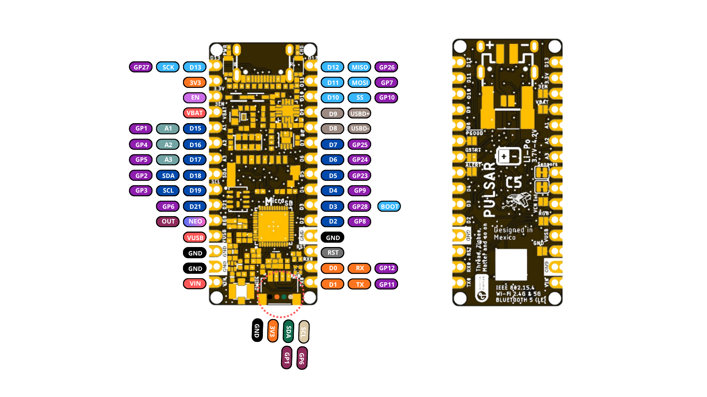

*Pulsar C5 pinout*
| Pos. | Board label | ESP32-C5HR8 | Primary board role | Shared resource |
|---:|---|---:|---|---|
| 1 | `D13` / `SCK` / LED | GPIO27 | SPI clock | microSD CLK, J20, `BUILTIN2` LED; strapping pin |
| 2 | `3V3` | — | 3.3 V rail | SGM6029 output |
| 3 | `EN` | — | 3.3 V regulator enable | Solder jumper to SGM6029 `EN` |
| 4 | `VBAT` | — | Battery rail | Solder jumper to `VBAT` |
| 5 | `A1` / `D15` | GPIO1 / ADC1_CH0 | Analog-capable I/O | QWIIC SDA |
| 6 | `A2` / `D16` | GPIO4 / ADC1_CH3 | Analog-capable I/O | MTCK |
| 7 | `A3` / `D17` | GPIO5 / ADC1_CH4 | Analog-capable I/O | MTDO |
| 8 | `SDA` / `D18` | GPIO2 / ADC1_CH1 | I2C data | Sensor bus; MTMS strapping pin |
| 9 | `SCL` / `D19` | GPIO3 / ADC1_CH2 | I2C clock | Sensor bus; MTDI strapping pin |
| 10 | `A6` / `D21` | GPIO6 / ADC1_CH5 | Analog-capable I/O | QWIIC SCL; optional VCNL4040 `INT` |
| 11 | `NEOPIXEL DOUT` | — | RGB-chain extension output | Solder jumper to LED1 `DO` |
| 12 | `VBUS` | — | USB VBUS | USB-C supply |
| 13 | `GND` | — | Ground | Solder jumper (Nano `RESET` position) |
| 14 | `GND` | — | Ground | Common return |
| 15 | `VIN` | — | Supply input | To `+5V` through D4 |
| 16 | `TX0` / `D1` | GPIO11 | UART0 TX | 499 Ω series resistor R3 |
| 17 | `RX0` / `D0` | GPIO12 | UART0 RX | General-purpose |
| 18 | `RST` | `CHIP_PU` | Reset | RESET button, 10 kΩ pull-up |
| 19 | `GND` | — | Ground | Common return |
| 20 | `D2` / `RGB` | GPIO0 | NeoPixel data | LED1 `DI` |
| 21 | `D3` / `BOOT` | GPIO28 | BOOT input | BOOT button; strapping pin |
| 22 | `D4` | GPIO9 | Digital I/O | General-purpose |
| 23 | `D5` | GPIO23 | Digital I/O | microSD CS; optional MAX17048 `ALERT` |
| 24 | `D6` | GPIO24 | Digital I/O | Optional MAX17048 `QSTRT` |
| 25 | `D7` | GPIO25 | Digital I/O | Optional BQ24074 `PGOOD`; strapping pin |
| 26 | `D8` | USB D- | USB D- | Shared with USB-C; GPIO13 through 22 Ω R9 |
| 27 | `D9` | USB D+ | USB D+ | Shared with USB-C; GPIO14 through 22 Ω R10 |
| 28 | `D10` / `SS` | GPIO10 | SPI chip select | J20 `SS` |
| 29 | `D11` / `MOSI` | GPIO7 | SPI MOSI | microSD CMD, J20; strapping pin |
| 30 | `D12` / `MISO` | GPIO26 | SPI MISO | microSD DAT0, J20; strapping pin |

`EN`, `VBAT`, `NEOPIXEL DOUT`, and the ground at position 13 are connected to
their edge-pad positions through solder jumpers.

### A4.2 Interface Summary
| Interface | Signal | Board label | GPIO | Notes |
|---|---|---|---:|---|
| UART0 | RX | `D0` | GPIO12 | |
| UART0 | TX | `D1` | GPIO11 | 499 Ω series resistor R3 |
| SPI | SS / CS | `D10` | GPIO10 | Also J20 pin 4 |
| SPI | MOSI | `D11` | GPIO7 | Shared with microSD and J20 |
| SPI | MISO | `D12` | GPIO26 | Shared with microSD and J20 |
| SPI | SCK | `D13` | GPIO27 | Shared with microSD, J20, and `BUILTIN2` LED |
| microSD | CS | `D5` | GPIO23 | Separate chip select from `D10` |
| Sensor I2C (`SDA_SENSOR`) | SDA | `SDA` / `D18` | GPIO2 | Onboard sensors through solder jumper; 4.7 kΩ pull-up |
| Sensor I2C (`SCL_SENSOR`) | SCL | `SCL` / `D19` | GPIO3 | Onboard sensors through solder jumper; 4.7 kΩ pull-up |
| QWIIC I2C | SDA | `A1` / `D15` | GPIO1 | J1 pin 3; no onboard pull-up |
| QWIIC I2C | SCL | `A6` / `D21` | GPIO6 | J1 pin 4; no onboard pull-up |
| USB | D- | `D8` | GPIO13 | Native USB; 22 Ω R9 |
| USB | D+ | `D9` | GPIO14 | Native USB; 22 Ω R10 |

The `SDA` / `SCL` edge pads are the sensor bus, not a separate external bus:
any device connected there shares the bus with the five onboard I2C devices.
QWIIC is an independent bus on GPIO1 and GPIO6.

Two schematic net labels differ from the connections drawn at the header:

- **`D2`:** IC1 GPIO8 carries the net label `D2`, but header position 20
  (`D2`) is wired to `NEOP_DIN` / GPIO0. No other connection is shown for the
  GPIO8 net; treat GPIO8 as unassigned until the PCB is verified.
- **`A6`:** the net is named `A6/GPIO4/TOUCH4`, but it connects to IC1 pin 15,
  which is GPIO6. GPIO4 is `A2` / `D16` (pin 13). The ESP32-C5 has no touch
  sensor, so `TOUCH4` does not apply.

### A4.3 Analog Inputs
| Analog label | Digital label | GPIO | ADC channel | Shared use |
|---|---|---:|---|---|
| `A1` | `D15` | GPIO1 | ADC1_CH0 | QWIIC SDA |
| `A2` | `D16` | GPIO4 | ADC1_CH3 | — |
| `A3` | `D17` | GPIO5 | ADC1_CH4 | — |
| `A4` / `SDA` | `D18` | GPIO2 | ADC1_CH1 | Sensor I2C SDA |
| `A5` / `SCL` | `D19` | GPIO3 | ADC1_CH2 | Sensor I2C SCL |
| `A6` | `D21` | GPIO6 | ADC1_CH5 | QWIIC SCL; optional VCNL4040 `INT` |

The Nano `A0` and `A7` positions carry `VBAT` and `NEOPIXEL DOUT` and are not
analog inputs. `A4`/`A5` and `A1`/`A6` are usable as analog inputs only while
the corresponding I2C bus is not in use.

### A4.4 Board Resources and I2C Addresses
| Resource | Signal / GPIO | Bus | I2C address | Notes |
|---|---|---|---|---|
| Native USB | GPIO13 / GPIO14 | USB Serial/JTAG | — | `D8` / `D9` |
| BOOT button | GPIO28 | — | — | `D3`; strapping pin |
| UART0 | GPIO11 / GPIO12 | UART | — | `D1` / `D0` |
| NeoPixel in | GPIO0 (`NEOP_DIN`) | — | — | LED1 WS2812 1010; `D2` |
| NeoPixel out | LED1 `DO` (`NEOP_DO`) | — | — | Header position 11 through solder jumper |
| Flash | GPIO15–GPIO18, GPIO20–GPIO22 | SPI0/1 | — | BY25Q64; not available as GPIO |
| PSRAM | In package | SPI0/1 | — | 8 MB, ESP32-C5HR8 |
| microSD | GPIO27, GPIO7, GPIO26, GPIO23 | SPI | — | CS on `D5` |
| QWIIC | GPIO1 / GPIO6 | QWIIC I2C | — | J1 |
| Battery monitor | GPIO2 / GPIO3 | Sensor I2C | `0x36` | MAX17048G+T10 |
| Light / proximity | GPIO2 / GPIO3 | Sensor I2C | `0x60` | VCNL4040M3OE |
| Temperature / RH | GPIO2 / GPIO3 | Sensor I2C | `0x44` | FHT40-DD-TR (SHT40 in schematic); verify address for FHT40 |
| Pressure | GPIO2 / GPIO3 | Sensor I2C | `0x5C` | LPS22HBTR (LPS22DFTR in schematic); `SA0` to GND |
| Magnetometer | GPIO2 / GPIO3 | Sensor I2C | `0x30` | MMC5603NJ |
| RF | `ANT_2G` (pin 42), `ANT_5G` (pin 48) | — | — | U1 diplexer to J2 |

### A4.5 Arduino Nano Pinout Compatibility
The board uses two parallel 15-position edge rows based on the Arduino Nano
layout. This provides a familiar mechanical footprint and labeling pattern, but
does not imply full electrical or shield compatibility.

Important differences include:

- The ESP32-C5HR8 and board GPIO operate in the 3.3 V logic domain.
- Several conventional positions have PULSAR-specific functions: `EN` at
  `AREF`, `VBAT` at `A0`, `NEOPIXEL DOUT` at `A7`, `VBUS` at `5V`, and a
  jumper-selected ground at the second `RESET` position.
- `D2` carries the RGB LED data and `D3` carries the BOOT signal.
- `D8` and `D9` carry the ESP32-C5 native USB D-/D+ signals and should not be
  treated as conventional digital I/O.
- GPIO2, GPIO3, GPIO7, GPIO25, GPIO26, GPIO27, and GPIO28 are strapping pins.
  External circuits must not force a level that changes the boot mode during
  reset.
- Analog channel labels do not follow a sequential GPIO order.

Before installing the board into a Nano-style carrier, verify power, reset,
analog, digital, and mechanically shared positions.

### A4.6 QWIIC Connector
J1 is a four-position, 1 mm-pitch QWIIC connector carrying:

| Pin | Signal | ESP32-C5HR8 connection | Function |
|---:|---|---:|---|
| 1 | GND | Ground | Common return |
| 2 | 3.3 V | Regulated rail | Peripheral supply |
| 3 | SDA | GPIO1 | External I2C data |
| 4 | SCL | GPIO6 | External I2C clock |

The QWIIC interface operates in the 3.3 V logic domain and is separate from
the GPIO2/GPIO3 sensor bus. The board does not fit pull-up resistors on
GPIO1/GPIO6; QWIIC devices normally provide them.

The QWIIC 3.3 V supply is provided by the SGM6029 regulator, which supports up
to 1 A total output current shared between the onboard circuitry and all
external 3.3 V loads.

### A4.7 J20 SPI Connector
J20 is a six-position, 1 mm-pitch SH connector for external SPI devices.

| Pin | Signal | ESP32-C5HR8 connection |
|---:|---|---:|
| 1 | SCK | GPIO27 |
| 2 | MOSI | GPIO7 |
| 3 | MISO | GPIO26 |
| 4 | SS | GPIO10 |
| 5 | 3.3 V | Regulated rail |
| 6 | GND | Ground |

SCK, MOSI, and MISO are shared with the microSD socket. Keep the microSD chip
select (GPIO23) high while communicating with a J20 device.

### A4.8 MicroSD Connector
| Socket signal | GPIO | Description |
|---|---:|---|
| `CLK` | GPIO27 | SPI SCK |
| `CMD` | GPIO7 | SPI MOSI |
| `DAT0` | GPIO26 | SPI MISO |
| `DAT3` | GPIO23 | SPI chip select |
| `DAT1`, `DAT2` | — | Not connected |
| VDD | 3.3 V | Card supply |
| GND / shield | Ground | Electrical return and connector shield |

Insert or remove the microSD card only when filesystem activity has stopped.
Software should flush and close open files before card extraction or power
removal.

### A4.9 Battery Connections
JP1 (PH 2.0 mm) and J3 (1.25 mm) provide two battery connector options wired
in parallel to `VBAT`. Connect only one battery at a time.

The battery input is designed for a single-cell LiPo battery with a nominal
voltage of 3.7 V and a maximum fully charged voltage of 4.2 V. Charging is
managed by the onboard BQ24074RGTR with a nominal charge current of 250 mA,
and battery state is reported by the MAX17048 fuel gauge.

Always verify connector polarity before connecting a battery, as connector
compatibility alone does not guarantee correct polarity.

A solder jumper can connect the battery rail to edge-pad position 4 (`VBAT`).

Do not connect multi-cell battery packs or batteries exceeding 4.2 V.

### A4.10 RF Antenna Connector
J2 is an RF1-2626-125CE-CT coaxial connector rated to 6 GHz. It carries the
combined 2.4 GHz and 5 GHz signal from the U1 diplexer. Use a dual-band antenna
with a mating plug and connect it before enabling radio transmission.

### A4.11 USB-C, BOOT, and Reset
The USB-C connector provides power, programming, and USB data connectivity.
The USB D- and D+ signals connect to the ESP32-C5 USB Serial/JTAG controller
(GPIO13 and GPIO14) through 22 Ω series resistors and are also exposed at the
`D8` and `D9` positions. CC1 and CC2 have 5.1 kΩ pull-down resistors.

The BOOT button pulls GPIO28 low. Holding BOOT during reset selects the
ESP32-C5 download boot mode used for firmware programming and recovery. The
RESET button pulls `CHIP_PU` low and restarts the ESP32-C5 while board power
remains applied.

A typical firmware-recovery sequence is to hold BOOT, press and release RESET,
then release BOOT after the device enumerates in download mode.

### A4.12 Debug Interface
The ESP32-C5 USB Serial/JTAG controller provides serial console, firmware
download, and JTAG debugging through the USB-C connector without an external
probe. The JTAG pins (MTMS, MTDI, MTCK, MTDO) are used as GPIO2–GPIO5 on this
board and are not routed to dedicated debug pads.

## A5 Board Operation
The procedures below define the board workflow for the Arduino IDE and the
Espressif Arduino core.

### A5.1 Getting Started with Arduino IDE
1. Install Arduino IDE 2.x.
2. Add the Espressif package index to **Additional Boards Manager URLs**:
   `https://espressif.github.io/arduino-esp32/package_esp32_index.json`
3. Install the **esp32 by Espressif Systems** package, version 3.3 or later
   (ESP32-C5 support).
4. Select **ESP32C5 Dev Module** or an installed PULSAR-specific board
   definition.
5. Set **Flash Size** to 8 MB, enable **PSRAM**, and enable **USB CDC On
   Boot** to use the USB-C serial port.
6. Connect an antenna to J2 if the sketch uses the radio.
7. Connect a USB-C data cable and select the enumerated serial port.
8. Open a basic Blink sketch and upload it.

Compile success confirms API and library compatibility; electrical operation
also depends on the connected hardware and selected configuration.

### A5.2 First Power-up and Inspection
Use USB-C for initial power. Inspect component orientation, connector seating,
and solder bridges before energizing the board. If available, use a
current-limited source and monitor the 3.3 V rail.

Do not attach a battery, external `VIN`, microSD card, QWIIC peripheral, or
J20 device for the first power check. Confirm the power indicator and absence
of unexpected heating, then establish USB enumeration and upload behavior.

### A5.3 BOOT and Reset Workflow
For a normal update, the Arduino core resets the board into download mode
automatically through USB Serial/JTAG. If automatic upload is unavailable:

1. Disconnect external driven signals.
2. Hold BOOT.
3. Press and release RESET, or connect USB while BOOT is held.
4. Release BOOT after the download port appears.
5. Upload the firmware using the toolchain.
6. Press RESET to run the application from external flash.

### A5.4 Recommended Bring-up Sequence
| Order | Subsystem | What the step establishes |
|---:|---|---|
| 1 | User LED | Core execution, GPIO27, and upload path |
| 2 | USB serial | Host communication and diagnostic output |
| 3 | ADC | Basic analog input path |
| 4 | RGB LED | GPIO0 timing |
| 5 | Sensor I2C | GPIO2/GPIO3, solder jumpers, and sensor addresses |
| 6 | Fuel gauge | MAX17048 voltage and state of charge |
| 7 | QWIIC I2C | GPIO1/GPIO6 and external expansion |
| 8 | PSRAM | Capacity detection and allocation |
| 9 | microSD | SPI bus, GPIO23 chip select, and filesystem |
| 10 | Wi-Fi / BLE / 802.15.4 | Antenna, RF path, and network connection |
| 11 | Combined application | Memory ownership and subsystem coexistence |

Testing one subsystem at a time makes pin conflicts and library configuration
errors easier to isolate.

### A5.5 C++ Example Collection
C++ examples for the ESP32-C5 revision are planned under
`software/cpp_examples/`. The recommended bring-up sequence in [A5.4](#a54-recommended-bring-up-sequence)
defines the intended example coverage.

### A5.6 Memory Planning
Keep stacks, interrupt state, frequently accessed variables, and DMA
descriptors in internal SRAM. Place large network buffers, logging queues, and
historical data in PSRAM. Check every allocation and track free internal and
PSRAM heap separately.

Wi-Fi, Bluetooth LE, and 802.15.4 stacks use internal memory; avoid allocating
every maximum-size buffer at startup without a documented memory budget.

### A5.7 Storage Operation
Configure SPI on GPIO27 (SCK), GPIO7 (MOSI), and GPIO26 (MISO) with GPIO23 as
the microSD chip select. Initialize the card, verify filesystem information,
open only the files needed, call `flush()` after important writes, and close
handles before removal or reset.

For data logging, buffer short records in RAM and write them in bounded batches
rather than performing filesystem operations from an interrupt handler.

### A5.8 Radio, Sensor, and Storage Coexistence
The sensor bus (GPIO2/GPIO3), QWIIC bus (GPIO1/GPIO6), and SPI bus
(GPIO7/GPIO26/GPIO27) do not overlap. The microSD card and J20 devices share
the SPI bus and must use separate chip selects. All subsystems compete for
processor time, memory, and power; radio transmission adds current peaks to
the 3.3 V rail.

Use bounded update rates, buffered logging, and nonblocking network tasks. A
combined application should expose health information over USB serial or RGB
status rather than failing silently.

### A5.9 Troubleshooting Guide
| Symptom | Checks |
|---|---|
| No USB device | Data-capable cable, BOOT/RESET sequence, host port, 3.3 V rail |
| Board does not boot | Strapping pins held low by external circuits, BOOT button |
| Blink does not run | GPIO27 mapping, selected board, successful upload |
| PSRAM unavailable | PSRAM option enabled, allocation result |
| Sensors not found | Sensor-bus solder jumpers, GPIO2/GPIO3, addresses |
| microSD fails | FAT32, GPIO23 chip select, SPI pins, card seating |
| Weak or no wireless link | Antenna on J2, band selection, matching network |
| Unstable combined app | Internal heap, PSRAM use, blocking loops, pin conflicts |

Record the exact board revision, core version, library versions, compiler
output, power source, and reproduction steps for every bring-up issue.

## A6 Mechanical Information
Hardware revision V1.2.3 uses a narrow development-board form factor with two
parallel 15-position edge rows following the Arduino Nano template, USB-C at
one end, and QWIIC, J20, and RF connectors for expansion.

### A6.1 Component-side Envelope
Board photographs for revision V1.2.3 are not yet available.

Adequate vertical and lateral clearance should be provided around the USB-C
connector, pushbuttons, QWIIC and J20 connectors, RF connector, and other
components. The edge pads must remain accessible when the board is mounted on
headers, carrier boards, sockets, or directly soldered to another PCB.

### A6.2 Bottom-side Envelope
Adequate clearance must be maintained for battery connection, microSD card
insertion and removal, and antenna cable routing. Enclosures and carrier
boards must not cover the pressure, humidity, and light-sensor openings when
those measurements are used.

### A6.3 Board Dimensions
A controlled dimension drawing and mounting-hole coordinates for revision
V1.2.3 are not yet available. Do not derive dimensions from rendered board
images.

### A6.4 Mechanical Integration Considerations
When integrating the UNIT PULSAR ESP32-C5 into a carrier board, fixture, or
enclosure, provide sufficient clearance for:

- USB-C cable insertion and removal.
- QWIIC and J20 cable connection.
- Antenna cable and connector on J2.
- Battery connector and cable routing.
- microSD card insertion and removal.
- BOOT and RESET button access.
- Edge-pad soldering or header installation.
- Configuration solder-jumper access when required.
- Airflow and light paths to the environmental and optical sensors.

Keep metal enclosures, ground planes, and batteries away from the antenna.
PCB thickness, maximum component heights, and connector insertion envelopes
should be verified from the corresponding component specifications when they
are critical to the final enclosure or carrier design.

## A8 Reference Documentation
The following resources provide the official hardware, software, and
application documentation for the UNIT PULSAR ESP32-C5.

| Reference | Location |
|---|---|
| Product repository | [UNIT-Electronics-MX/unit_pulsar_esp32_c5](https://github.com/UNIT-Electronics-MX/unit_pulsar_esp32_c5) |
| Hardware reference | [hardware/README.md](https://github.com/UNIT-Electronics-MX/unit_pulsar_esp32_c5/blob/main/hardware/README.md) |
| Technical wiki | [PULSAR ESP32-C5 Wiki](https://github.com/UNIT-Electronics-MX/unit_pulsar_esp32_c5/wiki) |
| Board schematic | [Hardware V1.2.3 schematic](https://github.com/UNIT-Electronics-MX/unit_pulsar_esp32_c5/blob/main/hardware/unit_sch_v_1_2_3_ue0134_pulsar_esp32_c5.pdf) |
| ESP32-C5 component datasheet | [Espressif ESP32-C5 Series Datasheet](https://documentation.espressif.com/esp32-c5_datasheet_en.pdf) |
| Arduino core | [Espressif Arduino-ESP32](https://github.com/espressif/arduino-esp32) |

The UNIT Electronics Wiki provides application-oriented documentation, setup
procedures, peripheral usage examples, and software workflows for the board.

The hardware schematic and this Product Reference define the board-level
implementation, connections, power architecture, interfaces, and hardware
characteristics. ESP32-C5HR8 device-level electrical characteristics and
processor specifications should be referenced from the official Espressif
ESP32-C5 datasheet.

## A9 Appendix
### A9.1 Schematic
The following two sheets are rendered from
`unit_sch_v_1_2_3_ue0134_pulsar_esp32_c5.pdf`. The original PDF remains the
authoritative electrical schematic for hardware revision V1.2.3.


#### A9.1.1 I/Os, USB-C, Charger, 3.3 V Regulator, Antenna, ESP32-C5, Flash, and LEDs
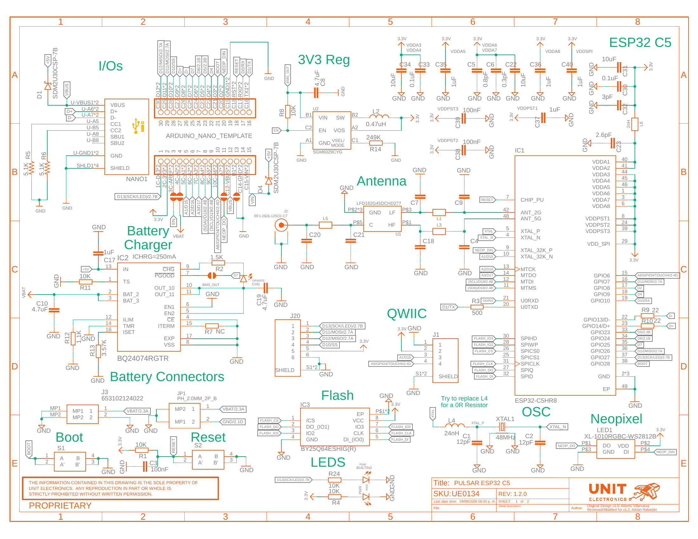

*Pulsar C5 schematic, sheet 1*


#### A9.1.2 Battery Monitor, microSD, and Sensors
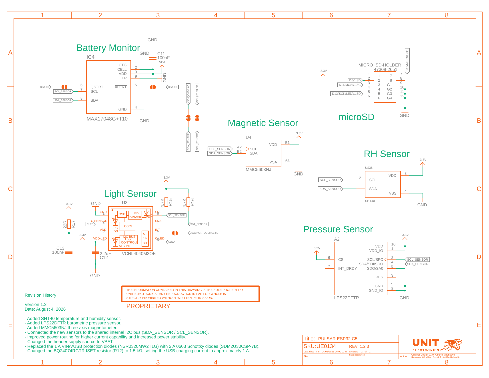

*Pulsar C5 schematic, sheet 2*


### A9.2 Technical References
The documentation set for the UNIT PULSAR ESP32-C5 is organized around the
following technical sources:

1. The hardware V1.2.3 schematic defines board connectivity, component
   designators, power architecture, and electrical implementation.

2. The bill of materials defines the assembled part numbers.

3. The official Espressif ESP32-C5 datasheet defines device-level electrical
   characteristics, processor capabilities, GPIO behavior, strapping pins, ADC
   operation, and radio functionality.

4. The UNIT Electronics Wiki provides setup procedures, peripheral usage
   documentation, application examples, and software workflows.

### A9.3 Design and Application Notes
The following characteristics depend on the final application, firmware
configuration, connected peripherals, or mechanical integration:

- Total board current consumption varies with CPU activity, radio mode and
  transmit power, enabled peripherals, RGB LED brightness, microSD activity,
  and external loads.
- Available current for external 3.3 V devices depends on the portion of the
  SGM6029 1 A output capability consumed by the board itself.
- Radiated RF performance depends on the antenna, cable, enclosure, and the
  populated matching network.
- Environmental-sensor accuracy depends on self-heating, airflow, and
  enclosure design.
- Thermal performance and maximum component temperatures depend on workload,
  ambient conditions, airflow, enclosure design, and external loading.

### A9.4 Document Control
| Field | Value |
|---|---|
| Product | UNIT PULSAR ESP32-C5 |
| SKU | UE0134 |
| Product family | UNIT DevLab ecosystem |
| Hardware revision | V1.2.3 |
| Product Reference | Version 0.1.0 |
| Publication date | 2026-09-24 |

### A9.5 Source Notes
- The schematic title block shows `REV: 1.2.0` on sheet 1 and `REV: 1.2.3` on
  sheet 2; the schematic file name uses V1.2.3, and the revision history is
  labeled Version 1.2. This Product Reference uses V1.2.3.

- The schematic names the humidity sensor `SHT40` and the pressure sensor
  `LPS22DFTR`; the bill of materials specifies `FHT40-DD-TR` and `LPS22HBTR`.
  This Product Reference follows the bill of materials for part numbers.

- The schematic revision history states that R12 was changed to 1.5 kΩ for an
  approximately 1 A USB charging current. The schematic and bill of materials
  show R12 = 1.1 kΩ on `ILIM` (input current limit) and R13 = 3.57 kΩ on
  `ISET`, with the annotation `ICHRG=250mA`. This Product Reference uses the
  schematic and bill-of-materials values.

- The J3 part number is `653102124022` in the schematic and `653102131822` in
  the bill of materials.

- GPIO8 carries the net label `D2` at IC1, but no header connection is shown
  for that net. Header position `D2` connects to GPIO0 (`NEOP_DIN`).

- The net connected to header position 10 and QWIIC pin 4 is named
  `A6/GPIO4/TOUCH4`, but it connects to IC1 pin 15 (GPIO6). The ESP32-C5 has no
  touch sensor. This Product Reference uses GPIO6.

- The label `D21` for header position 10 is taken from the board pinout
  artwork; the schematic shows only `A6`.

- The ESP32-C5 does not provide an SD host controller; the microSD socket uses
  SPI mode and `DAT1`/`DAT2` are not connected.

### A9.6 Hardware Errata
No hardware errata have been recorded for revision V1.2.3.

# Part C: ESP32-C5 Chip Datasheet

Source: ESP32-C5 Series Datasheet, Version 1.5. Ultra-low-power SoC with a 32-bit RISC-V single-core microprocessor; 2.4 and 5 GHz dual-band Wi-Fi 6 (802.11ax), Bluetooth 5 (LE), Zigbee and Thread (802.15.4); connection to external flash and PSRAM; 29 GPIOs; QFN48 (6×6 mm) / LGA48 (6×6 mm) package.

Including: ESP32-C5HR2, ESP32-C5HR8, ESP32-C5HF4, ESP32-C5NF8R2LA. The Pulsar board in [Part A](#part-a-unit-pulsar-esp32-c5-board) uses the **ESP32-C5HR8**.

The latest version of the datasheet is at <https://www.espressif.com/documentation/esp32-c5_datasheet_en.pdf>.

## C0 Product Overview

The ESP32-C5 SoC (System on Chip) supports 2.4 and 5 GHz dual-band Wi-Fi 6, Bluetooth LE 5, Zigbee 3.0 and Thread 1.4. It consists of a high-performance (HP) 32-bit RISC-V processor, a low-power (LP) 32-bit RISC-V processor, wireless baseband and MAC (Wi-Fi, Bluetooth LE, and 802.15.4), RF module, and numerous peripherals, with time-division coexistence of Wi-Fi, Bluetooth and 802.15.4.

The functional block diagram of the SoC is shown below. Its legend marks which modules have power in each power mode: Active; Active and Modem-sleep; Active, Modem-sleep and Light-sleep (some optional in Light-sleep); and all modes (some optional in Deep-sleep).

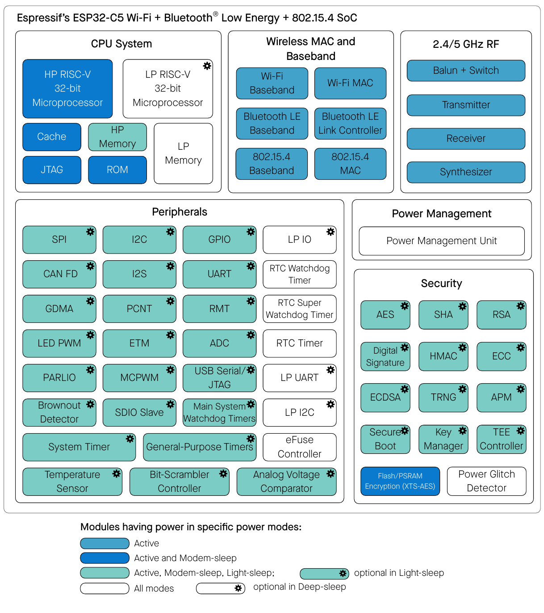

*ESP32-C5 Functional Block Diagram*

For more information on power consumption, see [C4.1.3.6 Power Management Unit](#c4136-power-management-unit).

### C0.1 Features

**Wi-Fi**

- 1T1R in 2.4 and 5 GHz dual band
- Operating frequency: 2412 ~ 2484 MHz, 5180 ~ 5885 MHz
- Data rate up to 150 Mbps
- IEEE 802.11ax-compliant
  - 20 MHz only
  - Uplink and downlink OFDMA to enhance connectivity and performance in congested environments for IoT applications
  - Downlink MU-MIMO (multi-user, multiple input, multiple output) to increase network capacity
  - Beamformee that improves signal quality
  - Spatial reuse to maximize parallel transmissions
  - Target wake time (TWT) that optimizes power saving mechanisms
- IEEE 802.11ac-compliant
  - 20 MHz bandwidth
  - Downlink fullband MU-MIMO
- Fully compatible with IEEE 802.11a/b/g/n protocol
  - 20 MHz and 40 MHz bandwidth
  - MCS0 ~ MCS7
  - Wi-Fi multimedia (WMM)
  - TX/RX A-MPDU, TX/RX A-MSDU
  - Immediate block ACK
  - Fragmentation and defragmentation
  - Transmission opportunity (TXOP)
  - Automatic beacon monitoring (hardware TSF)
  - Four virtual Wi-Fi interfaces
  - Simultaneous support for Infrastructure BSS in Station mode, SoftAP mode, Station + SoftAP mode, and promiscuous mode. Note that when ESP32-C5 scans in Station mode, the SoftAP channel will change along with the Station channel
  - Antenna diversity
  - 802.11mc FTM

**Bluetooth**

- Bluetooth LE: Bluetooth Core 6.0 certified
- Bluetooth mesh 1.1
- High power mode with up to 20 dBm transmission power
- Direction finding (AoA/AoD)
- Periodic advertising with responses (PAwR)
- LE connection subrating
- LE power control
- Speed: 125 Kbps, 500 Kbps, 1 Mbps, 2 Mbps
- LE advertising extensions and multiple advertising sets
- Allow devices to operate in Broadcaster, Observer, Central, and Peripheral roles concurrently

**IEEE 802.15.4**

- Compliant with IEEE 802.15.4-2015 protocol
- OQPSK PHY in 2.4 GHz band
- Data rate: 250 Kbps
- Thread 1.4
- Zigbee 3.0

**CPU and Memory**

- High-performance (HP) RISC-V processor:
  - Clock speed: up to 240 MHz
  - Five-stage pipeline
  - CoreMark score: 820.19 CoreMark; 3.42 CoreMark/MHz (O3)
- Low-power (LP) RISC-V processor:
  - Clock speed: up to 48 MHz
  - Two-stage pipeline
- ROM: 320 KB
- HP SRAM: 384 KB
- LP SRAM: 16 KB
- Flash/PSRAM controller with cache is supported
- Flash in-circuit programming (ICP) is supported

**Advanced Peripheral Interfaces**

- 29 programmable GPIOs
- Analog signal processing:
  - 12-bit SAR ADC, up to 6 channels
  - Temperature sensor
  - Brownout detector
  - Analog voltage comparator
- Digital interfaces:
  - Two UART controllers
  - Low-power (LP) UART controller
  - Two SPI ports for communication with flash/PSRAM
  - General-purpose SPI port
  - I2C
  - Low-power (LP) I2C
  - I2S
  - Pulse count controller
  - USB Serial/JTAG controller
  - Two CAN FD controllers, compatible with ISO 11898-1:2015
  - SDIO slave controller (not supported by chip revision v0.0 and v0.1)
  - LED PWM controller, up to 6 channels
  - Motor control PWM (MCPWM), up to 6 channels
  - Remote control peripheral (RMT) (TX/RX)
  - Parallel IO interface (PARLIO)
  - General DMA controller (GDMA), with 3 transmit channels and 3 receive channels
  - BitScrambler
  - Event task matrix (ETM)
- Timers:
  - 52-bit system timer
  - Two 54-bit general-purpose timers
  - 48-bit RTC timer
  - Three digital watchdog timers
  - Analog watchdog timer

**Security**

- Cryptographic hardware acceleration:
  - AES-128/256 (NIST FIPS 197)
  - SHA
  - RSA
  - ECC
  - HMAC
  - RSA Digital Signature Peripheral (RSA_DS)
  - ECDSA (Elliptic Curve Digital Signature Algorithm) Digital Signature Peripheral (ECDSA_DS)
- External memory encryption and decryption (XTS_AES)
- Secure boot
- True random number generator (TRNG)
- Key manager (supported by chip revision v1.2 or later)
- Access permission management (APM) and trusted execution environment (TEE) controller
- Power glitch detector

**RF Module**

- Antenna switches, RF balun, power amplifier, low-noise receive amplifier
- Up to +20 dBm of power for an 802.11b transmission
- Up to +19 dBm of power for an 802.11ax transmission
- Up to -106 dBm of sensitivity for Bluetooth LE receiver (125 Kbps)

### C0.2 Applications

With low power consumption, ESP32-C5 is an ideal choice for IoT devices in the following areas:

- Smart Home
- Industrial Automation
- Health Care
- Consumer Electronics
- Smart Agriculture
- POS Machines
- Service Robot
- Audio Devices
- Generic Low-power IoT Sensor Hubs
- Generic Low-power IoT Data Loggers
- Wi-Fi + Bluetooth Networking Card

## C1 ESP32-C5 Series Information

### C1.1 Nomenclature

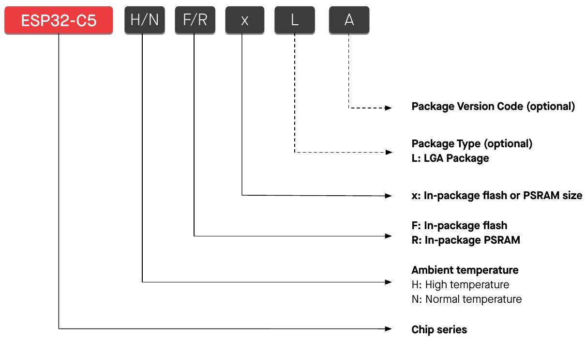

*Figure 1-1. ESP32-C5 Series Nomenclature*

A part number reads `ESP32-C5` + `H/N` + `F/R` + `x` + `L` + `A`:

| Field | Meaning |
|---|---|
| ESP32-C5 | Chip series |
| H / N | Ambient temperature. H: High temperature. N: Normal temperature |
| F / R | F: In-package flash. R: In-package PSRAM |
| x | In-package flash or PSRAM size |
| L | Package type (optional). L: LGA package |
| A | Package version code (optional) |

### C1.2 Comparison

**Table 1-1. ESP32-C5 Series Information**

| Part Number¹ | Ambient Temp.² (°C) | In-package flash³ | In-package PSRAM | Package | Chip Revision |
|---|---|---|---|---|---|
| ESP32-C5HR2 | –40 ~ 105 | — | 2 MB (Quad SPI)⁵ | QFN48 (6×6 mm) | v1.2 |
| ESP32-C5HR8 | –40 ~ 105 | — | 8 MB (Quad SPI) | QFN48 (6×6 mm) | v1.0/v1.2 |
| ESP32-C5HF4 | –40 ~ 105 | 4 MB (Quad SPI) | — | QFN48 (6×6 mm) | v1.0/v1.2 |
| ESP32-C5NF8R2LA⁴ | –40 ~ 85 | 8 MB (Quad SPI) | 2 MB (Quad SPI) | LGA48 (6×6 mm) | v1.2 |

1. For details on chip marking and packing, see [C7 Packaging](#c7-packaging).
2. Ambient temperature specifies the recommended temperature range of the environment outside an Espressif chip.
3. For information about in-package flash, see also [C4.1.2.1 Internal Memory](#c4121-internal-memory). By default, the SPI flash on the chip operates at a maximum clock frequency of 80 MHz and does not support the auto suspend feature. If you have a requirement for a higher flash clock frequency of 120 MHz or if you need the flash auto suspend feature, please contact Espressif.
4. The variant is not yet in mass production.
5. For details about SPI modes, see [C2.6 Pin Mapping Between Chip and Flash/PSRAM](#c26-pin-mapping-between-chip-and-flashpsram).

Note: the PDF table spans the HR2/HR8/HF4 rows with one temperature range and package, and lists the chip revisions as "v1.2" for HR2 and "v1.0/v1.2" spanning HR8 and HF4.

### C1.3 Chip Revision

As shown in Table 1-1 *ESP32-C5 Series Information*, ESP32-C5 now has multiple chip revisions available on the market using the same part number.

For chip revision identification, the ESP-IDF release that supports a specific chip revision, and errors fixed in each chip revision, please refer to *ESP32-C5 Series SoC Errata* (<https://www.espressif.com/documentation/esp32-c5_errata_en.pdf>).

## C2 Pins

### C2.1 Pin Layout

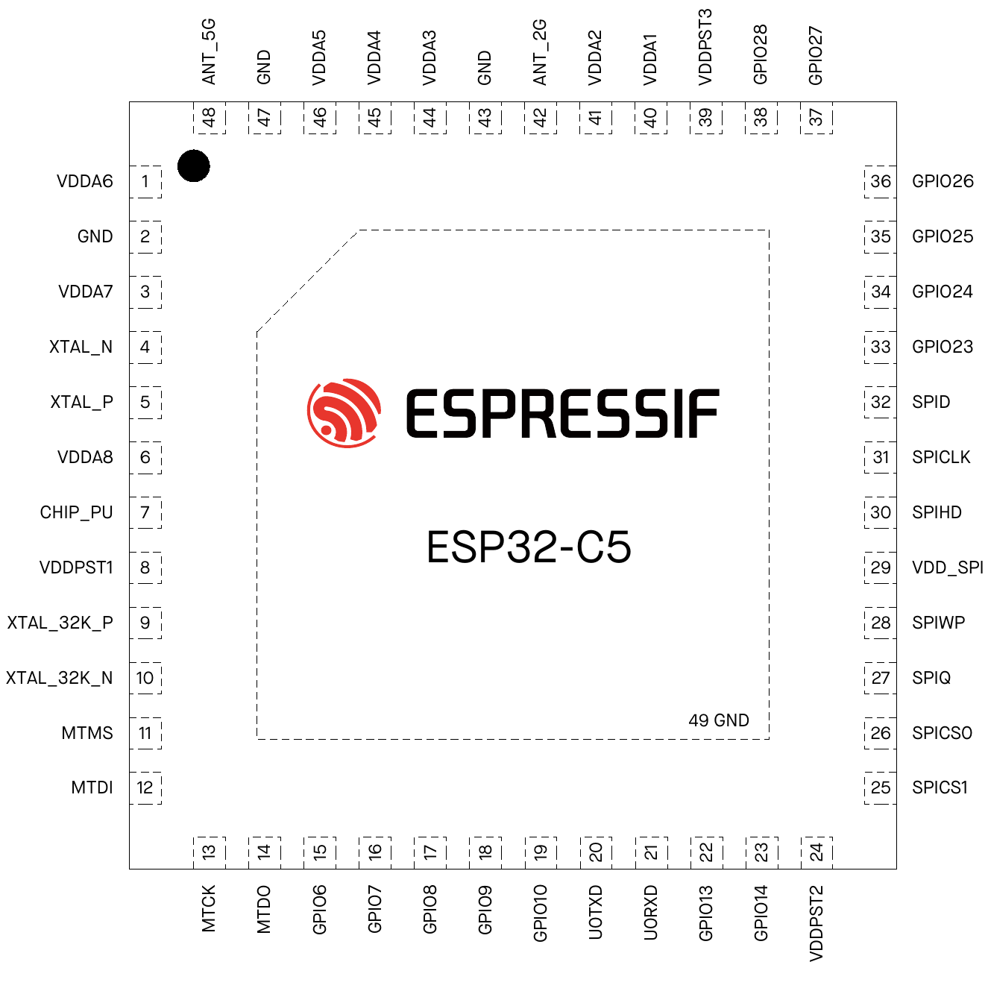

*Figure 2-1. ESP32-C5HR2 & ESP32-C5HR8 Pin Layout (Top View)*

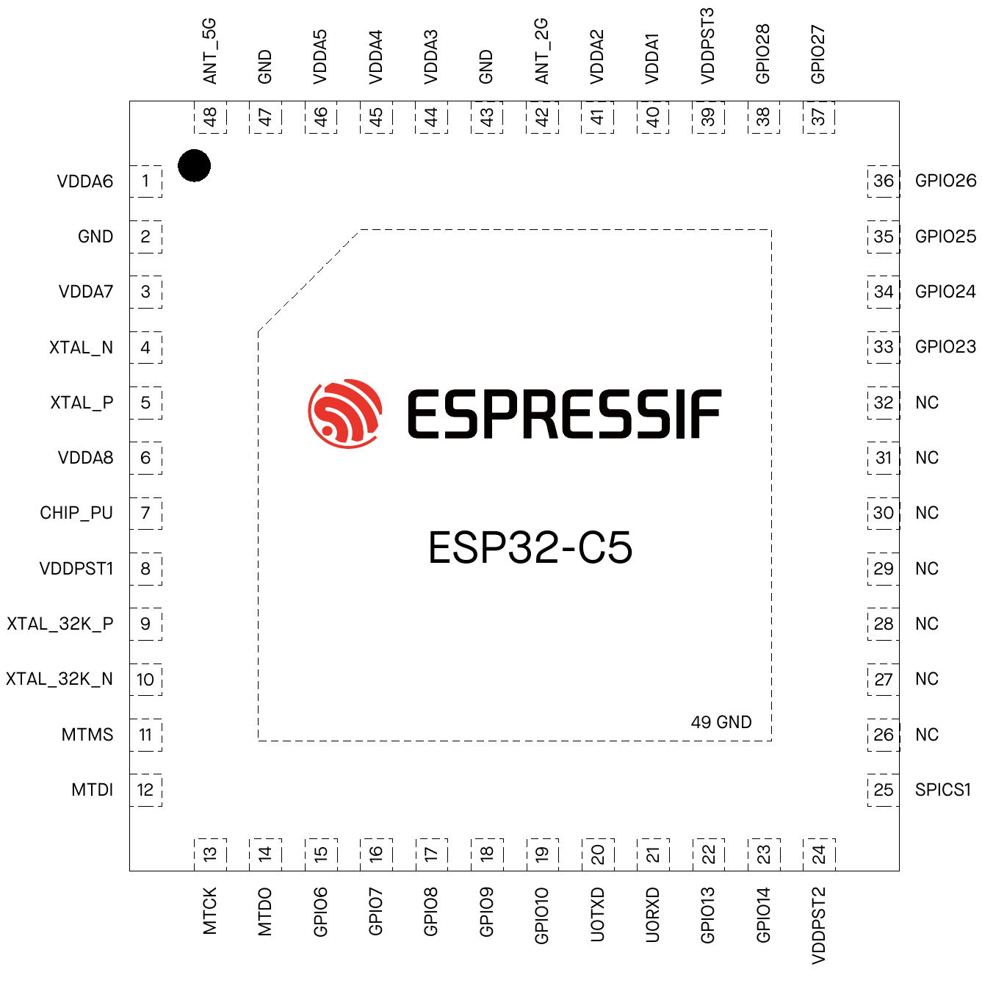

*Figure 2-2. ESP32-C5HF4 Pin Layout (Top View)*

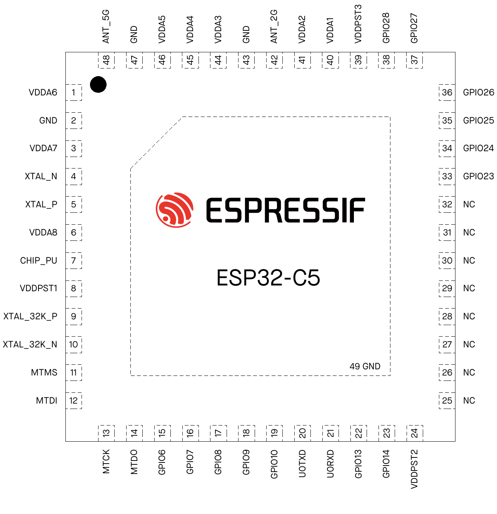

*Figure 2-3. ESP32-C5NF8R2LA Pin Layout (Top View)*

The three layouts share the same pin numbers. On the ESP32-C5HF4, pins 26–32 (SPICS0, SPIQ, SPIWP, VDD_SPI, SPIHD, SPICLK, SPID) are NC; on the ESP32-C5NF8R2LA, pin 25 (SPICS1) is NC as well. Pin 49 is the exposed GND pad.

### C2.2 Pin Overview

The ESP32-C5 chip integrates multiple peripherals that require communication with the outside world. To keep the chip package size reasonably small, the number of available pins has to be limited. So the only way to route all the incoming and outgoing signals is through pin multiplexing. Pin muxing is controlled via software programmable registers. For details, see [ESP32-C5 Technical Reference Manual](https://www.espressif.com/documentation/esp32-c5_technical_reference_manual_en.pdf) > Chapter *IO MUX and GPIO Matrix*.

All in all, the ESP32-C5 chip has the following types of pins:

- IO pins with the following predefined sets of functions to choose from:
  - Each IO pin has predefined HP IO MUX functions – see Table 2-3 *IO MUX Pin Functions*
  - Some IO pins have predefined LP IO MUX functions – see Table 2-5 *LP IO MUX Functions*
  - Some IO pins have predefined analog functions – see Table 2-7 *Analog Functions*

  *Predefined functions* means that each IO pin has a set of direct connections to certain signals from on-chip peripherals. During run-time, the user can configure which peripheral signal from a predefined set to connect to a certain pin at a certain time via memory mapped registers.
- Analog pins that have exclusively-dedicated analog functions – see Table 2-9 *Analog Pins*
- Power pins supply power to the chip components and non-power pins – see Table 2-10 *Power Pins*

Table 2-1 *Pin Overview* gives an overview of all the pins. For more information, see the respective sections below, or [C8 Consolidated Pin Overview](#c8-consolidated-pin-overview).

**Table 2-1. Pin Overview**

| Pin No. | Pin Name | Pin Type | Pin Providing Power²⁻⁴ | At Reset⁴,⁵ | After Reset⁴,⁵ | HP IO MUX¹ | LP IO MUX¹ | Analog¹ |
|---|---|---|---|---|---|---|---|---|
| 1 | VDDA6 | Power | | | | | | |
| 2 | GND | Power | | | | | | |
| 3 | VDDA7 | Power | | | | | | |
| 4 | XTAL_N | Analog | | | | | | |
| 5 | XTAL_P | Analog | | | | | | |
| 6 | VDDA8 | Power | | | | | | |
| 7 | CHIP_PU | Analog | VDDPST1 | | | | | |
| 8 | VDDPST1 | Power | | | | | | |
| 9 | XTAL_32K_P | IO | VDDPST1 | | | **HP IO MUX** | LP IO MUX | Analog |
| 10 | XTAL_32K_N | IO | VDDPST1 | | | **HP IO MUX** | LP IO MUX | Analog |
| 11 | MTMS | IO | VDDPST1 | IE | IE | **HP IO MUX** | LP IO MUX | Analog |
| 12 | MTDI | IO | VDDPST1 | IE | IE | **HP IO MUX** | LP IO MUX | Analog |
| 13 | MTCK | IO | VDDPST1 | | IE, WPU | **HP IO MUX** | LP IO MUX | Analog |
| 14 | MTDO | IO | VDDPST1 | IE | IE | **HP IO MUX** | LP IO MUX | Analog |
| 15 | GPIO6 | IO | VDDPST1 | IE | IE | **HP IO MUX** | LP IO MUX | Analog |
| 16 | GPIO7 | IO | VDDPST1 | IE | IE | **HP IO MUX** | | |
| 17 | GPIO8 | IO | VDDPST1 | | IE | **HP IO MUX** | | Analog |
| 18 | GPIO9 | IO | VDDPST1 | | IE | **HP IO MUX** | | Analog |
| 19 | GPIO10 | IO | VDDPST1 | | IE | **HP IO MUX** | | |
| 20 | U0TXD | IO | VDDPST1 | | IE, OE | **HP IO MUX** | | |
| 21 | U0RXD | IO | VDDPST1 | | IE, WPU | **HP IO MUX** | | |
| 22 | GPIO13 | IO | VDDPST2 | | IE | HP IO MUX | | **Analog** |
| 23 | GPIO14 | IO | VDDPST2 | USB_PU | IE, USB_PU⁴ | HP IO MUX | | **Analog** |
| 24 | VDDPST2 | Power | | | | | | |
| 25 | SPICS1/NC⁶ | IO | VDD_SPI | WPU | IE, WPU | **HP IO MUX** | | |
| 26 | SPICS0/NC⁶ | IO | VDD_SPI | WPU | IE, WPU | **HP IO MUX** | | |
| 27 | SPIQ/NC⁶ | IO | VDD_SPI | WPU | IE, WPU | **HP IO MUX** | | |
| 28 | SPIWP/NC⁶ | IO | VDD_SPI | WPU | IE, WPU | **HP IO MUX** | | |
| 29 | VDD_SPI/NC⁶ | Power/IO | — | | | HP IO MUX | | **Analog** |
| 30 | SPIHD/NC⁶ | IO | VDD_SPI | WPU | IE, WPU | **HP IO MUX** | | |
| 31 | SPICLK/NC⁶ | IO | VDD_SPI | WPU | IE, WPU | **HP IO MUX** | | |
| 32 | SPID/NC⁶ | IO | VDD_SPI | WPU | IE, WPU | **HP IO MUX** | | |
| 33 | GPIO23 | IO | VDDPST3 | | IE | **HP IO MUX** | | |
| 34 | GPIO24 | IO | VDDPST3 | | IE | **HP IO MUX** | | |
| 35 | GPIO25 | IO | VDDPST3 | IE | IE | **HP IO MUX** | | |
| 36 | GPIO26 | IO | VDDPST3 | IE | IE | **HP IO MUX** | | |
| 37 | GPIO27 | IO | VDDPST3 | IE, WPU | IE, WPU | **HP IO MUX** | | |
| 38 | GPIO28 | IO | VDDPST3 | IE, WPU | IE, WPU⁵ | **HP IO MUX** | | |
| 39 | VDDPST3 | Power | | | | | | |
| 40 | VDDA1 | Power | | | | | | |
| 41 | VDDA2 | Power | | | | | | |
| 42 | ANT_2G | Analog | | | | | | |
| 43 | GND | Power | | | | | | |
| 44 | VDDA3 | Power | | | | | | |
| 45 | VDDA4 | Power | | | | | | |
| 46 | VDDA5 | Power | | | | | | |
| 47 | GND | Power | | | | | | |
| 48 | ANT_5G | Analog | | | | | | |

1. Bold marks the pin function set in which a pin has its default function in the default boot mode. See [C3.1 Chip Boot Mode Control](#c31-chip-boot-mode-control).
2. In column *Pin Providing Power*, regarding pins powered by VDD_SPI: power actually comes from the internal power rail supplying power to VDD_SPI. For details, see [C2.5.2 Power Scheme](#c252-power-scheme).
3. Except for GPIO13 and GPIO14 whose default drive strength is 40 mA, the default drive strength for all the other pins is 20 mA.
4. Column *Pin Settings* shows predefined settings at reset and after reset with the following abbreviations:
   - IE – input enabled
   - OE – output enabled
   - WPU – internal weak pull-up resistor enabled
   - WPD – internal weak pull-down resistor enabled
   - USB_PU – USB pull-up resistor enabled
     - By default, the USB function is enabled for USB pins (i.e., GPIO13 and GPIO14), and the pin pull-up is decided by the USB pull-up. The USB pull-up resistor is controlled by USB_SERIAL_JTAG_DP/DM_PULLUP and its pull-up value is controlled by USB_SERIAL_JTAG_PULLUP_VALUE. For details, see [ESP32-C5 Technical Reference Manual](https://www.espressif.com/documentation/esp32-c5_technical_reference_manual_en.pdf) > Chapter *USB Serial/JTAG Controller*.
     - When the USB function is disabled, USB pins are used as regular GPIOs. In this case, the internal weak pull-up and pull-down resistors of the USB pins are disabled by default, but are configurable by IO_MUX_GPIO_FUN_WPU/WPD. For details, see [ESP32-C5 Technical Reference Manual](https://www.espressif.com/documentation/esp32-c5_technical_reference_manual_en.pdf) > Chapter *IO MUX and GPIO Matrix (GPIO, IO MUX)*.
5. Depends on the value of EFUSE_DIS_PAD_JTAG:
   - 0 – default value. Input enabled, and internal weak pull-up resistor enabled (IE & WPU)
   - 1 – input enabled (IE)
6. For ESP32-C5HF4, the SPICS0, SPIQ, SPIWP, VDD_SPI, SPIHD, SPICLK, and SPID pins are not connected (NC). For ESP32-C5NF8R2LA, the SPICS1 pin is also not connected (NC), in addition to the pins listed above.

### C2.3 IO Pins

For details on configuring IO pins, see [ESP32-C5 Technical Reference Manual](https://www.espressif.com/documentation/esp32-c5_technical_reference_manual_en.pdf) > Chapter *IO MUX and GPIO Matrix (GPIO, IO MUX)*.

#### C2.3.1 HP IO MUX Functions

The HP IO MUX multiplexes HP-domain peripheral signals onto IO pins, allowing multiple input/output signals to be connected to a single input/output pin. Each IO pin of ESP32-C5 can be connected to one of the three signals (IO MUX functions, i.e., F0-F2), as listed in Table 2-3 *IO MUX Pin Functions*.

Among the three sets of signals:

- Some are routed via the GPIO Matrix (GPIO0, GPIO1, etc.), which incorporates internal signal routing circuitry for mapping signals programmatically. It gives the pin access to almost any peripheral signals. However, the flexibility of programmatic mapping comes at a cost as it might affect the latency of routed signals. For details about connecting to peripheral signals via GPIO Matrix, see [ESP32-C5 Technical Reference Manual](https://www.espressif.com/documentation/esp32-c5_technical_reference_manual_en.pdf) > Chapter *IO MUX and GPIO Matrix*.
- Some are directly routed from certain peripherals (U0TXD, MTCK, etc.), including UART0, JTAG, SPI0/1, and SPI2 – see Table 2-2 *Peripheral Signals Routed via HP IO MUX*.

**Table 2-2. Peripheral Signals Routed via HP IO MUX**

| Pin Function | Signal | Description |
|---|---|---|
| U0TXD | Transmit data | UART0 interface |
| U0RXD | Receive data | UART0 interface |
| MTCK | Test clock | JTAG interface for debugging |
| MTDO | Test Data Out | JTAG interface for debugging |
| MTDI | Test Data In | JTAG interface for debugging |
| MTMS | Test Mode Select | JTAG interface for debugging |
| SPIQ | Master in, slave out | SPI0/1 interface for connection to off-package flash via the SPI bus. See also [C2.6](#c26-pin-mapping-between-chip-and-flashpsram) |
| SPID | Master out, slave in | SPI0/1 interface (as above) |
| SPIHD | Hold | SPI0/1 interface (as above) |
| SPIWP | Write protect | SPI0/1 interface (as above) |
| SPICLK | Clock | SPI0/1 interface (as above) |
| SPICS… | Chip select | SPI0/1 interface (as above) |
| FSPIQ | Master in, slave out | SPI2 main interface for fast SPI connection. Among these pins, FSPICS0 is for input or output signals in master or slave mode |
| FSPID | Master out, slave in | SPI2 main interface (as above) |
| FSPIHD | Hold | SPI2 main interface (as above) |
| FSPIWP | Write protect | SPI2 main interface (as above) |
| FSPICLK | Clock | SPI2 main interface (as above) |
| FSPICS0 | Chip select | SPI2 main interface (as above) |
| SDIO_CLK | Clock | SDIO interface for connection to external SDIO hosts |
| SDIO_CMD | Command | SDIO interface (as above) |
| SDIO_DATA… | Data | SDIO interface (as above) |

Table 2-3 *IO MUX Pin Functions* shows the HP IO MUX functions of IO pins.

**Table 2-3. IO MUX Pin Functions**

| Pin No. | IO MUX/GPIO Name¹,² | F0 | Type³ | F1 | Type | F2 | Type |
|---|---|---|---|---|---|---|---|
| 9 | GPIO0 | **GPIO0** | I/O/T | GPIO0 | I/O/T | | |
| 10 | GPIO1 | **GPIO1** | I/O/T | GPIO1 | I/O/T | | |
| 11 | GPIO2 | **MTMS** | I1 | GPIO2 | I/O/T | FSPIQ | I1/O/T |
| 12 | GPIO3 | **MTDI** | I1 | GPIO3 | I/O/T | *(name blank in source)* | I1/O/T |
| 13 | GPIO4 | **MTCK** | I1 | GPIO4 | I/O/T | FSPIHD | I1/O/T |
| 14 | GPIO5 | **MTDO** | O/T | GPIO5 | I/O/T | FSPIWP | I1/O/T |
| 15 | GPIO6 | **GPIO6** | I/O/T | GPIO6 | I/O/T | FSPICLK | I1/O/T |
| 16 | GPIO7 | **SDIO_DATA1** | I1/O/T | GPIO7 | I/O/T | FSPID | I1/O/T |
| 17 | GPIO8 | **SDIO_DATA0** | I1/O/T | GPIO8 | I/O/T | | |
| 18 | GPIO9 | **SDIO_CLK** | I1 | GPIO9 | I/O/T | | |
| 19 | GPIO10 | **SDIO_CMD** | I1/O/T | GPIO10 | I/O/T | FSPICS0 | I1/O/T |
| 20 | GPIO11 | **U0TXD** | O | GPIO11 | I/O/T | | |
| 21 | GPIO12 | **U0RXD** | I1 | GPIO12 | I/O/T | | |
| 22 | GPIO13 | **SDIO_DATA3** | I1/O/T | GPIO13 | I/O/T | | |
| 23 | GPIO14 | **SDIO_DATA2** | I1/O/T | GPIO14 | I/O/T | | |
| 25 | GPIO15 | **SPICS1** | O/T | GPIO15 | I/O/T | | |
| 26 | GPIO16 | **SPICS0** | O/T | GPIO16 | I/O/T | | |
| 27 | GPIO17 | **SPIQ** | I1/O/T | GPIO17 | I/O/T | | |
| 28 | GPIO18 | SPIWP | I1/O/T | **GPIO18** | I/O/T | | |
| 29 | GPIO19 | GPIO19 | I/O/T | GPIO19 | I/O/T | | |
| 30 | GPIO20 | SPIHD | I1/O/T | **GPIO20** | I/O/T | | |
| 31 | GPIO21 | **SPICLK** | O/T | GPIO21 | I/O/T | | |
| 32 | GPIO22 | **SPID** | I1/O/T | GPIO22 | I/O/T | | |
| 33 | GPIO23 | **GPIO23** | I/O/T | GPIO23 | I/O/T | | |
| 34 | GPIO24 | **GPIO24** | I/O/T | GPIO24 | I/O/T | | |
| 35 | GPIO25 | **GPIO25** | I/O/T | GPIO25 | I/O/T | | |
| 36 | GPIO26 | **GPIO26** | I/O/T | GPIO26 | I/O/T | | |
| 37 | GPIO27 | **GPIO27** | I/O/T | GPIO27 | I/O/T | | |
| 38 | GPIO28 | **GPIO28** | I/O/T | GPIO28 | I/O/T | | |

1. Bold marks the default pin functions in the default boot mode. For more information about the default boot mode, see [C3.1 Chip Boot Mode Control](#c31-chip-boot-mode-control).
2. Regarding highlighted cells, see [C2.3.4 Restrictions for GPIOs and LP GPIOs](#c234-restrictions-for-gpios-and-lp-gpios).
3. Each HP IO MUX function (Fn, n = 0 ~ 2) is associated with a type. The description of type is as follows:
   - I – input. O – output. T – high impedance.
   - I1 – input; if the pin is assigned a function other than Fn, the input signal of Fn is always 1.
   - I0 – input; if the pin is assigned a function other than Fn, the input signal of Fn is always 0.

Note: GPIO19 (pin 29) has no bold cell in the source; its default is the analog VDD_SPI function (Table 2-7).

#### C2.3.2 LP IO MUX Functions

When the chip is in Deep-sleep mode, the HP IO MUX functions described in [C2.3.1 HP IO MUX Functions](#c231-hp-io-mux-functions) will not work. That is where the LP IO MUX comes in. It allows multiple input/output signals to be a single input/output pin in Deep-sleep mode, as the pin is connected to the LP system and powered by VDDPST1.

LP IO pins can be assigned to LP functions. They can:

- Either work as LP GPIOs (LP_GPIO0, LP_GPIO1, etc.), connected to the LP CPU
- Or connect to LP peripheral signals (LP_I2C_SDA, LP_I2C_SCL, etc.) – see Table 2-4 *LP Peripheral Signals Routed via LP IO MUX*

**Table 2-4. LP Peripheral Signals Routed via LP IO MUX**

| Pin Function | Signal | Description |
|---|---|---|
| LP_I2C_SDA | Serial data | LP I2C interface |
| LP_I2C_SCL | Serial clock | LP I2C interface |
| LP_UART_RXD | Receive | LP UART interface |
| LP_UART_TXD | Transmit | LP UART interface |
| LP_UART_RTSN | Request to send | LP UART interface |
| LP_UART_CTSN | Clear to send | LP UART interface |
| LP_UART_DTRN | Data set ready | LP UART interface |
| LP_UART_DSRN | Data terminal ready | LP UART interface |

Table 2-5 *LP IO MUX Functions* shows the LP functions of LP IO pins.

**Table 2-5. LP IO MUX Functions**

| Pin No. | LP IO Name¹ | F0 | F1 | F2 | F3 |
|---|---|---|---|---|---|
| 9 | LP_GPIO0 | LP_UART_DTRN | LP_GPIO0 | | |
| 10 | LP_GPIO1 | LP_UART_DSRN | LP_GPIO1 | | |
| 11 | LP_GPIO2 | LP_UART_RTSN² | LP_GPIO2 | | LP_I2C_SDA² |
| 12 | LP_GPIO3 | LP_UART_CTSN | LP_GPIO3 | | LP_I2C_SCL |
| 13 | LP_GPIO4 | LP_UART_RXD | LP_GPIO4 | | |
| 14 | LP_GPIO5 | LP_UART_TXD | LP_GPIO5 | | |
| 15 | LP_GPIO6 | | LP_GPIO6 | | |

1. This column lists the LP GPIO names, since LP functions are configured with LP GPIO registers that use LP GPIO numbering.
2. Hardware flow control of LP_UART cannot be used with LP_I2C at the same time.

#### C2.3.3 Analog Functions

Some IO pins also have analog functions, for analog peripherals (such as ADC) in any power mode. Internal analog signals are routed to these analog functions, see Table 2-6 *Analog Signals Routed to Analog Functions*.

**Table 2-6. Analog Signals Routed to Analog Functions**

| Pin Function | Signal | Description |
|---|---|---|
| ADC1_CH… | ADC1 channel … signal | ADC1 interface |
| XTAL_32K_N | Negative clock signal | 32 kHz external clock input/output connected to ESP32-C5's crystal or oscillator |
| XTAL_32K_P | Positive clock signal | 32 kHz external clock input/output connected to ESP32-C5's crystal or oscillator |
| USB_D- | Data - | USB Serial/JTAG function |
| USB_D+ | Data + | USB Serial/JTAG function |
| PAD_COMP… | PAD… signal | Analog voltage comparator input |

Table 2-7 *Analog Functions* shows the analog functions of IO pins.

**Table 2-7. Analog Functions**

| Pin No. | Analog IO Name¹ | F0²,³ | F1²,³ |
|---|---|---|---|
| 9 | GPIO0 | XTAL_32K_P | |
| 10 | GPIO1 | XTAL_32K_N | ADC1_CH0 |
| 11 | GPIO2 | | ADC1_CH1 |
| 12 | GPIO3 | | ADC1_CH2 |
| 13 | GPIO4 | | ADC1_CH3 |
| 14 | GPIO5 | | ADC1_CH4 |
| 15 | GPIO6 | | ADC1_CH5 |
| 17 | GPIO8 | PAD_COMP0 | |
| 18 | GPIO9 | PAD_COMP1 | |
| 22 | GPIO13 | **USB_D-** | |
| 23 | GPIO14 | **USB_D+** | |
| 29 | GPIO19 | **VDD_SPI** | |

1. This column lists the GPIO names, since analog functions are configured with GPIO registers that use GPIO numbering.
2. Bold marks the default pin functions in SPI Boot mode. For more information about the default boot mode, see [C3.1 Chip Boot Mode Control](#c31-chip-boot-mode-control).
3. Regarding highlighted cells, see [C2.3.4 Restrictions for GPIOs and LP GPIOs](#c234-restrictions-for-gpios-and-lp-gpios).

#### C2.3.4 Restrictions for GPIOs and LP GPIOs

All IO pins of the ESP32-C5 have GPIO and some have LP GPIO pin functions. However, the IO pins are multiplexed and can be configured for different purposes based on the requirements. Some IOs have restrictions for usage. It is essential to consider the multiplexed nature and the limitations when using these IO pins.

In the tables of this chapter, some pin functions are highlighted in red or yellow. These functions indicate pins that require extra caution when used as GPIO:

- **Red** IO pins – allocated for communication with in-package flash/PSRAM and NOT recommended for other uses. For details, see [C2.6 Pin Mapping Between Chip and Flash/PSRAM](#c26-pin-mapping-between-chip-and-flashpsram).
- **Yellow** IO pins – have one of the following important functions:
  - Strapping pins – need to be at certain logic levels at startup. See [C3 Boot Configurations](#c3-boot-configurations).

    Note: strapping pins are highlighted by *Pin Name* or configurations *At Reset*, instead of the pin functions.
  - USB_D+/- – by default, connected to the USB Serial/JTAG controller. To function as GPIOs, these pins need to be reconfigured.
  - JTAG interface – often used for debugging. See Table 2-2 *Peripheral Signals Routed via HP IO MUX*. To free these pins up, the pin functions USB_D+/- of the USB Serial/JTAG controller can be used instead. See also [C3.4 JTAG Signal Source Control](#c34-jtag-signal-source-control).
  - UART0 interface – often used for debugging. See Table 2-2 *Peripheral Signals Routed via HP IO MUX*.
  - SDIO interface – multiplexed with the pins for the USB Serial/JTAG controller. The SDIO Slave controller can be used together with the USB Serial/JTAG controller in single SPI mode, but not in quad SPI mode.
  - VDD_SPI – the power supply pin for flash by default, and can only be used as a GPIO pin if the flash is powered by an external power supply.

For more information about assigning pins, please see [C2.3.5 Peripheral Pin Assignment](#c235-peripheral-pin-assignment) and [C8 Consolidated Pin Overview](#c8-consolidated-pin-overview).

#### C2.3.5 Peripheral Pin Assignment

Table 2-8 *Peripheral Pin Assignment* highlights which pins can be assigned to each peripheral interface according to the following priorities:

- **Priority 1 (P1)**: Fixed pins connected directly to peripheral signals via HP IO MUX or LP IO MUX. If a peripheral interface does not have priority 1 pins, it can be assigned to any GPIO pins from priority 2 to priority 4.
- Any GPIO pins mapping to peripheral signals via GPIO Matrix, can be priority 2, 3, or 4.
  - **Priority 2 (P2)**: GPIO pins can be freely used without restrictions.
  - **Priority 3 (P3)**: GPIO pins should be used with caution, as they may conflict with the following important functions described in [C2.3.4](#c234-restrictions-for-gpios-and-lp-gpios):
    - GPIO2, GPIO3, GPIO7, GPIO25, GPIO26, GPIO27, GPIO28: Strapping pins.
    - GPIO13, GPIO14: USB Serial/JTAG interface.
    - GPIO2, GPIO3, GPIO4, GPIO5: JTAG interface.
    - GPIO11, GPIO12: UART0 interface.
    - GPIO27: The VDD_SPI pin. The power supply pin for off-package flash by default, and can only be reconfigured as a GPIO pin if the flash is powered by an external power supply.
  - **Priority 4 (P4)**: GPIO pins already allocated or not recommended for use, as described in [C2.3.4](#c234-restrictions-for-gpios-and-lp-gpios):
    - GPIO15 ~ GPIO18, GPIO20 ~ GPIO22: SPI0/1 pins for the off-package flash and PSRAM and not recommended for general GPIO use.

If a peripheral interface does not have priority 2 to 4 pins, such as USB Serial/JTAG, it means it can be assigned only to priority 1 pins.

Sources disagree: the P3 list above (datasheet v1.5, §2.3.5) names GPIO27 as the VDD_SPI pin, but Tables 2-1, 2-3, 2-7 and 2-8 of the same datasheet put VDD_SPI on pin 29, which is GPIO19 (marked P3 in Table 2-8). GPIO19 is the consistent reading.

Note:

- For details about which peripheral signals are connected to HP IO MUX or LP IO MUX pins, please refer to [C2.3.1 HP IO MUX Functions](#c231-hp-io-mux-functions) or [C2.3.2 LP IO MUX Functions](#c232-lp-io-mux-functions).
- For details about which peripheral signals can be assigned to GPIO pins, please refer to [ESP32-C5 Technical Reference Manual](https://www.espressif.com/documentation/esp32-c5_technical_reference_manual_en.pdf) > Chapter *IO MUX and GPIO Matrix* > Section *HP Peripheral Signal List*.

**Table 2-8. Peripheral Pin Assignment**

|Pin No.|Pin Name|USB Serial/JTAG|JTAG|SDIO Slave|ADC|Analog Voltage Comparator|LP UART|LP I2C|UART0|UART1|SPI0/1|SPI2|I2C|CAN FD|LED PWM|I2S|MCPWM|RMT|PCNT|PARLIO|
|---|---|---|---|---|---|---|---|---|---|---|---|---|---|---|---|---|---|---|---|---|
|1|VDDA6||||||||||||||||||||
|2|GND||||||||||||||||||||
|3|VDDA7||||||||||||||||||||
|4|XTAL_N||||||||||||||||||||
|5|XTAL_P||||||||||||||||||||
|6|VDDA8||||||||||||||||||||
|7|CHIP_PU||||||||||||||||||||
|8|VDDPST1||||||||||||||||||||
|9|XTAL_32K_P||||||LP_UART_DTRN (P1)||GPIO0 (P2)|GPIO0 (P2)|GPIO0 (P2)|GPIO0 (P2)|GPIO0 (P2)|GPIO0 (P2)|GPIO0 (P2)|GPIO0 (P2)|GPIO0 (P2)|GPIO0 (P2)|GPIO0 (P2)|GPIO0 (P2)|
|10|XTAL_32K_N||||ADC1_CH0 (P1)||LP_UART_DSRN (P1)||GPIO1 (P2)|GPIO1 (P2)|GPIO1 (P2)|GPIO1 (P2)|GPIO1 (P2)|GPIO1 (P2)|GPIO1 (P2)|GPIO1 (P2)|GPIO1 (P2)|GPIO1 (P2)|GPIO1 (P2)|GPIO1 (P2)|
|11|MTMS||MTMS (P1)||ADC1_CH1 (P1)||LP_UART_RTSN (P1)|LP_I2C_SDA (P1)|GPIO2 (P3)|GPIO2 (P3)|GPIO2 (P3)|FSPIQ (P1)|GPIO2 (P3)|GPIO2 (P3)|GPIO2 (P3)|GPIO2 (P3)|GPIO2 (P3)|GPIO2 (P3)|GPIO2 (P3)|GPIO2 (P3)|
|12|MTDI||MTDI (P1)||ADC1_CH2 (P1)||LP_UART_CTSN (P1)|LP_I2C_SCL (P1)|GPIO3 (P3)|GPIO3 (P3)|GPIO3 (P3)|GPIO3 (P3)|GPIO3 (P3)|GPIO3 (P3)|GPIO3 (P3)|GPIO3 (P3)|GPIO3 (P3)|GPIO3 (P3)|GPIO3 (P3)|GPIO3 (P3)|
|13|MTCK||MTCK (P1)||ADC1_CH3 (P1)||LP_UART_RXD (P1)||GPIO4 (P3)|GPIO4 (P3)|GPIO4 (P3)|FSPIHD (P1)|GPIO4 (P3)|GPIO4 (P3)|GPIO4 (P3)|GPIO4 (P3)|GPIO4 (P3)|GPIO4 (P3)|GPIO4 (P3)|GPIO4 (P3)|
|14|MTDO||MTDO (P1)||ADC1_CH4 (P1)||LP_UART_TXD (P1)||GPIO5 (P3)|GPIO5 (P3)|GPIO5 (P3)|FSPIWP (P1)|GPIO5 (P3)|GPIO5 (P3)|GPIO5 (P3)|GPIO5 (P3)|GPIO5 (P3)|GPIO5 (P3)|GPIO5 (P3)|GPIO5 (P3)|
|15|GPIO6||||ADC1_CH5 (P1)||||GPIO6 (P2)|GPIO6 (P2)|GPIO6 (P2)|FSPICLK (P1)|GPIO6 (P2)|GPIO6 (P2)|GPIO6 (P2)|GPIO6 (P2)|GPIO6 (P2)|GPIO6 (P2)|GPIO6 (P2)|GPIO6 (P2)|
|16|GPIO7|||SDIO_DATA1 (P1)|||||GPIO7 (P3)|GPIO7 (P3)|GPIO7 (P3)|FSPID (P1)|GPIO7 (P3)|GPIO7 (P3)|GPIO7 (P3)|GPIO7 (P3)|GPIO7 (P3)|GPIO7 (P3)|GPIO7 (P3)|GPIO7 (P3)|
|17|GPIO8|||SDIO_DATA0 (P1)||PAD_COMP0 (P1)|||GPIO8 (P2)|GPIO8 (P2)|GPIO8 (P2)|GPIO8 (P2)|GPIO8 (P2)|GPIO8 (P2)|GPIO8 (P2)|GPIO8 (P2)|GPIO8 (P2)|GPIO8 (P2)|GPIO8 (P2)|GPIO8 (P2)|
|18|GPIO9|||SDIO_CLK (P1)||PAD_COMP1 (P1)|||GPIO9 (P2)|GPIO9 (P2)|GPIO9 (P2)|GPIO9 (P2)|GPIO9 (P2)|GPIO9 (P2)|GPIO9 (P2)|GPIO9 (P2)|GPIO9 (P2)|GPIO9 (P2)|GPIO9 (P2)|GPIO9 (P2)|
|19|GPIO10|||SDIO_CMD (P1)|||||GPIO10 (P2)|GPIO10 (P2)|GPIO10 (P2)|FSPICS0 (P1)|GPIO10 (P2)|GPIO10 (P2)|GPIO10 (P2)|GPIO10 (P2)|GPIO10 (P2)|GPIO10 (P2)|GPIO10 (P2)|GPIO10 (P2)|
|20|U0TXD||||||||U0TXD (P1)|GPIO11 (P3)|GPIO11 (P3)|GPIO11 (P3)|GPIO11 (P3)|GPIO11 (P3)|GPIO11 (P3)|GPIO11 (P3)|GPIO11 (P3)|GPIO11 (P3)|GPIO11 (P3)|GPIO11 (P3)|
|21|U0RXD||||||||U0RXD (P1)|GPIO12 (P3)|GPIO12 (P3)|GPIO12 (P3)|GPIO12 (P3)|GPIO12 (P3)|GPIO12 (P3)|GPIO12 (P3)|GPIO12 (P3)|GPIO12 (P3)|GPIO12 (P3)|GPIO12 (P3)|
|22|GPIO13|USB_D- (P1)||SDIO_DATA3 (P1)|||||GPIO13 (P3)|GPIO13 (P3)|GPIO13 (P3)|GPIO13 (P3)|GPIO13 (P3)|GPIO13 (P3)|GPIO13 (P3)|GPIO13 (P3)|GPIO13 (P3)|GPIO13 (P3)|GPIO13 (P3)|GPIO13 (P3)|
|23|GPIO14|USB_D+ (P1)||SDIO_DATA2 (P1)|||||GPIO14 (P3)|GPIO14 (P3)|GPIO14 (P3)|GPIO14 (P3)|GPIO14 (P3)|GPIO14 (P3)|GPIO14 (P3)|GPIO14 (P3)|GPIO14 (P3)|GPIO14 (P3)|GPIO14 (P3)|GPIO14 (P3)|
|24|VDDPST2||||||||||||||||||||
|25|SPICS1||||||||GPIO15 (P4)|GPIO15 (P4)|SPICS1 (P1)|GPIO15 (P4)|GPIO15 (P4)|GPIO15 (P4)|GPIO15 (P4)|GPIO15 (P4)|GPIO15 (P4)|GPIO15 (P4)|GPIO15 (P4)|GPIO15 (P4)|
|26|SPICS0||||||||GPIO16 (P4)|GPIO16 (P4)|SPICS0 (P1)|GPIO16 (P4)|GPIO16 (P4)|GPIO16 (P4)|GPIO16 (P4)|GPIO16 (P4)|GPIO16 (P4)|GPIO16 (P4)|GPIO16 (P4)|GPIO16 (P4)|
|27|SPIQ||||||||GPIO17 (P4)|GPIO17 (P4)|SPIQ (P1)|GPIO17 (P4)|GPIO17 (P4)|GPIO17 (P4)|GPIO17 (P4)|GPIO17 (P4)|GPIO17 (P4)|GPIO17 (P4)|GPIO17 (P4)|GPIO17 (P4)|
|28|SPIWP||||||||GPIO18 (P4)|GPIO18 (P4)|SPIWP (P1)|GPIO18 (P4)|GPIO18 (P4)|GPIO18 (P4)|GPIO18 (P4)|GPIO18 (P4)|GPIO18 (P4)|GPIO18 (P4)|GPIO18 (P4)|GPIO18 (P4)|
|29|VDD_SPI||||||||GPIO19 (P3)|GPIO19 (P3)|GPIO19 (P3)|GPIO19 (P3)|GPIO19 (P3)|GPIO19 (P3)|GPIO19 (P3)|GPIO19 (P3)|GPIO19 (P3)|GPIO19 (P3)|GPIO19 (P3)|GPIO19 (P3)|
|30|SPIHD||||||||GPIO20 (P4)|GPIO20 (P4)|SPIHD (P1)|GPIO20 (P4)|GPIO20 (P4)|GPIO20 (P4)|GPIO20 (P4)|GPIO20 (P4)|GPIO20 (P4)|GPIO20 (P4)|GPIO20 (P4)|GPIO20 (P4)|
|31|SPICLK||||||||GPIO21 (P4)|GPIO21 (P4)|SPICLK (P1)|GPIO21 (P4)|GPIO21 (P4)|GPIO21 (P4)|GPIO21 (P4)|GPIO21 (P4)|GPIO21 (P4)|GPIO21 (P4)|GPIO21 (P4)|GPIO21 (P4)|
|32|SPID||||||||GPIO22 (P4)|GPIO22 (P4)|SPID (P1)|GPIO22 (P4)|GPIO22 (P4)|GPIO22 (P4)|GPIO22 (P4)|GPIO22 (P4)|GPIO22 (P4)|GPIO22 (P4)|GPIO22 (P4)|GPIO22 (P4)|
|33|GPIO23||||||||GPIO23 (P2)|GPIO23 (P2)|GPIO23 (P2)|GPIO23 (P2)|GPIO23 (P2)|GPIO23 (P2)|GPIO23 (P2)|GPIO23 (P2)|GPIO23 (P2)|GPIO23 (P2)|GPIO23 (P2)|GPIO23 (P2)|
|34|GPIO24||||||||GPIO24 (P2)|GPIO24 (P2)|GPIO24 (P2)|GPIO24 (P2)|GPIO24 (P2)|GPIO24 (P2)|GPIO24 (P2)|GPIO24 (P2)|GPIO24 (P2)|GPIO24 (P2)|GPIO24 (P2)|GPIO24 (P2)|
|35|GPIO25||||||||GPIO25 (P3)|GPIO25 (P3)|GPIO25 (P3)|GPIO25 (P3)|GPIO25 (P3)|GPIO25 (P3)|GPIO25 (P3)|GPIO25 (P3)|GPIO25 (P3)|GPIO25 (P3)|GPIO25 (P3)|GPIO25 (P3)|
|36|GPIO26||||||||GPIO26 (P3)|GPIO26 (P3)|GPIO26 (P3)|GPIO26 (P3)|GPIO26 (P3)|GPIO26 (P3)|GPIO26 (P3)|GPIO26 (P3)|GPIO26 (P3)|GPIO26 (P3)|GPIO26 (P3)|GPIO26 (P3)|
|37|GPIO27||||||||GPIO27 (P3)|GPIO27 (P3)|GPIO27 (P3)|GPIO27 (P3)|GPIO27 (P3)|GPIO27 (P3)|GPIO27 (P3)|GPIO27 (P3)|GPIO27 (P3)|GPIO27 (P3)|GPIO27 (P3)|GPIO27 (P3)|
|38|GPIO28||||||||GPIO28 (P3)|GPIO28 (P3)|GPIO28 (P3)|GPIO28 (P3)|GPIO28 (P3)|GPIO28 (P3)|GPIO28 (P3)|GPIO28 (P3)|GPIO28 (P3)|GPIO28 (P3)|GPIO28 (P3)|GPIO28 (P3)|
|39|VDDPST3||||||||||||||||||||
|40|VDDA1||||||||||||||||||||
|41|VDDA2||||||||||||||||||||
|42|ANT_2G||||||||||||||||||||
|43|GND||||||||||||||||||||
|44|VDDA3||||||||||||||||||||
|45|VDDA4||||||||||||||||||||
|46|VDDA5||||||||||||||||||||
|47|GND||||||||||||||||||||
|48|ANT_5G||||||||||||||||||||

1. For USB Serial/JTAG, the USB_D- and USB_D+ can be swapped by configuring the USB_SERIAL_JTAG_EXCHG_PINS bit according to [ESP32-C5 Technical Reference Manual](https://www.espressif.com/documentation/esp32-c5_technical_reference_manual_en.pdf).
2. Signals of UART0, UART1, and SPI2 interfaces can be mapped to any GPIO pins through the GPIO Matrix, regardless of whether they are directly routed to fixed pins via IO MUX.

### C2.4 Analog Pins

**Table 2-9. Analog Pins**

| Pin No. | Pin Name | Pin Type | Pin Function |
|---|---|---|---|
| 4 | XTAL_N | — | External clock input/output connected to chip's crystal or oscillator. P/N means differential clock positive/negative. |
| 5 | XTAL_P | — | External clock input/output connected to chip's crystal or oscillator. P/N means differential clock positive/negative. |
| 7 | CHIP_PU | — | High: On, enables the chip (powered up). Low: Off, the chip powers off (powered down). Note: Do not leave the CHIP_PU pin floating. |
| 42 | ANT_2G | I/O | 2.4 GHz RF input/output |
| 48 | ANT_5G | I/O | 5 GHz RF input/output |

### C2.5 Power Supply

#### C2.5.1 Power Pins

The chip is powered via the power pins described in Table 2-10 *Power Pins*.

**Table 2-10. Power Pins**

| Pin No. | Pin Name | Direction | Power Domain/Other¹,² | IO Pins⁴ |
|---|---|---|---|---|
| 1 | VDDA6 | Input | Analog power domain 3.3 V | |
| 2 | GND | — | External ground connection | |
| 3 | VDDA7 | Input | Analog power domain 3.3 V | |
| 6 | VDDA8 | Input | Analog power domain 3.3 V | |
| 8 | VDDPST1 | Input | LP digital power domain | LP IO |
| 24 | VDDPST2 | Input | HP digital and part of analog pin power domains | HP IO |
| 29 | VDD_SPI³ | Output | Off-package flash | Flash IO |
| 39 | VDDPST3 | Input | HP digital power domain | HP IO |
| 40 | VDDA1 | Input | Analog power domain 3.3 V | |
| 41 | VDDA2 | Input | Analog power domain 3.3 V | |
| 43 | GND | — | External ground connection | |
| 44 | VDDA3 | Input | Analog power domain 3.3 V | |
| 45 | VDDA4 | Input | Analog power domain 3.3 V | |
| 46 | VDDA5 | Input | Analog power domain 3.3 V | |
| 47 | GND | — | External ground connection | |

1. See in conjunction with [C2.5.2 Power Scheme](#c252-power-scheme).
2. For recommended and maximum voltage and current, see [C5.1 Absolute Maximum Ratings](#c51-absolute-maximum-ratings) and [C5.2 Recommended Power Supply Characteristics](#c52-recommended-power-supply-characteristics).
3. To configure VDD_SPI as input or output, see [ESP32-C5 Technical Reference Manual](https://www.espressif.com/documentation/esp32-c5_technical_reference_manual_en.pdf) > Chapter *Low-Power Management*.
4. LP IO pins are those powered by VDDPST1 and so on, as shown in Figure 2-4 *ESP32-C5 Power Scheme*. See also Table 2-1 *Pin Overview* > Column *Pin Providing Power*.

#### C2.5.2 Power Scheme

The power scheme is shown in Figure 2-4 *ESP32-C5 Power Scheme*.

The components on the chip are powered via voltage regulators.

**Table 2-11. Voltage Regulators**

| Voltage Regulator | Output | Power Supply |
|---|---|---|
| HP | 1.1 V | HP power domain |
| LP | 1.1 V | LP power domain |

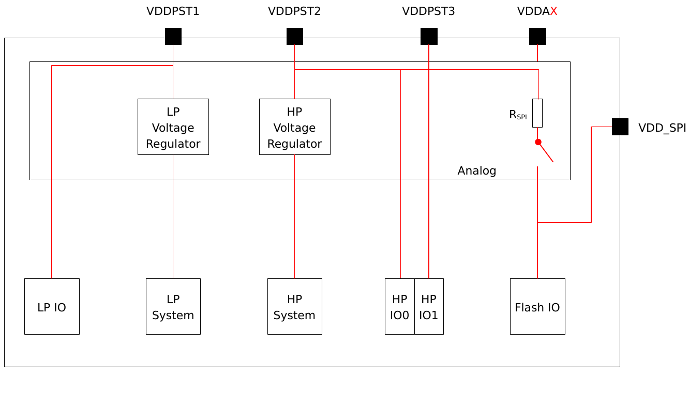

*Figure 2-4. ESP32-C5 Power Scheme*

#### C2.5.3 Chip Power-up and Reset

Once the power is supplied to the chip, its power rails need a short time to stabilize. After that, CHIP_PU – the pin used for power-up and reset – should be pulled high to activate the chip. For information on CHIP_PU as well as power-up and reset timing, see Figure 2-5 and Table 2-12.

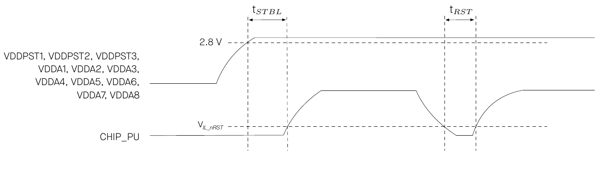

*Figure 2-5. Visualization of Timing Parameters for Power-up and Reset*

**Table 2-12. Description of Timing Parameters for Power-up and Reset**

| Parameter | Description | Min (µs) |
|---|---|---|
| t_STBL | Time reserved for the power rails of VDDPST1, VDDPST2, VDDPST3, VDDA1, VDDA2, VDDA3, VDDA4, VDDA5, VDDA6, VDDA7, and VDDA8 to stabilize before the CHIP_PU pin is pulled high to activate the chip | 50 |
| t_RST | Time reserved for CHIP_PU to stay below V_IL_nRST to reset the chip (see Table 5-4) | 50 |

### C2.6 Pin Mapping Between Chip and Flash/PSRAM

Table 2-13 lists the pin mapping between the chip and off-package flash/PSRAM for all SPI modes. It can also serve as a reference for chip variants with in-package flash/PSRAM.

For more information on SPI controllers, see also [C4.2.1.2 SPI Controller](#c4212-spi-controller).

Notice: It is not recommended to use the pins connected to flash/PSRAM for any other purposes.

**Table 2-13. Pin Mapping Between Chip and Off-Package Flash**

| Pin No. | Pin Name | Single SPI flash | Dual SPI flash | Quad SPI flash |
|---|---|---|---|---|
| 31 | SPICLK | CLK | CLK | CLK |
| 26 | SPICS0¹ | CS# | CS# | CS# |
| 32 | SPID | MOSI | SIO0² | SIO0 |
| 27 | SPIQ | MISO | SIO1 | SIO1 |
| 28 | SPIWP | WP# | | SIO2 |
| 30 | SPIHD | HOLD# | | SIO3 |

1. SPICS0 is used to access flash.
2. SIO: Serial Data Input and Output.

**Table 2-14. Pin Mapping Between Chip and Off-Package PSRAM**

| Pin No. | Pin Name | Single SPI PSRAM | Quad SPI PSRAM |
|---|---|---|---|
| 31 | SPICLK | CLK | CLK |
| 25 | SPICS1¹ | CE# | CE# |
| 32 | SPID | SI² | SIO0 |
| 27 | SPIQ | SO³ | SIO1 |
| 28 | SPIWP | | SIO2 |
| 30 | SPIHD | | SIO3 |

1. SPICS1 is used to access PSRAM.
2. SI: Serial Data Input, equivalent to MOSI.
3. SO: Serial Data Output, equivalent to MISO.

## C3 Boot Configurations

The chip allows for configuring the following boot parameters through strapping pins and eFuse parameters at power-up or a hardware reset, without microcontroller interaction.

- Chip boot mode
  - Strapping pin: GPIO26, GPIO27, and GPIO28
- SDIO sampling and driving clock edge
  - Strapping pin: GPIO25 and MTDI
- ROM message printing
  - Strapping pin: GPIO27
  - eFuse parameter: EFUSE_UART_PRINT_CONTROL and EFUSE_DIS_USB_SERIAL_JTAG_ROM_PRINT
- JTAG signal source
  - Strapping pin: GPIO7
  - eFuse parameter: EFUSE_DIS_PAD_JTAG, EFUSE_DIS_USB_JTAG, and EFUSE_JTAG_SEL_ENABLE

The default values of all the above eFuse parameters are 0, which means that they are not burnt. Given that eFuse is one-time programmable, once programmed to 1, it can never be reverted to 0. For how to program eFuse parameters, please refer to [ESP32-C5 Technical Reference Manual](https://www.espressif.com/documentation/esp32-c5_technical_reference_manual_en.pdf) > Chapter *eFuse Controller*.

The default values of the strapping pins, namely the logic levels, are determined by pins' internal weak pull-up/pull-down resistors at reset if the pins are not connected to any circuit, or connected to an external high-impedance circuit.

**Table 3-1. Default Configuration of Strapping Pins**

| Strapping Pin | Default Configuration | Bit Value |
|---|---|---|
| GPIO25 | Floating | – |
| GPIO26 | Floating | – |
| GPIO27 | Pull-up | 1 |
| GPIO28 | Pull-up | 1 |
| GPIO7 | Floating | – |
| MTMS | Floating | – |
| MTDI | Floating | – |

To change the bit values, the strapping pins should be connected to external pull-down/pull-up resistances.

All strapping pins have latches. At Chip Reset, the latches sample the bit values of their respective strapping pins and store them until the chip is powered down or shut down. The states of latches cannot be changed in any other way. It makes the strapping pin values available during the entire chip operation, and the pins are freed up to be used as regular IO pins after reset. For details on Chip Reset, see [ESP32-C5 Technical Reference Manual](https://www.espressif.com/documentation/esp32-c5_technical_reference_manual_en.pdf) > Chapter *Reset and Clock*.

The timing of signals connected to the strapping pins should adhere to the *setup time* and *hold time* specifications in Table 3-2 and Figure 3-1.

**Table 3-2. Description of Timing Parameters for the Strapping Pins**

| Parameter | Description | Min (ms) |
|---|---|---|
| t_SU | Setup time is the time reserved for the power rails to stabilize before the CHIP_PU pin is pulled high to activate the chip. | 0 |
| t_H | Hold time is the time reserved for the chip to read the strapping pin values after CHIP_PU is already high and before these pins start operating as regular IO pins. | 3 |

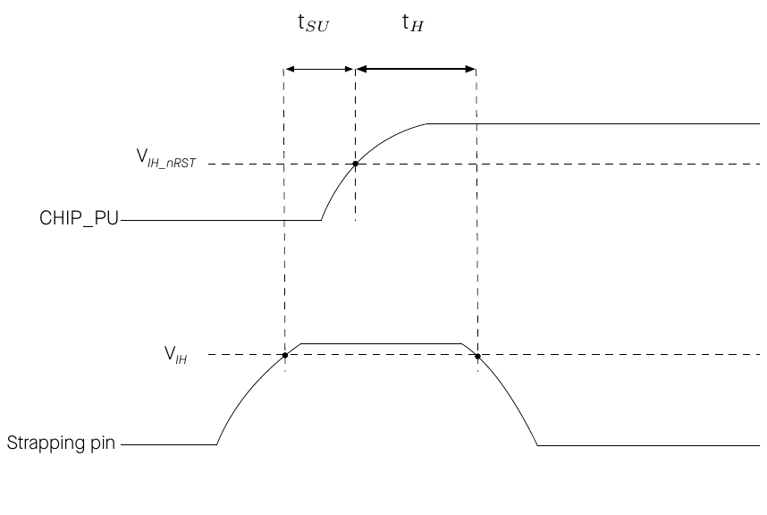

*Figure 3-1. Visualization of Timing Parameters for the Strapping Pins*

### C3.1 Chip Boot Mode Control

GPIO26, GPIO27, and GPIO28 control the boot mode after the reset is released. See Table 3-3 *Chip Boot Mode Control*.

**Table 3-3. Chip Boot Mode Control**

| Boot Mode | GPIO26 | GPIO27 | GPIO28 |
|---|---|---|---|
| **SPI boot mode** | Any value | Any value | **1** |
| Joint download boot mode 0² | Any value | 1 | 0 |
| Joint download boot mode 1³ | 0 | 0 | 0 |

1. Bold marks the default value and configuration.
2. Joint Download Boot 0 mode supports the following download methods:
   - USB-Serial-JTAG Download Boot
   - UART Download Boot
   - SPI Slave Download Boot (chip revision v0.1 only)
3. Joint Download Boot 1 mode supports the following download methods:
   - UART Download Boot
   - SDIO Download Boot

In SPI Boot mode, the ROM bootloader loads and executes the program from SPI flash to boot the system.

In Joint Download Boot 0 mode, users can download binary files into flash using UART0, USB, or SPI Slave interfaces. It is also possible to download binary files into SRAM and execute them from SRAM.

In Joint Download Boot 1 mode, users can download binary files into flash using UART0 or SDIO interfaces. It is also possible to download binary files into SRAM and execute them from SRAM.

### C3.2 SDIO Sampling and Driving Clock Edge Control

The strapping pins GPIO25 and MTDI can be used to decide on which clock edge to sample signals and drive output lines. See Table 3-4 *SDIO Input Sampling Edge/Output Driving Edge Control*.

**Table 3-4. SDIO Input Sampling Edge/Output Driving Edge Control**

| Edge behavior | GPIO25 | MTDI |
|---|---|---|
| Falling edge sampling, falling edge output | 0 | 0 |
| Falling edge sampling, rising edge output | 0 | 1 |
| Rising edge sampling, falling edge output | 1 | 0 |
| Rising edge sampling, rising edge output | 1 | 1 |

1. GPIO25 and MTDI are floating by default, so above are not default configurations.

### C3.3 ROM Messages Printing Control

During the boot process, the messages by the ROM code can be printed to:

- **(Default) UART0 and USB Serial/JTAG controller**
- UART0
- USB Serial/JTAG controller

EFUSE_UART_PRINT_CONTROL and GPIO27 control ROM messages printing to **UART0** as shown in Table 3-5 *UART0 ROM Message Printing Control*.

**Table 3-5. UART0 ROM Message Printing Control**

| UART0 ROM Message Printing | Register² | eFuse³ | GPIO27 |
|---|---|---|---|
| **ROM messages are always printed to UART0 during boot** | **0** | **0 (0b00)** | x⁴ |
| Print is enabled during boot | 0 | 1 (0b01) | 0 |
| Print is disabled during boot | 0 | 1 (0b01) | 1 |
| Print is disabled during boot | 0 | 2 (0b10) | 0 |
| Print is enabled during boot | 0 | 2 (0b10) | 1 |
| Print is disabled during boot | 0 | 3 (0b11) | x |
| Print is disabled during boot | 1 | x | x |

1. Bold marks the default value and configuration.
2. Register: LP_AON_STORE4_REG[0]
3. eFuse: EFUSE_UART_PRINT_CONTROL
4. x: x indicates that the value has no effect on the result and can be ignored.

EFUSE_DIS_USB_SERIAL_JTAG_ROM_PRINT controls the printing to **USB Serial/JTAG controller** as shown in Table 3-6 *USB Serial/JTAG ROM Message Printing Control*.

**Table 3-6. USB Serial/JTAG ROM Message Printing Control**

| USB Serial/JTAG ROM Code Printing | EFUSE_DIS_USB_SERIAL_JTAG_ROM_PRINT |
|---|---|
| **Enabled** | **0** |
| Disabled | 1 |
| Disabled | Ignored |

1. Bold marks the default value and configuration.

### C3.4 JTAG Signal Source Control

The strapping pin GPIO7 can be used to control the source of JTAG signals during the early boot process. This pin does not have any internal pull resistors and the strapping value must be controlled by the external circuit that cannot be in a high impedance state.

As Table 3-7 *JTAG Signal Source Control* shows, GPIO7 is used in combination with EFUSE_DIS_PAD_JTAG, EFUSE_DIS_USB_JTAG, and EFUSE_JTAG_SEL_ENABLE.

**Table 3-7. JTAG Signal Source Control**

| JTAG Signal Source | eFuse 1² | eFuse 2³ | eFuse 3⁴ | GPIO7 |
|---|---|---|---|---|
| **USB Serial/JTAG Controller⁶** | **0** | **0** | **0** | x⁵ |
| USB Serial/JTAG Controller⁶ | 0 | 0 | 1 | 1 |
| JTAG pins MTDI, MTCK, MTMS, and MTDO | 0 | 0 | 1 | 0 |
| JTAG pins MTDI, MTCK, MTMS, and MTDO | 0 | x | x | x |
| JTAG pins MTDI, MTCK, MTMS, and MTDO | 0 | 1 | x | x |
| USB Serial/JTAG Controller⁶ | 1 | 0 | x | x |
| JTAG is disabled | 1 | x | x | x |
| JTAG is disabled | 1 | 1 | x | x |

1. Bold marks the default value and configuration.
2. eFuse 1: EFUSE_DIS_PAD_JTAG
3. eFuse 2: EFUSE_DIS_USB_JTAG
4. eFuse 3: EFUSE_JTAG_SEL_ENABLE
5. x: x indicates that the value has no effect on the result and can be ignored.
6. In Joint Download Boot 1 mode, the USB Serial/JTAG controller is forcibly disabled, and the JTAG signal only comes from JTAG pins. If PAD_JTAG is also disabled, then JTAG is disabled.

Note: Table 3-7 is transcribed cell by cell from the merged cells of datasheet v1.5. Its fourth and seventh rows ("x" for eFuse 2) overlap with other rows as printed; read them together with footnote 6 and the TRM chapter *Chip Boot Control*.

## C4 Functional Description

### C4.1 System

This section describes the core of the chip’s operation, covering its microprocessor, memory organization, system components, and security features.

#### C4.1.1 Microprocessor and Master

This subsection describes the core processing units within the chip and their capabilities.

##### C4.1.1.1 High-Performance CPU

The ESP-RISC-V CPU (HP CPU) is a high-performance 32-bit core based on the RISC-V instruction set architecture (ISA) comprising base integer (I), multiplication/division (M), atomic (A) and compressed (C) standard extensions.

**Feature List**

- five-stage pipeline that supports clock frequency of up to 240 MHz
- RV32IMAC ISA (instruction set architecture)
- two-cycle pipelined multiplier and radix-4 SRT divider
- Zc extensions (Zcb, Zcmp, and Zcmt)
- custom hardware loop instructions (Xhwlp)
- compliant with RISC-V Core Local Interrupt (CLINT)
- compliant with RISC-V Core-Local Interrupt Controller (CLIC)
- branch predictor BHT, BTB, and RAS
- up to 3 hardware breakpoints/watchpoints
- up to 16 PMP/PMA regions
- Machine and User privilege modes
- USB/JTAG for debugging
- compliant with RISC-V debug specification v0.13
- offline trace debug that is compliant with RISC-V Trace Specification v2.0

For details, see [ESP32-C5 Technical Reference Manual](https://www.espressif.com/documentation/esp32-c5_technical_reference_manual_en.pdf) > Chapter *High-Performance CPU*.

##### C4.1.1.2 RISC-V Trace Encoder

The RISC-V Trace Encoder in the ESP32-C5 chip provides a way to capture detailed trace information from the High-Performance CPU’s execution, enabling deeper analysis and optimization of the system. It connects to the HP CPU’s instruction trace interface and compresses the information into smaller packets, which are then stored in internal SRAM.

**Feature List**

- compatible with Efficient Trace for RISC-V Version 2.0
- synchronization packets sent every few clock cycles or packets
- zero bytes as anchor tags to identify boundaries between data packets
- configurable memory writing mode: loop mode or non-loop mode
- trace lost status to indicate packet loss
- automatic restart after packet loss
- support for delta address mode and full address mode
- support for filter unit

For details, see [ESP32-C5 Technical Reference Manual](https://www.espressif.com/documentation/esp32-c5_technical_reference_manual_en.pdf) > Chapter *RISC-V Trace Encoder (TRACE)*.

##### C4.1.1.3 Low-Power CPU

The ESP32-C5 Low-Power CPU (LP CPU) is a 32-bit processor based on the RISC-V ISA comprising integer (I), multiplication/division (M), atomic (A), and compressed (C) standard extensions. It is designed for ultra-low power consumption and is capable of staying powered on during Deep-sleep mode when the HP CPU is powered down.

This LP CPU is designed as a simplified, low-power replacement of HP CPU in sleep modes. It can be also used to supplement the functions of the HP CPU in normal working mode. The LP CPU and LP memory remain powered on in Deep-sleep mode. Hence, the developer can store a program for the LP CPU in the LP memory to access LP IO, LP peripherals, and RTC timers in Deep-sleep mode.

**Feature List**

- two-stage pipeline that supports a clock frequency of up to 48 MHz
- RV32IMAC ISA (instruction set architecture)
- 3-4 cycle multiplier and iterative divider
- support for custom vectored interrupts
- up to 2 hardware breakpoints/watchpoints
- JTAG for debugging
- compliant with RISC-V debug specification v0.13
- boot by the CPU, its dedicated timer, or LP IO

For details, see [ESP32-C5 Technical Reference Manual](https://www.espressif.com/documentation/esp32-c5_technical_reference_manual_en.pdf) > Chapter *Low-Power CPU*.

##### C4.1.1.4 GDMA Controller

The GDMA Controller is a General Direct Memory Access (GDMA) controller that allows peripheral-to-memory, memory-to-peripheral, and memory-to-memory data transfer without the CPU’s intervention. The GDMA has six independent channels, three transmit channels and three receive channels. These channels are shared by peripherals with the GDMA feature, consisting of SPI2, UHCI0, I2S, AES, SHA, ADC, and PARLIO.

**Feature List**

- programmable length of data to be transferred in bytes
- linked list of descriptors for efficient data transfer management
- INCR4/8/16 burst transfer when accessing the internal RAM or external memory for improved performance
- access to an address space of up to 384 KB in internal RAM
- software-configurable selection of peripheral requesting service
- fixed-priority and round-robin channel arbitration schemes for managing bandwidth
- support for Event Task Matrix

For details, see [ESP32-C5 Technical Reference Manual](https://www.espressif.com/documentation/esp32-c5_technical_reference_manual_en.pdf) > Chapter *GDMA Controller (DMA)*.

#### C4.1.2 Memory Organization

This subsection describes the memory arrangement to explain how data is stored, accessed, and managed for efficient operation.

Figure 4-1 illustrates the address mapping structure of ESP32-C5.

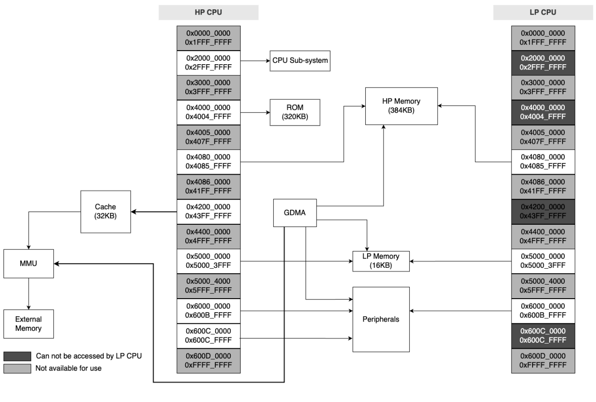

*Figure 4-1. Address Mapping Structure*

##### C4.1.2.1 Internal Memory

The internal memory of ESP32-C5 refers to the memory integrated on the chip die or in the chip package, including ROM, SRAM, eFuse, and flash.

**Feature List**

- 320 KB of ROM for booting and core functions
- 384 KB of SRAM for data and instructions
- 16 KB of low-power SRAM (LP SRAM) that can be accessed by HP CPU or LP CPU. It can retain data in Deep-sleep mode
- 4 Kbit of eFuse memory, with 1792 bits available for users. See also [C4.1.2.3 eFuse Controller](#c4123-efuse-controller)
- In-package flash and PSRAM
  - See flash and PSRAM size in [C1 ESP32-C5 Series Information](#c1-esp32-c5-series-information)
  - For specifications, refer to [C5.7 Memory Specifications](#c57-memory-specifications)

For details, see [ESP32-C5 Technical Reference Manual](https://www.espressif.com/documentation/esp32-c5_technical_reference_manual_en.pdf) > Chapter *System and Memory*.

##### C4.1.2.2 External Memory

ESP32-C5 supports SPI, Dual SPI, Quad SPI, and QPI interfaces that allow connection to the external flash and PSRAM.

CPU’s instruction memory space and read-only data memory space can map into the external flash and PSRAM of ESP32-C5, and the size of the external flash or PSRAM can be 32 MB at most. ESP32-C5 supports hardware encryption/decryption based on XTS-AES to protect developers’ programs and data in the external flash and PSRAM.

**Feature List**

- 32 MB of instruction memory space which can map into the external flash and PSRAM as individual blocks of 64 KB. 32-bit fetch is supported
- 32 MB of data memory space which can map into the external flash and PSRAM as individual blocks of 64 KB. 8-bit, 16-bit, and 32-bit reads are supported by the external flash. 8-bit, 16-bit, and 32-bit reads and writes are supported by the external PSRAM

Note:

After ESP32-C5 is initialized, software can customize the mapping of off-package flash and PSRAM into the CPU address space.

For details, see [ESP32-C5 Technical Reference Manual](https://www.espressif.com/documentation/esp32-c5_technical_reference_manual_en.pdf) > Chapter *System and Memory*.

##### C4.1.2.3 eFuse Controller

The eFuse memory is a one-time programmable memory that stores parameters and user data, and the eFuse controller of ESP32-C5 is used to program and read this eFuse memory.

**Feature List**

- 4 Kbits in total, with 1792 bits reserved for users, e.g., encryption key and device ID
- one-time programmable storage
- configurable write protection
- configurable read protection
- various hardware encoding schemes to protect against data corruption

For details, see [ESP32-C5 Technical Reference Manual](https://www.espressif.com/documentation/esp32-c5_technical_reference_manual_en.pdf) > Chapter *eFuse Controller*.

##### C4.1.2.4 cache

ESP32-C5 has an four-way set associative cache.

**Feature List**

- size: 32 KB
- block size: 32 bytes
- pre-load function
- lock function
- critical word first and early restart

For details, see [ESP32-C5 Technical Reference Manual](https://www.espressif.com/documentation/esp32-c5_technical_reference_manual_en.pdf) > Chapter *Cache*.

#### C4.1.3 System Components

This subsection describes the essential components that contribute to the overall functionality and control of the system.

##### C4.1.3.1 IO MUX and GPIO Matrix

The IO MUX and GPIO Matrix in the ESP32-C5 chip provide flexible routing of peripheral input and output signals to the GPIO pins. These peripherals enhance the functionality and performance of the chip by allowing the configuration of I/O, support for multiplexing, and signal synchronization for peripheral inputs.

**Feature List**

- 29 GPIO pins for general-purpose I/O or connection to internal peripheral signals
- GPIO matrix:
  - routing 77 peripheral input and 75 output signals to any GPIO pin
  - signal synchronization for peripheral inputs based on IO MUX operating clock
  - GPIO Filter hardware for input signal filtering

- IO MUX for directly connecting certain digital signals (SPI, JTAG, UART) to pins
- support for Event Task Matrix

For details, see [ESP32-C5 Technical Reference Manual](https://www.espressif.com/documentation/esp32-c5_technical_reference_manual_en.pdf) > Chapter *IO MUX and GPIO Matrix*.

##### C4.1.3.2 Reset

The ESP32-C5 chip provides four types of reset that occur at different levels, namely CPU Reset, Core Reset, System Reset, and Chip Reset. Except for Chip Reset, all reset types preserve the data stored in internal memory.

**Feature List**

- four types of reset:
  - CPU reset – resets the CPU core
  - core reset – resets the whole digital system except for the LP system
  - system Reset – resets the whole digital system, including the LP system
  - chip reset – resets the whole chip

- reset trigger:
  - directly by hardware
  - via software by configuring the corresponding registers of the CPU

- support for retrieving reset cause

For details, see [ESP32-C5 Technical Reference Manual](https://www.espressif.com/documentation/esp32-c5_technical_reference_manual_en.pdf) > Chapter *Reset and Clock*.

##### C4.1.3.3 Clock

The ESP32-C5 chip has clocks sourced from oscillators, RC circuits, and PLL circuits, which are then processed by dividers or selectors. The clocks can be classified into high-speed clocks for devices working at higher frequencies and slow-speed clocks for low-power systems and some peripherals.

**Feature List**

- high-speed clocks for HP system
  - external main crystal clock (supports 48 MHz crystal clock frequency)
  - internal fast RC oscillator clock (typically about 20 MHz, and adjustable)
  - PLL clock


  Notice:
  - ESP32-C5 is unable to operate without an external main crystal clock.
  - ESP32-C5 can automatically filter out high-frequency glitches from the external main crystal clock.

- slow-speed clocks for RTC counter, RTC watchdog, and the power management unit (PMU)
  - internal slow RC oscillator (typically about 150 kHz)
  - 32 kHz external low-speed crystal clock
  - external IO clock (external clock source connected with digital IO)

- fast-speed clocks for low-power peripherals and sensor controllers
  - external main crystal clock divided by 2
  - internal fast RC oscillator clock (typically about 20 MHz, and adjustable)

For details, see [ESP32-C5 Technical Reference Manual](https://www.espressif.com/documentation/esp32-c5_technical_reference_manual_en.pdf) > Chapter *Reset and Clock*.

##### C4.1.3.4 Interrupt Matrix

The Interrupt Matrix in the ESP32-C5 chip routes interrupt requests generated by various peripherals to CPU interrupts.

**Feature List**

- 84 peripheral interrupt sources accepted as input
- 32 CPU peripheral interrupts generated to CPU as output
- current interrupt status query of peripheral interrupt sources
- multiple interrupt sources mapping to a single CPU interrupt (i.e., shared interrupts)

For details, see [ESP32-C5 Technical Reference Manual](https://www.espressif.com/documentation/esp32-c5_technical_reference_manual_en.pdf) > Chapter *Interrupt Matrix*.

##### C4.1.3.5 Event Task Matrix

ESP32-C5 integrates an SoC ETM with multiple channels. Each input event on channels is mapped to an output task. Events are generated by peripherals, while tasks are received by peripherals.

**Feature List**

- up to 50 mapping channels, each connected to an event and a task and controlled independently
- an event or a task can be mapped to any tasks or events in the matrix. That is to say, one event can be mapped to different tasks via multiple channels, or different events can be mapped to the same task via their individual channels
- peripherals supporting ETM consisting of GPIO, LED PWM, general-purpose timers, RTC timer, system timer, MCPWM, temperature sensor, ADC, I2S, LP CPU, GDMA, and PMU

For details, see [ESP32-C5 Technical Reference Manual](https://www.espressif.com/documentation/esp32-c5_technical_reference_manual_en.pdf) > Chapter *Event Task Matrix*.

##### C4.1.3.6 Power Management Unit

The ESP32-C5 has an advanced Power Management Unit (PMU). It can be flexibly configured to power up different power domains of the chip to achieve the best balance between chip performance, power consumption, and wakeup latency.

The integrated LP CPU allow the ESP32-C5 to operate in Deep-sleep mode with most of the power domains turned off, thus achieving extremely low-power consumption.

Configuring the PMU is a complex procedure. To simplify power management for typical scenarios, there are the following predefined power modes that power up different combinations of power domains:

- Active mode – The HP CPU, RF circuits, and all peripherals are on. The chip can process data, receive, transmit, and listen.
- Modem-sleep mode – The HP CPU is on, but the clock frequency can be reduced. The wireless connections can be configured to remain active as RF circuits are periodically switched on when required.
- Light-sleep mode – The HP CPU stops running, and can be optionally powered on. The LP peripherals, as well as the LP CPU can be woken up periodically by the timer. The chip can be woken up via all wake up mechanisms: MAC, RTC timer, or external interrupts. Wireless connections can remain active. Some groups of digital peripherals can be optionally powered off.
- Deep-sleep mode – Only the LP system is powered on. Wireless connection data is stored in LP memory.

For modules powered on in each power mode, see the [ESP32-C5 Functional Block Diagram](#c0-product-overview).

For power consumption in different power modes, see [C5.6 Current Consumption](#c56-current-consumption).

For details, see [ESP32-C5 Technical Reference Manual](https://www.espressif.com/documentation/esp32-c5_technical_reference_manual_en.pdf) > Chapter *Low-Power Management*.

##### C4.1.3.7 System Timer

The System Timer (SYSTIMER) in the ESP32-C5 chip is a 52-bit timer that can be used to generate tick interrupts for the operating system or as a general timer to generate periodic or one-time interrupts.

**Feature List**

- two 52-bit counters and three 52-bit comparators
- counters with an average clock frequency of 16 MHz
- three types of independent interrupts generated according to alarm value
- two alarm modes: target mode and period mode
- 52-bit alarm values and 26-bit alarm periods
- automatic reload of counter value
- counters can be stalled if the CPU is stalled or in OCD mode
- real-time alarm events

For details, see [ESP32-C5 Technical Reference Manual](https://www.espressif.com/documentation/esp32-c5_technical_reference_manual_en.pdf) > Chapter *System Timer*.

##### C4.1.3.8 Timer Group

The Timer Group (TIMG) in the ESP32-C5 chip can be used to precisely time an interval, trigger an interrupt after a particular interval (periodically and aperiodically), or act as a hardware clock. ESP32-C5 has two timer groups, TIMG0 and TIMG1, each consisting of one general-purpose timer and one Main System Watchdog Timer.

**Feature List**

- 16-bit prescaler
- 54-bit time-base counter programmable to incrementing or decrementing
- able to read real-time value of the time-base counter
- halt and resume the time-base counter
- programmable alarm generation
- timer value reload (auto-reload at an alarm or a software-controlled instant reload)
- frequency calculation of slow clock for TIMG0
- level interrupt generation
- real-time alarm events
- support several ETM tasks and events

For details, see [ESP32-C5 Technical Reference Manual](https://www.espressif.com/documentation/esp32-c5_technical_reference_manual_en.pdf) > Chapter *Timer Group (TIMG)*.

##### C4.1.3.9 Watchdog Timers

The Watchdog Timers (WDT) in ESP32-C5 are used to detect and recover from malfunctions. The chip contains three digital watchdog timers: one in each of the two timer groups (MWDT) and one in the RTC Module (RWDT). Additionally, there is one analog watchdog timer called the Super watchdog (SWD) that helps prevent the system from operating in a sub-optimal state.

**Feature List**

- digital watchdog timers:
  - four stages, each with a programmable timeout value. Each stage can be configured, enabled and disabled separately
  - three timeout actions for MWDT: interrupt, CPU reset, or core reset upon expiry of each stage; four timeout actions for RWDT interrupt: CPU reset, core reset, or system reset for RWDT upon expiry of each stage
  - 32-bit expiry counter
  - write protection, to prevent RWDT and MWDT configuration from being altered inadvertently
  - flash boot protection If the boot process from an SPI flash does not complete within a predetermined period of time, the watchdog will reboot the entire main system

- analog watchdog timer：
  - ultra-low power
  - interrupt to indicate that the SWD is about to time out
  - various dedicated methods for software to feed SWD, which enables SWD to monitor the working state of the whole operating system

For details, see [ESP32-C5 Technical Reference Manual](https://www.espressif.com/documentation/esp32-c5_technical_reference_manual_en.pdf) > Chapter *Watchdog Timers*.

##### C4.1.3.10 RTC Timer

ESP32-C5 RTC Timer is a 48-bit readable counter that can operate in any power mode. It is used as a system timer when the timers in the HP system is unavailable. It also allows for configuring timer interrupts and logging the time when specific events happen in the system.

**Feature List**

- 48-bit counter operating under the RTC clock
- real-time reading of the time-base counter’s value
- configurable target value for the counter to trigger an interrupt upon timeout

For details, see [ESP32-C5 Technical Reference Manual](https://www.espressif.com/documentation/esp32-c5_technical_reference_manual_en.pdf) > Chapter *RTC Timer*.

##### C4.1.3.11 Permission Control

The Permission Control module in ESP32-C5 is responsible for managing access permissions to memory and peripheral registers. It consists of two parts: PMP (Physical Memory Protection) and APM (Access Permission Management).

**Feature List**

- access permission management for ROM, HP memory, HP peripheral, and LP peripheral address spaces
- APM supports each master (such as DMA) to select one of the four security modes
- access permission configuration for up to 32 address ranges
- individual permission configuration for each register
- Interrupt function and exception information record

For details, see [ESP32-C5 Technical Reference Manual](https://www.espressif.com/documentation/esp32-c5_technical_reference_manual_en.pdf) > Chapter *Permission Control (PMS)*.

##### C4.1.3.12 System Registers

The System Registers in the ESP32-C5 chip are used to configure various auxiliary chip features.

**Feature List**

- control External memory encryption and decryption
- control CPU core debugging
- control Bus timeout protection

For details, see [ESP32-C5 Technical Reference Manual](https://www.espressif.com/documentation/esp32-c5_technical_reference_manual_en.pdf) > Chapter *System Registers (HP_SYSREG)*.

##### C4.1.3.13 Debug Assistant

The Debug Assistant provides a set of functions to help locate bugs and issues during software debugging. It offers various monitoring capabilities and logging features to assist in identifying and resolving software errors efficiently.

**Feature List**

- read/write monitoring: Monitor whether the CPU bus reads from or writes to a specified memory address space
- stack pointer (SP) monitoring: Prevent stack overflow or erroneous push/pop operations violation will trigger an interrupt.
- program counter (PC) logging: Record PC value. The developer can get the last PC value at the most recent CPU reset
- bus access logging: Record information about bus access when the CPU or DMA writes a specified value

For details, see [ESP32-C5 Technical Reference Manual](https://www.espressif.com/documentation/esp32-c5_technical_reference_manual_en.pdf) > Chapter *Debug Assistant (ASSIST_DEBUG)*.

##### C4.1.3.14 Brownout Detector

ESP32-C5 can periodically monitor the voltage of the power supply, and in the event of abnormal voltage, it is capable of generating interrupts or initiating resets.

**Feature List**

- configurable detection threshold
- configurable reset level
- glitch filtering

For more details, see the [ESP32-C5 Technical Reference Manual](https://www.espressif.com/documentation/esp32-c5_technical_reference_manual_en.pdf) > Chapter *Power Supply Detector*.

#### C4.1.4 Cryptography and Security Component

This subsection describes the security features incorporated into the chip, which safeguard data and operations.

##### C4.1.4.1 AES Accelerator

ESP32-C5 integrates an Advanced Encryption Standard (AES) accelerator, which is a hardware device that speeds up computation using AES algorithm significantly, compared to AES algorithms implemented solely in software. The AES accelerator integrated in ESP32-C5 has two working modes, which are typical AES and DMA-AES.

**Feature List**

- typical AES working mode
  - AES-128/AES-256 encryption and decryption, compliant with NIST FIPS 197

- DMA-AES working mode
  - AES-128/AES-256 encryption and decryption, compliant with NIST FIPS 197
  - block cipher mode, compliant with NIST SP 800-38A
    - ECB (Electronic Codebook)
    - CBC (Cipher Block Chaining)
    - OFB (Output Feedback)
    - CTR (Counter)
    - CFB8 (8-bit Cipher Feedback)
    - CFB128 (128-bit Cipher Feedback)
  - interrupt generation

For details, see [ESP32-C5 Technical Reference Manual](https://www.espressif.com/documentation/esp32-c5_technical_reference_manual_en.pdf) > Chapter *AES Accelerator (AES)*.

##### C4.1.4.2 ECC Accelerator

Elliptic Curve Cryptography (ECC) is an approach to public-key cryptography based on the algebraic structure of elliptic curves. ECC allows smaller keys compared to RSA cryptography while providing equivalent security.

ESP32-C5’s ECC Accelerator can complete various calculations based on different elliptic curves, thus accelerating the ECC algorithm and ECC-derived algorithms (such as ECDSA).

**Feature List**

- three elliptic curves, namely P-192, P-256 and P-384 defined in FIPS 186-3
- two coordinate systems, namely Affine Coordinates and Jacobian Coordinates
- different point operations, including point addition, point multiplication, and point verification
- different modular operations based on the order or mod base of the curve, including mod addition, mod subtraction, mod multiplication, and mod division
- interrupt upon completion of calculation
- secure operating mode for Base Point Multiplication within a specified time frame

For details, see the [ESP32-C5 Technical Reference Manual](https://www.espressif.com/documentation/esp32-c5_technical_reference_manual_en.pdf) > Chapter *ECC Accelerator (ECC)*.

##### C4.1.4.3 HMAC Accelerator

The HMAC Accelerator (HMAC) module is designed to compute Message Authentication Codes (MACs) using the SHA-256 Hash algorithm and keys as described in RFC 2104. It provides hardware support for HMAC computations, significantly reducing software complexity and improving performance.

**Feature List**

- standard HMAC-SHA-256 algorithm
- hash result only accessible by configurable hardware peripheral (in downstream mode)
- compatibility with challenge-response authentication algorithm
- required keys for RSA_DS (in downstream mode)
- re-enabled soft-disabled JTAG (in downstream mode)

For details, see the [ESP32-C5 Technical Reference Manual](https://www.espressif.com/documentation/esp32-c5_technical_reference_manual_en.pdf) > Chapter *HMAC Accelerator*.

##### C4.1.4.4 RSA Accelerator

The RSA accelerator provides hardware support for high-precision computation used in various RSA asymmetric cipher algorithms, significantly improving their run time and reducing their software complexity. Compared with RSA algorithms implemented solely in software, this hardware accelerator can speed up RSA algorithms significantly. The RSA accelerator also supports operands of different lengths, which provides more flexibility during the computation.

**Feature List**

- large-number modular exponentiation with two optional acceleration options
- large-number modular multiplication, up to 3072 bits
- large-number multiplication, with operands up to 1536 bits
- operands of different lengths
- interrupt on completion of computation

For details, see the [ESP32-C5 Technical Reference Manual](https://www.espressif.com/documentation/esp32-c5_technical_reference_manual_en.pdf) > Chapter *RSA Accelerator*.

##### C4.1.4.5 SHA Accelerator

ESP32-C5 integrates an SHA accelerator, which is a hardware device that speeds up the SHA algorithm significantly, compared to SHA algorithms implemented solely in software. The SHA accelerator integrated in ESP32-C5 has two working modes, which are typical SHA and DMA-SHA.

**Feature List**

- the following hash algorithms introduced in FIPS PUB 180-4
  - SHA-1
  - SHA-224
  - SHA-256
  - SHA-384
  - SHA-512/224
  - SHA-512/256
  - SHA-512/t

- two working modes
  - typical SHA
  - DMA-SHA

- interleaved function in typical SHA working mode
- interrupt function in DMA-SHA working mode

For more details, see the [ESP32-C5 Technical Reference Manual](https://www.espressif.com/documentation/esp32-c5_technical_reference_manual_en.pdf) > Chapter *SHA Accelerator (SHA)*.

##### C4.1.4.6 RSA Digital Signature Peripheral (RSA_DS)

The RSA Digital Signature Peripheral (RSA_DS) is used to verify the authenticity and integrity of a message using a cryptographic algorithm. This can be used to validate a device’s identity to a server, or to check the integrity of a message.

ESP32-C5 includes an RSA_DS module providing hardware acceleration of messages’ signatures based on RSA. HMAC is used as the key derivation function to output the RSA_DS_KEY key using eFuse as the input key. Subsequently, the RSA_DS peripheral uses RSA_DS_KEY to decrypt the pre-encrypted parameters and calculate the signature. The whole process happens in hardware so that neither the decryption key for the RSA parameters nor the input key for the HMAC key derivation function can be seen by users while calculating the signature.

**Feature List**

- RSA digital signatures with key length up to 3072 bits
- encrypted private key data, only decryptable by the RSA_DS peripheral
- SHA-256 digest to protect private key data against tampering by an attacker

For more details, see the [ESP32-C5 Technical Reference Manual](https://www.espressif.com/documentation/esp32-c5_technical_reference_manual_en.pdf) > Chapter *RSA Digital Signature Peripheral (RSA_DS)*.

##### C4.1.4.7 ECDSA Digital Signature Peripheral (ECDSA_DS)

In cryptography, the ECDSA Digital Signature Peripheral (ECDSA_DS) offers a variant of the Digital Signature Algorithm (DSA) which uses elliptic-curve cryptography.

ESP32-C5’s ECDSA_DS provides a secure and efficient environment for computing ECDSA signatures. It offers fast computations while ensuring the confidentiality of the signing process to prevent information leakage. This makes it a valuable tool for applications that require high-speed cryptographic operations with strong security guarantees. By using the ECDSA_DS, users can be confident that their data is being protected without sacrificing performance.

**Feature List**

- digital signature generation and verification
- public key exportation
- three elliptic curves, namely P-192, P-256, and P-384 defined in FIPS 186-3
- four hash algorithms for message hash in the ECDSA operation, namely SHA-224, SHA-256, SHA-384, and SHA-512 defined in FIPS PUB 180-4
- deterministic ECDSA defined in RFC6979.
- high security features:
  - dynamic access permission in different operation statuses to ensure information security, preventing key leakage due to intermediate data leakage
  - fixed-duration signing and verification processes to resist side-channel attacks

For details, see the [ESP32-C5 Technical Reference Manual](https://www.espressif.com/documentation/esp32-c5_technical_reference_manual_en.pdf) > Chapter *ECDSA Digital Signature Peripheral (ECDSA_DS)*.

##### C4.1.4.8 External Memory Encryption and Decryption

The ESP32-C5 integrates an External Memory Encryption and Decryption module that complies with the XTS-AES standard algorithm specified in IEEE Std 1619-2007, providing security for users’ application code and data stored in the external memory (flash and PSRAM). Users can store proprietary firmware and sensitive data (e.g., credentials for gaining access to a private network) to the off-package flash, and securely run data-sensitive applications in PSRAM.

**Feature List**

- general XTS-AES algorithm, compliant with IEEE Std 1619-2007
- software-based manual encryption
- high-speed auto encryption without software
- high-speed auto decryption without software
- encryption and decryption functions jointly enabled/disabled by registers configuration, eFuse parameters, and boot mode
- configurable counter measures against DPA attacks
- flash and PSRAM use their own separate keys

For more details, see the [ESP32-C5 Technical Reference Manual](https://www.espressif.com/documentation/esp32-c5_technical_reference_manual_en.pdf) > Chapter *External Memory Encryption and Decryption (XTS_AES)*.

##### C4.1.4.9 True Random Number Generator

The ESP32-C5 contains a true random number generator, which generates 32-bit random numbers that can be used for cryptographical operations, among other things.

**Feature List**

- RNG entropy source
  - thermal noise from high-speed ADC or SAR ADC
  - an asynchronous clock mismatch

For more details, see the [ESP32-C5 Technical Reference Manual](https://www.espressif.com/documentation/esp32-c5_technical_reference_manual_en.pdf) > Chapter *Random Number Generator (RNG)*.

##### C4.1.4.10 Key Manager

The key manager is the security core of the system. They can store and deploy keys securely. The key manager utilizes each chip’s unique physical unclonable function (PUF) to generate a hardware unique key (HUK) for that chip, which serves as the chip’s root of trust. The HUK is generated automatically each time the chip powers on and disappears when the chip powers off. The key manager thus protects key storage and provisioning by design.

On the ESP32-C5, the key manager stores key information (not the keys in plaintext, but the information needed to recover them) in external memory, enabling flexible key management features such as unlimited number of keys and dynamic key changes.

**Feature List**

The HUK generator has the following features:

- HUK generation mode:
  - generates a new HUK and its recovery information

- HUK recovery mode:
  - recovers a deployed HUK with its recovery information

- prompt for HUK recovery error
- prompt for HUK risk level

The key manager has the following features:

- unlimited number of keys
- specified private key deployment (AES deploy mode):
  - users specify the value of the key

- negotiated private key deployment (ECDH0 deploy mode):
  - highest security mode: there is no need to worry about the leaks of data in external channels
  - requires chip initiation to obtain the private key
  - negotiates the key value between each chip and the user

- negotiated private key deployment (ECDH1 deploy mode):
  - provides auxiliary key software/scripts to users
  - no need to boot the chip to obtain the private key

- random key deployment (random deploy mode):
  - deploys a hardware-generated random key with nobody knowing the exact value

- private key recovery deployment (private key recovery mode):
  - recovers exactly the same key by entering the key information generated during deployment

- key information export (key_info export mode):
  - generates unique key information for the same key each time

For more details, see the [ESP32-C5 Technical Reference Manual](https://www.espressif.com/documentation/esp32-c5_technical_reference_manual_en.pdf) > Chapter *Key Manager*.

Note:

This feature is supported by chip revision v1.2 or later.

##### C4.1.4.11 Power Glitch Detector

ESP32-C5 can monitor the voltage of the power supply in real time. When a voltage glitch occurs, the chip will reset immediately to prevent power glitch attacks.

**Feature List**

- configurable threshold for power glitch (around 2.7 V by default)
- enabled upon power-up

For more details, see the [ESP32-C5 Technical Reference Manual](https://www.espressif.com/documentation/esp32-c5_technical_reference_manual_en.pdf) > Chapter *Power Supply Detector*.

### C4.2 Peripherals

This section describes the chip’s peripheral capabilities, covering connectivity interfaces and on-chip sensors that extend its functionality.

#### C4.2.1 Connectivity Interface

This subsection describes the connectivity interfaces on the chip that enable communication and interaction with external devices and networks.

##### C4.2.1.1 UART Controller

ESP32-C5 has three UART interfaces, i.e. UART0, UART1, and LP UART. All the three interfaces provide hardware flow control (CTS and RTS signals) and software flow control (XON and XOFF).

**Feature List**

- programmable baud rates up to 5 MBaud
- RAM shared by TX FIFOs and RX FIFOs
- support for various lengths of data bits and stop bits
- parity bit support
- special character AT_CMD detection
- RS485 protocol support (not supported by LP UART)
- IrDA protocol support (not supported by LP UART)
- high-speed data communication using GDMA (not supported by LP UART)
- receive timeout feature
- UART as the wake-up source
- software and hardware flow control

For details, see [ESP32-C5 Technical Reference Manual](https://www.espressif.com/documentation/esp32-c5_technical_reference_manual_en.pdf) > Chapter *UART Controller (UART)*.

**Pin Assignment**

For details, see [C2.3.5 Peripheral Pin Assignment](#c235-peripheral-pin-assignment).

##### C4.2.1.2 SPI Controller

ESP32-C5 features three SPI interfaces (SPI0, SPI1, and SPI2). SPI0 and SPI1 can be configured to operate in SPI memory mode, while SPI2 can be configured to operate in general-purpose SPI mode.

**Feature List**

- SPI Memory mode

In SPI memory mode, SPI0 and SPI1 interfaces are for external SPI memory. Data are transferred in unit of byte. Up to four-line STR reads and writes are supported. The clock frequency is configurable to a maximum of 120 MHz.

- SPI2 General-purpose SPI (GP-SPI) mode

SPI2 can operate in master and slave modes. SPI2 supports two-line full-duplex communication and single/two/four-line half-duplex communication in both master and slave modes. The host’s clock frequency is configurable. Data are transferred in unit of byte. The clock polarity (CPOL) and phase (CPHA) are also configurable. The SPI2 interface can connect to GDMA.
  - In master mode, the clock frequency is 80 MHz at most, and the four modes of SPI transfer format are supported.
  - In slave mode, the clock frequency is 40 MHz at most, and the four modes of SPI transfer format are also supported.

For details, see [ESP32-C5 Technical Reference Manual](https://www.espressif.com/documentation/esp32-c5_technical_reference_manual_en.pdf) > Chapter *SPI Controller (SPI)*.

**Pin Assignment**

For details, see [C2.3.5 Peripheral Pin Assignment](#c235-peripheral-pin-assignment).

##### C4.2.1.3 I2C Controller

ESP32-C5 has an I2C and an LP I2C bus interface. I2C is used for I2C master mode or slave mode, depending on your configuration, while LP I2C is always in master mode.

**Feature List**

- standard mode (100 Kbit/s)
- fast mode (400 Kbit/s)
- up to 800 Kbit/s (constrained by SCL and SDA pull-up strength)
- 7-bit and 10-bit addressing mode
- double addressing mode
- 7-bit broadcast address

For details, see [ESP32-C5 Technical Reference Manual](https://www.espressif.com/documentation/esp32-c5_technical_reference_manual_en.pdf) > Chapter *I2C Controller (I2C)*.

**Pin Assignment**

For details, see [C2.3.5 Peripheral Pin Assignment](#c235-peripheral-pin-assignment).

##### C4.2.1.4 I2S Controller

ESP32-C5 includes a standard I2S interface. This interface can operate as a master or a slave in full-duplex mode or half-duplex mode, and supports 8-bit, 16-bit, 24-bit, or 32-bit serial communication. BCK clock frequency, from 10 kHz up to 40 MHz, is supported.

The I2S interface supports TDM Philips, TDM MSB alignment, TDM PCM standard, PDM standard, and PCM-to-PDM TX interface. It connects to the GDMA controller.

**Feature List**

- master mode and slave mode
- full-duplex and half-duplex communications
- separate TX and RX units that can work independently or simultaneously
- a variety of audio standards supported:
  - TDM Philips standard
  - TDM MSB alignment standard
  - TDM PCM standard
  - PDM standard

- various TX/RX modes
  - TDM TX mode, up to 16 channels supported
  - TDM RX mode, up to 16 channels supported
  - PDM TX mode
    - raw PDM data transmission
    - PCM-to-PDM data format conversion, up to 2 channels supported
  - PDM RX mode
    - raw PDM data reception

- configurable clock source with frequency up to 240 MHz
- configurable high-precision sample clock with a variety of sampling frequencies supported
- 8/16/24/32-bit data width
- synchronous counter in TX mode
- ETM feature
- direct memory access
- standard I2S interface interrupts

For details, see [ESP32-C5 Technical Reference Manual](https://www.espressif.com/documentation/esp32-c5_technical_reference_manual_en.pdf) > Chapter *I2S Controller (I2S)*.

**Pin Assignment**

For details, see [C2.3.5 Peripheral Pin Assignment](#c235-peripheral-pin-assignment).

##### C4.2.1.5 USB Serial/JTAG Controller

ESP32-C5 contains a USB Serial/JTAG controller. This unit can be used to program the SoC’s flash, read program output, as well as attach a debugger to the running program. All of these are possible for any computer with a USB host without any active external components.

**Feature List**

- USB 2.0 full speed compliant, capable of up to 12 Mbit/s transfer speed (note that this controller does not support the faster 480 Mbit/s high-speed transfer mode)
- CDC-ACM virtual serial port and JTAG adapter functionality
- programming the chip’s flash
- CPU debugging with compact JTAG instructions
- a full-speed USB PHY integrated in the chip

For details, see [ESP32-C5 Technical Reference Manual](https://www.espressif.com/documentation/esp32-c5_technical_reference_manual_en.pdf) > Chapter *USB Serial/JTAG Controller (USB_SERIAL_JTAG)*.

**Pin Assignment**

For details, see [C2.3.5 Peripheral Pin Assignment](#c235-peripheral-pin-assignment).

##### C4.2.1.6 CAN FD Controller

The CAN FD is a multi-master multi-cast communication protocol. The CAN FD controller facilitates the communication based on this protocol.

**Feature List**

- compliant with ISO11898-1:2015
- RX buffer FIFO with 128 words (6 CAN FD frames with 64-byte data payloads, 21 CAN/CAN FD frames with 8-byte data payloads)
- 4 TX buffers (1 CAN FD frame in each TX buffer)
- 32-bit APB interface
- support of ISO and non-ISO CAN FD protocol
- timestamping and time triggered transmission
- three single-bit filters and one range filter
- support interrupts
- loopback, bus monitoring, ACK forbidden, self test, and restricted operation modes

For details, see [ESP32-C5 Technical Reference Manual](https://www.espressif.com/documentation/esp32-c5_technical_reference_manual_en.pdf) > Chapter *Controller Area Network Flexible Data-Rate*.

**Pin Assignment**

For details, see [C2.3.5 Peripheral Pin Assignment](#c235-peripheral-pin-assignment).

##### C4.2.1.7 LED PWM Controller

The LED PWM controller can generate independent digital waveform on six channels.

**Feature List**

- generating digital waveform with configurable periods and duty cycle. The resolution of duty cycle can be up to 20 bits
- multiple clock sources, including 80 MHz PLL clock, external main crystal clock, and internal fast RC oscillator
- operation when the CPU is in Light-sleep mode
- gradual increase or decrease of duty cycle, which is useful for the LED RGB color-gradient generator
- up to 16 duty cycle ranges for gamma curve generation, each can be independently configured in terms of duty cycle direction (increase or decrease), step size, the number of steps, and step frequency

For details, see [ESP32-C5 Technical Reference Manual](https://www.espressif.com/documentation/esp32-c5_technical_reference_manual_en.pdf) > Chapter *LED PWM Controller*.

**Pin Assignment**

For details, see [C2.3.5 Peripheral Pin Assignment](#c235-peripheral-pin-assignment).

##### C4.2.1.8 Pulse Count Controller

The Pulse Count controller (PCNT) in ESP32-C5 captures pulses and counts pulse edges in seven modes.

**Feature List**

- four independent pulse counters (units) that count from 1 to 65535
- each unit consists of two independent channels sharing one pulse counter
- all channels have input pulse signals (e.g. sig_ch0_un) with their corresponding control signals (e.g. ctrl_ch0_un)
- independently filter glitches of input pulse signals (sig_ch0_un and sig_ch1_un) and control signals (ctrl_ch0_un and ctrl_ch1_un) on each unit
- each channel has the following parameters:
  1. selection between counting on positive or negative edges of the input pulse signal
  2. configuration to Increment, Decrement, or Disable counter mode for control of signal’s high and low states

- support step counting
- maximum frequency of pulses: 40 MHz

For details, see [ESP32-C5 Technical Reference Manual](https://www.espressif.com/documentation/esp32-c5_technical_reference_manual_en.pdf) > Chapter *Pulse Count Controller*.

**Pin Assignment**

For details, see [C2.3.5 Peripheral Pin Assignment](#c235-peripheral-pin-assignment).

##### C4.2.1.9 Motor Control PWM

ESP32-C5 integrates an MCPWM that can be used to drive digital motors and smart light.

**Feature List**

- a clock divider (prescaler), three PWM timers, three PWM operators, and a dedicated capture submodule. PWM timers are used to generate timing references. PWM operators generate desired waveform based on the timing references
- a PWM operator can use the timing reference of any PWM timer
- a PWM operator can use the same timing reference with other PWM operators
- PWM operators can use different PWM timers’ values to produce independent PWM signals
- PWM timers can be synchronized

For details, see [ESP32-C5 Technical Reference Manual](https://www.espressif.com/documentation/esp32-c5_technical_reference_manual_en.pdf) > Chapter *Motor Control PWM (MCPWM)*.

**Pin Assignment**

For details, see [C2.3.5 Peripheral Pin Assignment](#c235-peripheral-pin-assignment).

##### C4.2.1.10 Remote Control Peripheral

The Remote Control Peripheral (RMT) supports two channels of infrared remote transmission and two channels of infrared remote reception. By controlling pulse waveform through software, it supports various infrared and other single wire protocols.

**Feature List**

- four channels:
  - TX channels 0 ~ 1
  - RX channels 2 ~ 3
  - four channels share a 192 x 32-bit RAM

- the transmitter supports:
  - normal TX mode
  - wrap TX mode
  - modulation on TX pulses
  - continuous TX mode
  - multiple channels (programmable) transmitting data simultaneously

- the receiver supports:
  - normal RX mode
  - wrap RX mode
  - RX filtering
  - demodulation on RX pulses

For more details, see [ESP32-C5 Technical Reference Manual](https://www.espressif.com/documentation/esp32-c5_technical_reference_manual_en.pdf) > Chapter *Remote Control Peripheral (RMT)*.

**Pin Assignment**

For details, see [C2.3.5 Peripheral Pin Assignment](#c235-peripheral-pin-assignment).

##### C4.2.1.11 Parallel IO Controller

ESP32-C5 integrates a PARLIO controller for parallel data transfer. It has a transmitter and a receiver, connected with the GDMA controller. In full-duplex mode the PARLIO controller supports up to 4-bit parallel data transfer, while in half-duplex mode it supports up to 8-bit parallel data transfer.

**Feature List**

- multiple clock sources and clock division, with clock frequency up to 40 MHz
- receiver/transmitter supports input and output clock inverse
- 1/2/4/8-bit data transfer
- changeable sample sequence for data to be transmitted and received in 1-bit, 2-bit, and 4-bit mode
- support for multiple data sampling mode by the receiver
- support for multiple GDMA EOF signal generation modes by the receiver
- output external chip select signals with configurable delay cycles
- support for transmitter clock gating

For more details, see [ESP32-C5 Technical Reference Manual](https://www.espressif.com/documentation/esp32-c5_technical_reference_manual_en.pdf) > Chapter *Parallel IO Controller*.

**Pin Assignment**

For details, see [C2.3.5 Peripheral Pin Assignment](#c235-peripheral-pin-assignment).

##### C4.2.1.12 BitScrambler

The ESP32-C5 has an extensive amount of DMA-capable peripherals. These can move data from memory to an external device, and vice versa, without any interference from the CPU. This only works if the external device needs or emits the data in question in the same format as the software expects it: if not, the CPU needs to rewrite the format of the data. Examples include a need to swap bytes, reverse bytes, and shift the data left or right.

As bitwise operations tend to be fairly CPU-expensive and the purpose of DMA is to not use the CPU in the transfer, ESP32-C5 integrates one BitScrambler, which are dedicated peripherals to change the format of data in between memory and the peripheral. The RX channel is dedicated to peripheral-to-memory transfers, and the TX channel is dedicated to memory-to-peripheral transfers. The BitScrambler is capable of performing the aforementioned operations, but as a flexible programmable state machine, it is capable of more advanced things as well.

**Feature List**

- one BitScrambler, one channel for RX (peripheral-to-memory), one channel for TX (memory-to-peripheral). The two channels support only half-duplex communications, and cannot work at the same time
- support for memory-to-memory transfers
- process up to 32 bits per DMA clock period
- data path controlled by a BitScrambler program stored in the instruction memory
- input registers able to read 0, 8, 16, or 32 bits per clock cycle
- output registers:
  - able to write 0, 8, 16, or 32 bits per clock cycle
  - data sources for output register bits: 64 bits of input data, two counters, LUT RAM data, data output of last cycle, comparators
  - with some restrictions, each of the 32 output register bits can come from any bit on the data sources

- 8 x 257-bit instruction memory, for storing eight instructions, controlling control flow and the data path
- 2048 bytes of lookup table (LUT) memory, configurable as various word widths

For more details, see [ESP32-C5 Technical Reference Manual](https://www.espressif.com/documentation/esp32-c5_technical_reference_manual_en.pdf) > Chapter *BitScrambler*.

**Pin Assignment**

The BitScrambler does not directly interact with IOs, so it has no pins assigned.

##### C4.2.1.13 SDIO Slave Controller

The SDIO Slave controller in ESP32-C5 provides hardware support for the Secure Digital Input/Output (SDIO) device interface. It allows an SDIO host to access ESP32-C5 via an SDIO bus protocol.

**Feature List**

- compatible with SDIO Physical Layer Specification V2.00 and SDIO Specifications V2.00
- support SPI, 1-bit SDIO, and 4-bit SDIO transfer modes
- clock range of 0 ~ 50 MHz
- configurable sample and drive clock edge
- integrated and SDIO-accessible registers for information interaction
- support SDIO interrupts
- automatic padding data and discarding the padded data on the SDIO bus
- block size up to 512 bytes
- interrupt vector between the host and slave for bidirectional interrupt
- support DMA for data transfer
- support wake-up from sleep when connection is retained

For more details about the SDIO Slave controller, refer to the [ESP32-C5 Technical Reference Manual](https://www.espressif.com/documentation/esp32-c5_technical_reference_manual_en.pdf) > Chapter *SDIO Slave Controller (SDIO)*.

**Pin Assignment**

For details, see [C2.3.5 Peripheral Pin Assignment](#c235-peripheral-pin-assignment).

Note:

This peripheral is not supported by chip revision v0.0 and v0.1.

#### C4.2.2 Analog Signal Processing

This subsection describes components on the chip that sense and process real-world data.

##### C4.2.2.1 Temperature Sensor

ESP32-C5 provides a temperature sensor to monitor temperature changes inside the chip in real time. The sensor converts analog voltage to digital values and supports compensation for the temperature offset.

**Feature List**

- software-triggered temperature measurement. Once triggered, the sensor continuously measures temperature. Software can read the data any time.
- hardware-triggered automatic temperature monitoring
- two modes for automatic monitoring of temperature and support for triggering interrupts
- configurable temperature offset based on the application scenario for improved accuracy
- configurable temperature measurement range
- support for several Event Task Matrix (ETM) related events and tasks

For more details, see [ESP32-C5 Technical Reference Manual](https://www.espressif.com/documentation/esp32-c5_technical_reference_manual_en.pdf) > Chapter *Temperature Sensor*.

##### C4.2.2.2 ADC Controller

ESP32-C5 integrates One 12-bit successive approximation ADC (SAR ADC) for measuring analog signals from up to six channels.

**Feature List**

- 12-bit resolution
- analog inputs sampling from up to six pins
- one-shot sampling mode and multi-channel sampling mode
- multi-channel sampling mode supports:
  - configurable channel sampling sequence
  - two filters whose filter coefficients are configurable
  - two threshold monitors that can trigger an interrupt when the filtered value is below a low threshold or above a high threshold
  - continuous transfer of converted data to memory via GDMA interface

- support for several Event Task Matrix (ETM) related events and tasks

For more details, see [ESP32-C5 Technical Reference Manual](https://www.espressif.com/documentation/esp32-c5_technical_reference_manual_en.pdf) > Chapter *ADC Controller*.

**Pin Assignment**

For details, see [C2.3.5 Peripheral Pin Assignment](#c235-peripheral-pin-assignment).

##### C4.2.2.3 Analog Voltage Comparator

ESP32-C5 provides an analog voltage comparator which contains two special pads. This peripheral can be used to compare the voltages of the two pads or compare the voltage of one pad with a stable internal voltage that is adjustable.

**Feature List**

- internal or external reference voltage
- supported internal reference voltage ranging from 0 to 0.7 * VDD_PST
- support for ETM
- interrupt triggered when the measured voltage reaches the reference voltage

For more details, see [ESP32-C5 Technical Reference Manual](https://www.espressif.com/documentation/esp32-c5_technical_reference_manual_en.pdf) > Chapter *Analog Voltage Comparator*.

**Pin Assignment**

For details, see [C2.3.5 Peripheral Pin Assignment](#c235-peripheral-pin-assignment).

### C4.3 Wireless Communication

This section describes the chip’s wireless communication capabilities, spanning radio technology, Wi-Fi, and Bluetooth.

#### C4.3.1 Radio

This subsection describes the fundamental radio technology embedded in the chip that facilitates wireless communication and data exchange.

##### C4.3.1.1 2.4 & 5 GHz Receiver

The 2.4 & 5 GHz receiver demodulates the 2.4 & 5 GHz RF signal to quadrature baseband signals and converts them to the digital domain with two high-resolution, high-speed ADCs. To adapt to varying signal channel conditions, ESP32-C5 integrates RF filters, Automatic Gain Control (AGC), DC offset cancelation circuits, and baseband filters.

##### C4.3.1.2 2.4 & 5 GHz Transmitter

The 2.4 & 5 GHz transmitter modulates the quadrature baseband signals to the 2.4 & 5 GHz RF signal, and drives the antenna with a high-powered CMOS power amplifier. The use of digital calibration further improves the linearity of the power amplifier.

Additional calibrations are integrated to cancel any radio imperfections, such as:

- carrier leakage
- I/Q amplitude/phase matching
- baseband nonlinearities
- RF nonlinearities
- antenna matching

These built-in calibration routines reduce the cost, time, and specialized equipment required for product testing.

##### C4.3.1.3 Clock Generator

The clock generator produces quadrature clock signals of 2.4 & 5 GHz for both the receiver and the transmitter. All components of the clock generator are integrated into the chip, including inductors, varactors, filters, regulators and dividers.

The clock generator has built-in calibration and self-test circuits. Quadrature clock phases and phase noise are optimized on chip with patented calibration algorithms which ensure the best performance of the receiver and the transmitter.

#### C4.3.2 Wi-Fi

This subsection describes the chip’s Wi-Fi capabilities, which facilitate wireless communication at a high data rate.

##### C4.3.2.1 Wi-Fi Radio and Baseband

The ESP32-C5 Wi-Fi radio and baseband support the following features:

- compliant with IEEE 802.11a/b/g/n/ac/ax
- 1T1R in 2.4 GHz and 5 GHz dual band
- 802.11ax
  - 20 MHz-only non-AP mode
  - MCS0 ~ MCS9 in 2.4 GHz band
  - MCS0 ~ MCS7 in 5 GHz band
  - uplink and downlink OFDMA
  - downlink MU-MIMO (multi-user, multiple input, multiple output)
  - longer OFDM symbol, with 0.8, 1.6, and 3.2 µs guard interval
  - DCM (dual carrier modulation), up to 16-QAM
  - single-user/multi-user beamformee
  - channel quality indication (CQI)
  - RX STBC (single spatial stream)

- 802.11ac
  - MCS0 ~ MCS7 that support 20 MHz bandwidth
  - downlink fullband MU-MIMO (multi-user, multiple input, multiple output)
  - single-user/multi-user beamformee
  - RX STBC (single spatial stream)
  - 0.4 µs guard interval

- 802.11a/b/g/n
  - MCS0 ~ MCS7 that support 20 MHz and 40 MHz bandwidth
  - MCS32
  - data rate up to 150 Mbps
  - 0.4 µs guard interval

- adjustable transmitting power
- antenna diversity: ESP32-C5 supports antenna diversity with an external RF switch. This switch is controlled by one or more GPIOs, and used to select the best antenna to minimize the effects of channel imperfections.

##### C4.3.2.2 Wi-Fi MAC

ESP32-C5 implements the full IEEE 802.11a/b/g/n/ac/ax Wi-Fi MAC protocol. It supports the Basic Service Set (BSS) STA and SoftAP operations under the Enhanced Distributed Channel Access (EDCA). Power management is handled automatically with minimal host interaction to minimize the active duty period.

The ESP32-C5 Wi-Fi MAC applies the following low-level protocol functions automatically:

- four virtual Wi-Fi interfaces
- infrastructure BSS in Station mode, SoftAP mode, Station + SoftAP mode, and promiscuous mode
- RTS protection, CTS-to-Self protection, immediate block ACK
- fragmentation and defragmentation
- TX/RX A-MPDU, TX/RX A-MSDU
- transmission opportunity (TXOP)
- Wi-Fi multimedia (WMM)
- GCMP, CCMP, TKIP, WAPI, WEP, BIP, WPA2-PSK, and WPA3-PSK
- automatic beacon monitoring (hardware TSF)
- 802.11mc FTM
- 802.11ax supports:
  - target wake time (TWT) requester
  - multiple BSSIDs
  - triggered response scheduling
  - Multi-User Request-to-Send (MU-RTS), Multi-User Block ACK Request (MU-BAR), and Multi-STA Block ACK (M-BA) frame
  - intra-PPDU power saving mechanism
  - two network allocation vectors (NAV)
  - BSS coloring
  - spatial reuse
  - uplink power headroom
  - operating mode control
  - buffer status report
  - TXOP duration RTS threshold
  - UL-OFDMA random access (UORA)

##### C4.3.2.3 Networking Features

Espressif provides libraries for TCP/IP networking, ESP-WIFI-MESH networking, and other networking protocols over Wi-Fi. TLS 1.0, 1.1, and 1.2 are also supported.

#### C4.3.3 Bluetooth LE

This subsection describes the chip’s Bluetooth capabilities, which facilitate wireless communication for low-power, short-range applications.

##### C4.3.3.1 Bluetooth LE PHY

Bluetooth Low Energy PHY in ESP32-C5 supports:

- 1 Mbps PHY
- 2 Mbps PHY for higher data rates
- coded PHY for longer range (125 Kbps and 500 Kbps)
- HW listen before talk (LBT)

##### C4.3.3.2 Bluetooth LE Link Controller

Bluetooth Low Energy Link Controller and Host in ESP32-C5 support:

- direction finding (AoA/AoD)
- periodic advertising with responses (PAwR)
- LE connection subrating（LE enhanced connection update）
- LE advertising extensions and multiple advertising sets
- allow devices to operate in Broadcaster, Observer, Central, and Peripheral roles concurrently
- adaptive frequency hopping and channel assessment
- LE channel selection algorithm #2
- LE power control
- advertising coding selection
- encrypted advertising data
- LE GATT security levels characteristic
- AdvDataInfo in periodic advertising
- LE channel classification
- enhanced attribute protocol
- advertising channel index
- GATT caching
- periodic advertising sync transfer
- high duty cycle non-connectable advertising
- LE data packet length extension
- LE secure connections
- LE privacy 1.2
- link layer extended scanner filter policies
- low duty cycle directed advertising
- link layer encryption
- LE ping

#### C4.3.4 802.15.4

This subsection describes the chip’s compatibility with the 802.15.4 standard, which facilitates wireless communication for low-power, short-range applications.

##### C4.3.4.1 802.15.4 PHY

ESP32-C5’s 802.15.4 PHY supports:

- O-QPSK PHY in 2.4 GHz
- 250 Kbps data rate
- RSSI and LQI supported

##### C4.3.4.2 802.15.4 MAC

ESP32-C5 supports most key features defined in IEEE Standard 802.15.4-2015, including:

- CSMA/CA
- active scan and energy detect
- HW frame filter
- HW auto acknowledge
- HW auto frame pending
- coordinated sampled listening (CSL)

## C5 Electrical Characteristics

### C5.1 Absolute Maximum Ratings

Stresses above those listed in Table 5-1 *Absolute Maximum Ratings* may cause permanent damage to the device. These are stress ratings only and normal operation of the device at these or any other conditions beyond those indicated in [C5.2 Recommended Power Supply Characteristics](#c52-recommended-power-supply-characteristics) is not implied. Exposure to absolute-maximum-rated conditions for extended periods may affect device reliability.

**Table 5-1. Absolute Maximum Ratings**

| Parameter | Description | Min | Max | Unit |
|---|---|---|---|---|
| Input power pins¹ | Allowed input voltage | –0.3 | 3.6 | V |
| T_STORE | Storage temperature | –40 | 150 | °C |

1. For more information on input power pins, see [C2.5.1 Power Pins](#c251-power-pins).

### C5.2 Recommended Power Supply Characteristics

**Table 5-2. Recommended Power Characteristics**

| Parameter¹ | Description | Min | Typ | Max | Unit |
|---|---|---|---|---|---|
| VDDA1, VDDA2, VDDA3, VDDA4, VDDA5, VDDA6, VDDA7, VDDA8 | Recommended input voltage | 3.0 | 3.3 | 3.6 | V |
| VDDPST1, VDDPST3 | Recommended input voltage | 3.0 | 3.3 | 3.6 | V |
| VDD_SPI (as input) | — | 3.0 | 3.3 | 3.6 | V |
| VDDPST2²,³ | Recommended input voltage | 3.0 | 3.3 | 3.6 | V |
| I_VDD | Cumulative input current | 0.6 | — | — | A |

1. See in conjunction with [C2.5 Power Supply](#c25-power-supply).
2. If VDDPST2 is used to power VDD_SPI (see [C2.5.2 Power Scheme](#c252-power-scheme)), the voltage drop on R_SPI should be accounted for.
3. If writing to eFuses, the voltage on VDDPST2 should not exceed 3.3 V as the circuits responsible for burning eFuses are sensitive to higher voltages.

### C5.3 VDD_SPI Output Characteristics

**Table 5-3. VDD_SPI Internal and Output Characteristics**

| Parameter | Description¹ | Typ | Unit |
|---|---|---|---|
| R_SPI | VDD_SPI powered by VDDPST2 via R_SPI for 3.3 V flash or PSRAM² | 3 | Ω |

1. See in conjunction with [C2.5.2 Power Scheme](#c252-power-scheme).
2. VDDPST2 must be more than VDD_flash_min + I_flash_max × R_SPI, where
   - VDD_flash_min – minimum operating voltage of flash
   - I_flash_max – maximum operating current of flash

### C5.4 DC Characteristics (3.3 V, 25 °C)

**Table 5-4. DC Characteristics (3.3 V, 25 °C)**

| Parameter | Description | Min | Typ | Max | Unit |
|---|---|---|---|---|---|
| C_IN | Pin capacitance | — | 2 | — | pF |
| V_IH | High-level input voltage | 0.75 × VDD¹ | — | VDD¹ + 0.3 | V |
| V_IL | Low-level input voltage | –0.3 | — | 0.25 × VDD¹ | V |
| I_IH | High-level input current | — | — | 50 | nA |
| I_IL | Low-level input current | — | — | 50 | nA |
| V_OH² | High-level output voltage | 0.8 × VDD¹ | — | — | V |
| V_OL² | Low-level output voltage | — | — | 0.1 × VDD¹ | V |
| I_OH | High-level source current (VDD¹ = 3.3 V, V_OH >= 2.64 V, PAD_DRIVER = 3) | — | 40 | — | mA |
| I_OL | Low-level sink current (VDD¹ = 3.3 V, V_OL = 0.495 V, PAD_DRIVER = 3) | — | 28 | — | mA |
| R_PU | Internal weak pull-up resistor | — | 45 | — | kΩ |
| R_PD | Internal weak pull-down resistor | — | 45 | — | kΩ |
| V_IH_nRST | Chip reset release voltage (CHIP_PU voltage is within the specified range) | 0.75 × VDD¹ | — | VDD¹ + 0.3 | V |
| V_IL_nRST | Chip reset voltage (CHIP_PU voltage is within the specified range) | –0.3 | — | 0.25 × VDD¹ | V |

1. VDD – voltage from a power pin of a respective power domain.
2. V_OH and V_OL are measured using high-impedance load.

### C5.5 ADC Characteristics

The measurements in this section are taken with an external 100 nF capacitor connected to the ADC, using DC signals as input, and at an ambient temperature of 25 °C with disabled Wi-Fi.

**Table 5-5. ADC Characteristics**

| Symbol | Min | Max | Unit |
|---|---|---|---|
| DNL (Differential nonlinearity)¹ | –5 | 5 | LSB |
| INL (Integral nonlinearity) | –5 | 5 | LSB |
| Sampling rate | — | 2000 | kSPS² |

1. To get better DNL results, you can sample multiple times and apply a filter, or calculate the average value.
2. kSPS means kilo samples-per-second.

The calibrated ADC results after hardware calibration and software calibration are shown in Table 5-6. For higher accuracy, you may implement your own calibration methods.

**Table 5-6. ADC Calibration Results**

| Parameter | Description | Min | Max | Unit |
|---|---|---|---|---|
| Total error | ATTEN0, effective measurement range of 0 ~ 1000 | –10 | 10 | mV |
| Total error | ATTEN1, effective measurement range of 0 ~ 1300 | –10 | 10 | mV |
| Total error | ATTEN2, effective measurement range of 0 ~ 1900 | –12 | 12 | mV |
| Total error | ATTEN3, effective measurement range of 0 ~ 3300 | –15 | 15 | mV |

### C5.6 Current Consumption

#### C5.6.1 RF Current Consumption in Active Mode

The current consumption measurements are taken with a 3.3 V supply at 25 °C ambient temperature.

TX current consumption is rated at a 100% duty cycle.

RX current consumption is rated when the peripherals are disabled and the CPU idle.

**Table 5-7. Current Consumption for Wi-Fi (2.4 GHz) in Active Mode**

| Work Mode | RF Condition | Description | Peak (mA) |
|---|---|---|---|
| Active (RF working) | TX | 802.11b, 1 Mbps, DSSS @ 20 dBm | 320 |
| Active (RF working) | TX | 802.11g, 54 Mbps, OFDM @ 17 dBm | 263 |
| Active (RF working) | TX | 802.11n, HT20, MCS7 @ 17 dBm | 264 |
| Active (RF working) | TX | 802.11n, HT40, MCS7 @ 16 dBm | 258 |
| Active (RF working) | TX | 802.11ax, MCS9 @ 15 dBm | 245 |
| Active (RF working) | RX | 802.11b/g/n, HT20 | 87 |
| Active (RF working) | RX | 802.11n, HT40 | 91 |
| Active (RF working) | RX | 802.11ax, HE20 | 87 |

**Table 5-8. Current Consumption for Wi-Fi (5 GHz) in Active Mode**

| Work Mode | RF Condition | Description | Peak (mA) |
|---|---|---|---|
| Active (RF working) | TX | 802.11a, 6 Mbps, OFDM @ 18 dBm | 408 |
| Active (RF working) | TX | 802.11n, HT20, MCS7 @ 16 dBm | 387 |
| Active (RF working) | TX | 802.11n, HT40, MCS7 @ 15 dBm | 381 |
| Active (RF working) | TX | 802.11ac, VHT20, MCS7 @ 16 dBm | 388 |
| Active (RF working) | TX | 802.11ax, HE20, MCS7 @ 16 dBm | 388 |
| Active (RF working) | RX | 802.11a/n, HT20 | 110 |
| Active (RF working) | RX | 802.11n, HT40 | 113 |
| Active (RF working) | RX | 802.11ac, VHT20 | 110 |
| Active (RF working) | RX | 802.11ax, HE20 | 110 |

**Table 5-9. Current Consumption for Bluetooth LE in Active Mode**

| Work Mode | RF Condition | Description | Peak (mA) |
|---|---|---|---|
| Active (RF working) | TX | Bluetooth LE @ 20 dBm | 331 |
| Active (RF working) | TX | Bluetooth LE @ 9 dBm | 180 |
| Active (RF working) | TX | Bluetooth LE @ 0 dBm | 140 |
| Active (RF working) | TX | Bluetooth LE @ –15 dBm | 94 |
| Active (RF working) | RX | Bluetooth LE | 79 |

**Table 5-10. Current Consumption for 802.15.4 in Active Mode**

| Work Mode | RF Condition | Description | Peak (mA) |
|---|---|---|---|
| Active (RF working) | TX | 802.15.4 @ 20 dBm | 337 |
| Active (RF working) | TX | 802.15.4 @ 9 dBm | 179 |
| Active (RF working) | TX | 802.15.4 @ 0 dBm | 138 |
| Active (RF working) | TX | 802.15.4 @ –15 dBm | 93 |
| Active (RF working) | RX | 802.15.4 | 78 |

#### C5.6.2 Current Consumption in Other Modes

**Table 5-11. Current Consumption in Modem-sleep Mode**

| Mode | CPU Frequency (MHz) | Description | Typ (mA), All Peripherals Clocks Disabled | Typ (mA), All Peripherals Clocks Enabled¹ |
|---|---|---|---|---|
| Modem-sleep²,³ | 240 | WAITI | 18 | 27 |
| Modem-sleep²,³ | 240 | CPU while loop | 26 | 35 |
| Modem-sleep²,³ | 240 | Run CoreMark | 34 | 43 |
| Modem-sleep²,³ | 160 | WAITI | 15 | 27 |
| Modem-sleep²,³ | 160 | CPU while loop | 20 | 32 |
| Modem-sleep²,³ | 160 | Run CoreMark | 26 | 37 |
| Modem-sleep²,³ | 80 | WAITI | 12 | 24 |
| Modem-sleep²,³ | 80 | CPU while loop | 15 | 26 |
| Modem-sleep²,³ | 80 | Run CoreMark | 18 | 29 |
| Modem-sleep²,³ | 40 | WAITI | 8 | 18 |
| Modem-sleep²,³ | 40 | CPU while loop | 10 | 19 |
| Modem-sleep²,³ | 40 | Run CoreMark | 12 | 21 |

1. In practice, the current consumption might be different depending on which peripherals are enabled.
2. In Modem-sleep mode, Wi-Fi is clock gated.
3. In Modem-sleep mode, the consumption might be higher when accessing flash.

**Table 5-12. Current Consumption in Low-Power Modes**

| Mode | Description | Typ (mA) |
|---|---|---|
| Light-sleep | CPU and wireless communication modules are powered down, peripheral clocks are disabled, and all GPIOs are high-impedance | 0.25 |
| Light-sleep | CPU, wireless communication modules and peripherals are powered down, and all GPIOs are high-impedance | 0.06 |
| Deep-sleep | RTC timer and LP memory are powered on | 0.012 |
| Power off | CHIP_PU is set to low level, the chip is powered off | 0.002 |

### C5.7 Memory Specifications

The data below is sourced from the memory vendor datasheet. These values are guaranteed through design and/or characterization but are not fully tested in production. Devices are shipped with the memory erased.

**Table 5-13. Flash Specifications**

| Parameter | Description | Min | Typ | Max | Unit |
|---|---|---|---|---|---|
| VCC | Power supply voltage (1.8 V) | 1.65 | 1.80 | 2.00 | V |
| VCC | Power supply voltage (3.3 V) | 2.7 | 3.3 | 3.6 | V |
| F_C | Maximum clock frequency | 80 | — | — | MHz |
| — | Program/erase cycles | 100,000 | — | — | cycles |
| T_RET | Data retention time | 20 | — | — | years |
| T_PP | Page program time | — | 0.8 | 5 | ms |
| T_SE | Sector erase time (4 KB) | — | 70 | 500 | ms |
| T_BE1 | Block erase time (32 KB) | — | 0.2 | 2 | s |
| T_BE2 | Block erase time (64 KB) | — | 0.3 | 3 | s |
| T_CE | Chip erase time (16 Mb) | — | 7 | 20 | s |
| T_CE | Chip erase time (32 Mb) | — | 20 | 60 | s |
| T_CE | Chip erase time (64 Mb) | — | 25 | 100 | s |
| T_CE | Chip erase time (128 Mb) | — | 60 | 200 | s |
| T_CE | Chip erase time (256 Mb) | — | 70 | 300 | s |

**Table 5-14. PSRAM Specifications**

| Parameter | Description | Min | Typ | Max | Unit |
|---|---|---|---|---|---|
| VCC | Power supply voltage (1.8 V) | 1.62 | 1.80 | 1.98 | V |
| VCC | Power supply voltage (3.3 V) | 2.7 | 3.3 | 3.6 | V |
| F_C | Maximum clock frequency | 80 | — | — | MHz |

### C5.8 Reliability

**Table 5-15. Reliability Qualifications**

| Test Item | Test Conditions | Test Standard |
|---|---|---|
| HTOL (High Temperature Operating Life) | 125 °C, 1000 hours, 3.6 V¹ | JESD22-A108 |
| ESD (Electro-Static Discharge Sensitivity) | HBM (Human Body Mode)² ± 2000 V | JS-001 |
| ESD (Electro-Static Discharge Sensitivity) | CDM (Charge Device Mode)³ ± 1000 V | JS-002 |
| Latch up | Current trigger ± 200 mA; Voltage trigger 1.5 × VDDmax | JESD78 |
| Preconditioning | Bake 24 hours @125 °C; Moisture soak (level 3: 192 hours @30 °C, 60% RH); IR reflow solder: 260 + 0 °C, 20 seconds, three times | J-STD-020, JESD47, JESD22-A113 |
| TCT (Temperature Cycling Test) | –65 °C / 150 °C, 500 cycles | JESD22-A104 |
| uHAST (Highly Accelerated Stress Test, unbiased) | 130 °C, 85% RH, 96 hours | JESD22-A118 |
| HTSL (High Temperature Storage Life) | 150 °C, 1000 hours | JESD22-A103 |
| LTSL (Low Temperature Storage Life) | –40 °C, 1000 hours | JESD22-A119 |

1. 5G RF underwent a separate HTOL test under the conditions: 105 °C, 1700 hours, 3.45 V.
2. JEDEC document JEP155 states that 500 V HBM allows safe manufacturing with a standard ESD control process.
3. JEDEC document JEP157 states that 250 V CDM allows safe manufacturing with a standard ESD control process.

## C6 RF Characteristics

This section contains tables with RF characteristics of the Espressif product.

The RF data is measured at the antenna port, where RF cable is connected, including the front-end loss. The front-end circuit is a 0 Ω resistor.

Devices should operate in the center frequency range allocated by regional regulatory authorities. The target center frequency range and the target transmit power are configurable by software. See *ESP RF Test Tool and Test Guide* for instructions.

Unless otherwise stated, the RF tests are conducted with a 3.3 V (±5%) supply at 25 °C ambient temperature.

### C6.1 2.4 GHz Wi-Fi Radio

**Table 6-1. 2.4 GHz Wi-Fi RF Characteristics**

| Name | Description |
|---|---|
| Center frequency range of operating channel | 2412 ~ 2484 MHz |
| Wi-Fi wireless standard | IEEE 802.11b/g/n/ax |

#### C6.1.1 2.4 GHz Wi-Fi RF Transmitter (TX) Characteristics

**Table 6-2. 2.4 GHz TX Power with Spectral Mask and EVM Meeting 802.11 Standards**

| Rate | Min (dBm) | Typ (dBm) | Max (dBm) |
|---|---|---|---|
| 802.11b, 1 Mbps, DSSS | — | 20.0 | — |
| 802.11b, 11 Mbps, CCK | — | 20.0 | — |
| 802.11g, 6 Mbps, OFDM | — | 19.0 | — |
| 802.11g, 54 Mbps, OFDM | — | 17.0 | — |
| 802.11n, HT20, MCS0 | — | 19.0 | — |
| 802.11n, HT20, MCS7 | — | 17.0 | — |
| 802.11n, HT40, MCS0 | — | 18.0 | — |
| 802.11n, HT40, MCS7 | — | 16.0 | — |
| 802.11ax, HE20, MCS0 | — | 19.0 | — |
| 802.11ax, HE20, MCS9 | — | 15.0 | — |

**Table 6-3. 2.4 GHz TX EVM Test¹**

| Rate | Min (dB) | Typ (dB) | Limit (dB) |
|---|---|---|---|
| 802.11b, 1 Mbps, DSSS | — | –25.0 | –10.0 |
| 802.11b, 11 Mbps, CCK | — | –25.0 | –10.0 |
| 802.11g, 6 Mbps, OFDM | — | –25.0 | –5.0 |
| 802.11g, 54 Mbps, OFDM | — | –30.0 | –25.0 |
| 802.11n, HT20, MCS0 | — | –25.0 | –5.0 |
| 802.11n, HT20, MCS7 | — | –31.5 | –27.0 |
| 802.11n, HT40, MCS0 | — | –25.0 | –5.0 |
| 802.11n, HT40, MCS7 | — | –32.0 | –27.0 |
| 802.11ax, HE20, MCS0 | — | –25.0 | –5.0 |
| 802.11ax, HE20, MCS9 | — | –34.5 | –32.0 |

1. EVM is measured at the corresponding typical TX power provided in Table 6-2 *2.4 GHz TX Power with Spectral Mask and EVM Meeting 802.11 Standards* above.

#### C6.1.2 2.4 GHz Wi-Fi RF Receiver (RX) Characteristics

For RX tests, the PER (packet error rate) limit is 8% for 802.11b, and 10% for 802.11g/n/ax.

**Table 6-4. 2.4 GHz RX Sensitivity**

| Rate | Min (dBm) | Typ (dBm) | Max (dBm) |
|---|---|---|---|
| 802.11b, 1 Mbps, DSSS | — | –100.5 | — |
| 802.11b, 2 Mbps, DSSS | — | –97.5 | — |
| 802.11b, 5.5 Mbps, CCK | — | –94.5 | — |
| 802.11b, 11 Mbps, CCK | — | –90.0 | — |
| 802.11g, 6 Mbps, OFDM | — | –95.0 | — |
| 802.11g, 9 Mbps, OFDM | — | –94.0 | — |
| 802.11g, 12 Mbps, OFDM | — | –93.0 | — |
| 802.11g, 18 Mbps, OFDM | — | –91.0 | — |
| 802.11g, 24 Mbps, OFDM | — | –87.0 | — |
| 802.11g, 36 Mbps, OFDM | — | –84.0 | — |
| 802.11g, 48 Mbps, OFDM | — | –80.0 | — |
| 802.11g, 54 Mbps, OFDM | — | –78.0 | — |
| 802.11n, HT20, MCS0 | — | –95.0 | — |
| 802.11n, HT20, MCS1 | — | –93.0 | — |
| 802.11n, HT20, MCS2 | — | –90.0 | — |
| 802.11n, HT20, MCS3 | — | –86.5 | — |
| 802.11n, HT20, MCS4 | — | –83.5 | — |
| 802.11n, HT20, MCS5 | — | –79.0 | — |
| 802.11n, HT20, MCS6 | — | –77.5 | — |
| 802.11n, HT20, MCS7 | — | –76.5 | — |
| 802.11n, HT40, MCS0 | — | –92.0 | — |
| 802.11n, HT40, MCS1 | — | –89.0 | — |
| 802.11n, HT40, MCS2 | — | –86.5 | — |
| 802.11n, HT40, MCS3 | — | –83.5 | — |
| 802.11n, HT40, MCS4 | — | –80.0 | — |
| 802.11n, HT40, MCS5 | — | –76.5 | — |
| 802.11n, HT40, MCS6 | — | –74.5 | — |
| 802.11n, HT40, MCS7 | — | –73.5 | — |
| 802.11ax, HE20, MCS0 | — | –94.0 | — |
| 802.11ax, HE20, MCS1 | — | –91.0 | — |
| 802.11ax, HE20, MCS2 | — | –88.5 | — |
| 802.11ax, HE20, MCS3 | — | –86.0 | — |
| 802.11ax, HE20, MCS4 | — | –82.5 | — |
| 802.11ax, HE20, MCS5 | — | –78.5 | — |
| 802.11ax, HE20, MCS6 | — | –77.0 | — |
| 802.11ax, HE20, MCS7 | — | –76.0 | — |
| 802.11ax, HE20, MCS8 | — | –71.0 | — |
| 802.11ax, HE20, MCS9 | — | –70.0 | — |

**Table 6-5. 2.4 GHz Maximum RX Level**

| Rate | Min (dBm) | Typ (dBm) | Max (dBm) |
|---|---|---|---|
| 802.11b, 1 Mbps, DSSS | — | 5 | — |
| 802.11b, 11 Mbps, CCK | — | 5 | — |
| 802.11g, 6 Mbps, OFDM | — | 5 | — |
| 802.11g, 54 Mbps, OFDM | — | 0 | — |
| 802.11n, HT20, MCS0 | — | 5 | — |
| 802.11n, HT20, MCS7 | — | 0 | — |
| 802.11n, HT40, MCS0 | — | 5 | — |
| 802.11n, HT40, MCS7 | — | 0 | — |
| 802.11ax, HE20, MCS0 | — | 5 | — |
| 802.11ax, HE20, MCS9 | — | 0 | — |

**Table 6-6. 2.4 GHz RX Adjacent Channel Rejection**

| Rate | Min (dB) | Typ (dB) | Max (dB) |
|---|---|---|---|
| 802.11b, 1 Mbps, DSSS | — | 41 | — |
| 802.11b, 11 Mbps, CCK | — | 40 | — |
| 802.11g, 6 Mbps, OFDM | — | 37 | — |
| 802.11g, 54 Mbps, OFDM | — | 17 | — |
| 802.11n, HT20, MCS0 | — | 34 | — |
| 802.11n, HT20, MCS7 | — | 16 | — |
| 802.11n, HT40, MCS0 | — | 24 | — |
| 802.11n, HT40, MCS7 | — | 13 | — |
| 802.11ax, HE20, MCS0 | — | 38 | — |
| 802.11ax, HE20, MCS9 | — | 12 | — |

### C6.2 5 GHz Wi-Fi Radio

**Table 6-7. 5 GHz Wi-Fi RF Characteristics**

| Name | Description |
|---|---|
| Center frequency range of operating channel | 5180 ~ 5885 MHz |
| Wi-Fi wireless standard | IEEE 802.11a/n/ac/ax |

#### C6.2.1 5 GHz Wi-Fi RF Transmitter (TX) Characteristics

**Table 6-8. 5 GHz TX Power with Spectral Mask and EVM Meeting 802.11 Standards**

| Rate | Min (dBm) | Typ (dBm) | Max (dBm) |
|---|---|---|---|
| 802.11a, 6 Mbps, OFDM | — | 18.0 | — |
| 802.11a, 54 Mbps, OFDM | — | 17.0 | — |
| 802.11n, HT20, MCS0 | — | 18.0 | — |
| 802.11n, HT20, MCS7 | — | 16.0 | — |
| 802.11n, HT40, MCS0 | — | 17.0 | — |
| 802.11n, HT40, MCS7 | — | 15.0 | — |
| 802.11ac, VHT20, MCS0 | — | 18.0 | — |
| 802.11ac, VHT20, MCS7 | — | 16.0 | — |
| 802.11ax, HE20, MCS0 | — | 18.0 | — |
| 802.11ax, HE20, MCS7 | — | 16.0 | — |

**Table 6-9. 5 GHz TX EVM Test¹**

| Rate | Min (dB) | Typ (dB) | Limit (dB) |
|---|---|---|---|
| 802.11a, 6 Mbps, OFDM | — | –25.0 | –5.0 |
| 802.11a, 54 Mbps, OFDM | — | –29.0 | –25.0 |
| 802.11n, HT20, MCS0 | — | –25.0 | –5.0 |
| 802.11n, HT20, MCS7 | — | –31.0 | –27.0 |
| 802.11n, HT40, MCS0 | — | –25.0 | –5.0 |
| 802.11n, HT40, MCS7 | — | –31.0 | –27.0 |
| 802.11ac, VHT20, MCS0 | — | –25.0 | –5.0 |
| 802.11ac, VHT20, MCS7 | — | –31.0 | –27.0 |
| 802.11ax, HE20, MCS0 | — | –25.0 | –5.0 |
| 802.11ax, HE20, MCS7 | — | –31.5 | –27.0 |

1. EVM is measured at the corresponding typical TX power provided in Table 6-8 *5 GHz TX Power with Spectral Mask and EVM Meeting 802.11 Standards* above.

#### C6.2.2 5 GHz Wi-Fi RF Receiver (RX) Characteristics

For RX tests, the PER (packet error rate) limit is 10% for 802.11a/n/ac/ax.

**Table 6-10. 5 GHz RX Sensitivity**

| Rate | Min (dBm) | Typ (dBm) | Max (dBm) |
|---|---|---|---|
| 802.11a, 6 Mbps, OFDM | — | –94.0 | — |
| 802.11a, 9 Mbps, OFDM | — | –93.0 | — |
| 802.11a, 12 Mbps, OFDM | — | –92.0 | — |
| 802.11a, 18 Mbps, OFDM | — | –90.0 | — |
| 802.11a, 24 Mbps, OFDM | — | –87.0 | — |
| 802.11a, 36 Mbps, OFDM | — | –83.0 | — |
| 802.11a, 48 Mbps, OFDM | — | –78.5 | — |
| 802.11a, 54 Mbps, OFDM | — | –77.0 | — |
| 802.11n, HT20, MCS0 | — | –94.0 | — |
| 802.11n, HT20, MCS1 | — | –92.0 | — |
| 802.11n, HT20, MCS2 | — | –89.0 | — |
| 802.11n, HT20, MCS3 | — | –86.0 | — |
| 802.11n, HT20, MCS4 | — | –82.5 | — |
| 802.11n, HT20, MCS5 | — | –78.5 | — |
| 802.11n, HT20, MCS6 | — | –77.0 | — |
| 802.11n, HT20, MCS7 | — | –75.5 | — |
| 802.11n, HT40, MCS0 | — | –91.5 | — |
| 802.11n, HT40, MCS1 | — | –89.0 | — |
| 802.11n, HT40, MCS2 | — | –86.5 | — |
| 802.11n, HT40, MCS3 | — | –83.0 | — |
| 802.11n, HT40, MCS4 | — | –80.0 | — |
| 802.11n, HT40, MCS5 | — | –76.0 | — |
| 802.11n, HT40, MCS6 | — | –74.5 | — |
| 802.11n, HT40, MCS7 | — | –72.5 | — |
| 802.11ac, VHT20, MCS0 | — | –94.0 | — |
| 802.11ac, VHT20, MCS1 | — | –92.0 | — |
| 802.11ac, VHT20, MCS2 | — | –89.5 | — |
| 802.11ac, VHT20, MCS3 | — | –86.0 | — |
| 802.11ac, VHT20, MCS4 | — | –83.0 | — |
| 802.11ac, VHT20, MCS5 | — | –78.5 | — |
| 802.11ac, VHT20, MCS6 | — | –77.0 | — |
| 802.11ac, VHT20, MCS7 | — | –75.5 | — |
| 802.11ax, HE20, MCS0 | — | –94.0 | — |
| 802.11ax, HE20, MCS1 | — | –91.0 | — |
| 802.11ax, HE20, MCS2 | — | –88.0 | — |
| 802.11ax, HE20, MCS3 | — | –85.0 | — |
| 802.11ax, HE20, MCS4 | — | –82.0 | — |
| 802.11ax, HE20, MCS5 | — | –78.0 | — |
| 802.11ax, HE20, MCS6 | — | –76.5 | — |
| 802.11ax, HE20, MCS7 | — | –75.0 | — |

**Table 6-11. 5 GHz Maximum RX Level**

| Rate | Min (dBm) | Typ (dBm) | Max (dBm) |
|---|---|---|---|
| 802.11a, 6 Mbps, OFDM | — | 5 | — |
| 802.11a, 54 Mbps, OFDM | — | 0 | — |
| 802.11n, HT20, MCS0 | — | 5 | — |
| 802.11n, HT20, MCS7 | — | 0 | — |
| 802.11n, HT40, MCS0 | — | 5 | — |
| 802.11n, HT40, MCS7 | — | 0 | — |
| 802.11ac, VHT20, MCS0 | — | 5 | — |
| 802.11ac, VHT20, MCS7 | — | 0 | — |
| 802.11ax, HE20, MCS0 | — | 5 | — |
| 802.11ax, HE20, MCS7 | — | 0 | — |

**Table 6-12. 5 GHz RX Adjacent Channel Rejection**

| Rate | Min (dB) | Typ (dB) | Max (dB) |
|---|---|---|---|
| 802.11a, 6 Mbps, OFDM | — | 29 | — |
| 802.11a, 54 Mbps, OFDM | — | 9 | — |
| 802.11n, HT20, MCS0 | — | 26 | — |
| 802.11n, HT20, MCS7 | — | 8 | — |
| 802.11n, HT40, MCS0 | — | 29 | — |
| 802.11n, HT40, MCS7 | — | 11 | — |
| 802.11ac, VHT20, MCS0 | — | 25 | — |
| 802.11ac, VHT20, MCS7 | — | 6 | — |
| 802.11ax, HE20, MCS0 | — | 25 | — |
| 802.11ax, HE20, MCS7 | — | 6 | — |

### C6.3 Bluetooth LE Radio

**Table 6-13. Bluetooth LE RF Characteristics**

| Name | Description |
|---|---|
| Center frequency range of operating channel | 2402 ~ 2480 MHz |
| RF transmit power range | –15 ~ 20 dBm |

#### C6.3.1 Bluetooth LE RF Transmitter (TX) Characteristics

**Table 6-14. Bluetooth LE - Transmitter Characteristics - 1 Mbps**

| Parameter | Description | Min | Typ | Max | Unit |
|---|---|---|---|---|---|
| Carrier frequency offset and drift | Max. \|f_n\|, n=0, 1, 2, 3, ...k | — | 7.0 | — | kHz |
| Carrier frequency offset and drift | Max. \|f_0 − f_n\|, n=2, 3, 4, ...k | — | 0.6 | — | kHz |
| Carrier frequency offset and drift | Max. \|f_n − f_(n−5)\|, n=6, 7, 8, ...k | — | 0.6 | — | kHz |
| Carrier frequency offset and drift | \|f_1 − f_0\| | — | 0.3 | — | kHz |
| Modulation characteristics | ΔF1avg | — | 250.0 | — | kHz |
| Modulation characteristics | Min. ΔF2max (for at least 99.9% of all ΔF2max) | — | 255.0 | — | kHz |
| Modulation characteristics | ΔF2avg /ΔF1avg | — | 0.98 | — | — |
| In-band emissions | ± 2 MHz offset | — | –33 | — | dBm |
| In-band emissions | ± 3 MHz offset | — | –40 | — | dBm |
| In-band emissions | > ± 3 MHz offset | — | –45 | — | dBm |

**Table 6-15. Bluetooth LE - Transmitter Characteristics - 2 Mbps**

| Parameter | Description | Min | Typ | Max | Unit |
|---|---|---|---|---|---|
| Carrier frequency offset and drift | Max. \|f_n\|, n=0, 1, 2, 3, ...k | — | 7.0 | — | kHz |
| Carrier frequency offset and drift | Max. \|f_0 − f_n\|, n=2, 3, 4, ...k | — | 0.6 | — | kHz |
| Carrier frequency offset and drift | Max. \|f_n − f_(n−5)\|, n=6, 7, 8, ...k | — | 0.7 | — | kHz |
| Carrier frequency offset and drift | \|f_1 − f_0\| | — | 0.3 | — | kHz |
| Modulation characteristics | ΔF1avg | — | 495.1 | — | kHz |
| Modulation characteristics | Min. ΔF2max (for at least 99.9% of all ΔF2max) | — | 515.0 | — | kHz |
| Modulation characteristics | ΔF2avg /ΔF1avg | — | 0.99 | — | — |
| In-band emissions | ± 4 MHz offset | — | –43 | — | dBm |
| In-band emissions | ± 5 MHz offset | — | –45 | — | dBm |
| In-band emissions | > ± 5 MHz offset | — | –45 | — | dBm |

**Table 6-16. Bluetooth LE - Transmitter Characteristics - 125 Kbps**

| Parameter | Description | Min | Typ | Max | Unit |
|---|---|---|---|---|---|
| Carrier frequency offset and drift | Max. \|f_n\|, n=0, 1, 2, 3, ...k | — | 7.0 | — | kHz |
| Carrier frequency offset and drift | Max. \|f_0 − f_n\|, n=1, 2, 3, ...k | — | 0.3 | — | kHz |
| Carrier frequency offset and drift | \|f_0 − f_3\| | — | 0.3 | — | kHz |
| Carrier frequency offset and drift | Max. \|f_n − f_(n−3)\|, n=7, 8, 9, ...k | — | 0.4 | — | kHz |
| Modulation characteristics | ΔF1avg | — | 251.2 | — | kHz |
| Modulation characteristics | Min. ΔF1max (for at least 99.9% of all ΔF1max) | — | 256.7 | — | kHz |
| In-band emissions | ± 2 MHz offset | — | –31 | — | dBm |
| In-band emissions | ± 3 MHz offset | — | –40 | — | dBm |
| In-band emissions | > ± 3 MHz offset | — | –43 | — | dBm |

**Table 6-17. Bluetooth LE - Transmitter Characteristics - 500 Kbps**

| Parameter | Description | Min | Typ | Max | Unit |
|---|---|---|---|---|---|
| Carrier frequency offset and drift | Max. \|f_n\|, n=0, 1, 2, 3, ...k | — | 7.0 | — | kHz |
| Carrier frequency offset and drift | Max. \|f_0 − f_n\|, n=1, 2, 3, ...k | — | 0.5 | — | kHz |
| Carrier frequency offset and drift | \|f_0 − f_3\| | — | 0.2 | — | kHz |
| Carrier frequency offset and drift | Max. \|f_n − f_(n−3)\|, n=7, 8, 9, ...k | — | 0.5 | — | kHz |
| Modulation characteristics | ΔF2avg | — | 246.3 | — | kHz |
| Modulation characteristics | Min. ΔF2max (for at least 99.9% of all ΔF2max) | — | 253.3 | — | kHz |
| In-band emissions | ± 2 MHz offset | — | –31 | — | dBm |
| In-band emissions | ± 3 MHz offset | — | –40 | — | dBm |
| In-band emissions | > ± 3 MHz offset | — | –43 | — | dBm |

#### C6.3.2 Bluetooth LE RF Receiver (RX) Characteristics

**Table 6-18. Bluetooth LE - Receiver Characteristics - 1 Mbps**

| Parameter | Description | Min | Typ | Max | Unit |
|---|---|---|---|---|---|
| Sensitivity @30.8% PER | — | — | –98.5 | — | dBm |
| Maximum received signal @30.8% PER | — | — | 5 | — | dBm |
| C/I and receiver selectivity performance: co-channel | F = F0 MHz | — | 9 | — | dB |
| C/I and receiver selectivity performance: adjacent channel | F = F0 + 1 MHz | — | –4 | — | dB |
| C/I and receiver selectivity performance: adjacent channel | F = F0 – 1 MHz | — | –3 | — | dB |
| C/I and receiver selectivity performance: adjacent channel | F = F0 + 2 MHz | — | –31 | — | dB |
| C/I and receiver selectivity performance: adjacent channel | F = F0 – 2 MHz | — | –34 | — | dB |
| C/I and receiver selectivity performance: adjacent channel | F = F0 + 3 MHz | — | –33 | — | dB |
| C/I and receiver selectivity performance: adjacent channel | F = F0 – 3 MHz | — | –43 | — | dB |
| C/I and receiver selectivity performance: adjacent channel | F ≥ F0 + 4 MHz | — | –37 | — | dB |
| C/I and receiver selectivity performance: adjacent channel | F ≤ F0 – 4 MHz | — | –50 | — | dB |
| C/I and receiver selectivity performance: image frequency | — | — | –28 | — | dB |
| C/I and receiver selectivity performance: adjacent channel to image frequency | F = Fimage + 1 MHz | — | –27 | — | dB |
| C/I and receiver selectivity performance: adjacent channel to image frequency | F = Fimage – 1 MHz | — | –30 | — | dB |
| Out-of-band blocking performance | 30 MHz ~ 2000 MHz | — | –13 | — | dBm |
| Out-of-band blocking performance | 2003 MHz ~ 2399 MHz | — | –25 | — | dBm |
| Out-of-band blocking performance | 2484 MHz ~ 2997 MHz | — | –20 | — | dBm |
| Out-of-band blocking performance | 3000 MHz ~ 12.75 GHz | — | –20 | — | dBm |
| Intermodulation | — | — | –41 | — | dBm |

**Table 6-19. Bluetooth LE - Receiver Characteristics - 2 Mbps**

| Parameter | Description | Min | Typ | Max | Unit |
|---|---|---|---|---|---|
| Sensitivity @30.8% PER | — | — | –95.5 | — | dBm |
| Maximum received signal @30.8% PER | — | — | 5 | — | dBm |
| C/I and receiver selectivity performance: co-channel | F = F0 MHz | — | 8 | — | dB |
| C/I and receiver selectivity performance: adjacent channel | F = F0 + 2 MHz | — | –8 | — | dB |
| C/I and receiver selectivity performance: adjacent channel | F = F0 – 2 MHz | — | –10 | — | dB |
| C/I and receiver selectivity performance: adjacent channel | F = F0 + 4 MHz | — | –27 | — | dB |
| C/I and receiver selectivity performance: adjacent channel | F = F0 – 4 MHz | — | –42 | — | dB |
| C/I and receiver selectivity performance: adjacent channel | F = F0 + 6 MHz | — | –39 | — | dB |
| C/I and receiver selectivity performance: adjacent channel | F = F0 – 6 MHz | — | –50 | — | dB |
| C/I and receiver selectivity performance: adjacent channel | F ≥ F0 + 8 MHz | — | –48 | — | dB |
| C/I and receiver selectivity performance: adjacent channel | F ≤ F0 – 8 MHz | — | –54 | — | dB |
| C/I and receiver selectivity performance: image frequency | — | — | –27 | — | dB |
| C/I and receiver selectivity performance: adjacent channel to image frequency | F = Fimage + 2 MHz | — | –26 | — | dB |
| C/I and receiver selectivity performance: adjacent channel to image frequency | F = Fimage – 2 MHz | — | –28 | — | dB |
| Out-of-band blocking performance | 30 MHz ~ 2000 MHz | — | –13 | — | dBm |
| Out-of-band blocking performance | 2003 MHz ~ 2399 MHz | — | –25 | — | dBm |
| Out-of-band blocking performance | 2484 MHz ~ 2997 MHz | — | –20 | — | dBm |
| Out-of-band blocking performance | 3000 MHz ~ 12.75 GHz | — | –20 | — | dBm |
| Intermodulation | — | — | –39 | — | dBm |

**Table 6-20. Bluetooth LE - Receiver Characteristics - 125 Kbps**

| Parameter | Description | Min | Typ | Max | Unit |
|---|---|---|---|---|---|
| Sensitivity @30.8% PER | — | — | –106.0 | — | dBm |
| Maximum received signal @30.8% PER | — | — | 5 | — | dBm |
| C/I and receiver selectivity performance: co-channel | F = F0 MHz | — | 3 | — | dB |
| C/I and receiver selectivity performance: adjacent channel | F = F0 + 1 MHz | — | –6 | — | dB |
| C/I and receiver selectivity performance: adjacent channel | F = F0 – 1 MHz | — | –7 | — | dB |
| C/I and receiver selectivity performance: adjacent channel | F = F0 + 2 MHz | — | –34 | — | dB |
| C/I and receiver selectivity performance: adjacent channel | F = F0 – 2 MHz | — | –39 | — | dB |
| C/I and receiver selectivity performance: adjacent channel | F = F0 + 3 MHz | — | –30 | — | dB |
| C/I and receiver selectivity performance: adjacent channel | F = F0 – 3 MHz | — | –47 | — | dB |
| C/I and receiver selectivity performance: adjacent channel | F ≥ F0 + 4 MHz | — | –46 | — | dB |
| C/I and receiver selectivity performance: adjacent channel | F ≤ F0 – 4 MHz | — | –54 | — | dB |
| C/I and receiver selectivity performance: image frequency | — | — | –28 | — | dB |
| C/I and receiver selectivity performance: adjacent channel to image frequency | F = Fimage + 1 MHz | — | –34 | — | dB |
| C/I and receiver selectivity performance: adjacent channel to image frequency | F = Fimage – 1 MHz | — | –31 | — | dB |

**Table 6-21. Bluetooth LE - Receiver Characteristics - 500 Kbps**

| Parameter | Description | Min | Typ | Max | Unit |
|---|---|---|---|---|---|
| Sensitivity @30.8% PER | — | — | –102.5 | — | dBm |
| Maximum received signal @30.8% PER | — | — | 5 | — | dBm |
| C/I and receiver selectivity performance: co-channel | F = F0 MHz | — | 3 | — | dB |
| C/I and receiver selectivity performance: adjacent channel | F = F0 + 1 MHz | — | –6 | — | dB |
| C/I and receiver selectivity performance: adjacent channel | F = F0 – 1 MHz | — | –7 | — | dB |
| C/I and receiver selectivity performance: adjacent channel | F = F0 + 2 MHz | — | –33 | — | dB |
| C/I and receiver selectivity performance: adjacent channel | F = F0 – 2 MHz | — | –38 | — | dB |
| C/I and receiver selectivity performance: adjacent channel | F = F0 + 3 MHz | — | –38 | — | dB |
| C/I and receiver selectivity performance: adjacent channel | F = F0 – 3 MHz | — | –47 | — | dB |
| C/I and receiver selectivity performance: adjacent channel | F ≥ F0 + 4 MHz | — | –41 | — | dB |
| C/I and receiver selectivity performance: adjacent channel | F ≤ F0 – 4 MHz | — | –52 | — | dB |
| C/I and receiver selectivity performance: image frequency | — | — | –23 | — | dB |
| C/I and receiver selectivity performance: adjacent channel to image frequency | F = Fimage + 1 MHz | — | –29 | — | dB |
| C/I and receiver selectivity performance: adjacent channel to image frequency | F = Fimage – 1 MHz | — | –29 | — | dB |

### C6.4 802.15.4 Radio

**Table 6-22. 802.15.4 RF Characteristics**

| Name | Description |
|---|---|
| Center frequency range of operating channel¹ | 2405 ~ 2480 MHz |

1. Zigbee in the 2.4 GHz range supports 16 channels at 5 MHz spacing from channel 11 to channel 26.

#### C6.4.1 802.15.4 RF Transmitter (TX) Characteristics

**Table 6-23. 802.15.4 Transmitter Characteristics - 250 Kbps**

| Parameter | Min | Typ | Max | Unit |
|---|---|---|---|---|
| RF transmit power range | –15.0 | — | 20.0 | dBm |
| EVM | — | 4.0% | — | — |

#### C6.4.2 802.15.4 RF Receiver (RX) Characteristics

**Table 6-24. 802.15.4 Receiver Characteristics - 250 Kbps**

| Parameter | Description | Min | Typ | Max | Unit |
|---|---|---|---|---|---|
| Sensitivity @1% PER | — | — | –104.0 | — | dBm |
| Maximum received signal @1% PER | — | — | 5 | — | dBm |
| Relative jamming level: adjacent channel | F = F0 + 5 MHz | — | 28 | — | dB |
| Relative jamming level: adjacent channel | F = F0 – 5 MHz | — | 32 | — | dB |
| Relative jamming level: alternate channel | F = F0 + 10 MHz | — | 48 | — | dB |
| Relative jamming level: alternate channel | F = F0 – 10 MHz | — | 53 | — | dB |

## C7 Packaging

- For information about tape, reel, and chip marking, please refer to *ESP32-C5 Chip Packaging Information*.
- The pins of the chip are numbered in anti-clockwise order starting from Pin 1 in the top view. For pin numbers and pin names, see also [C2.1 Pin Layout](#c21-pin-layout).
- The recommended land pattern source file (asc) is available for download. You can view the file with Autodesk Viewer.

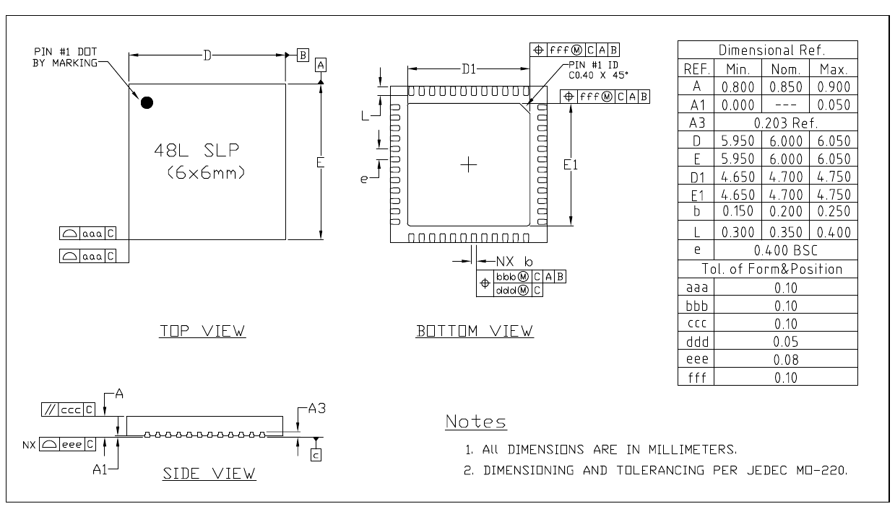

*Figure 7-1. QFN48 (6 × 6 mm) Package*

The dimension table in Figure 7-1 (all dimensions in millimetres; dimensioning and tolerancing per JEDEC MO-220):

| Ref. | Min. | Nom. | Max. |
|---|---|---|---|
| A | 0.800 | 0.850 | 0.900 |
| A1 | 0.000 | — | 0.050 |
| A3 | 0.203 Ref. | | |
| D | 5.950 | 6.000 | 6.050 |
| E | 5.950 | 6.000 | 6.050 |
| D1 | 4.650 | 4.700 | 4.750 |
| E1 | 4.650 | 4.700 | 4.750 |
| b | 0.150 | 0.200 | 0.250 |
| L | 0.300 | 0.350 | 0.400 |
| e | 0.400 BSC | | |

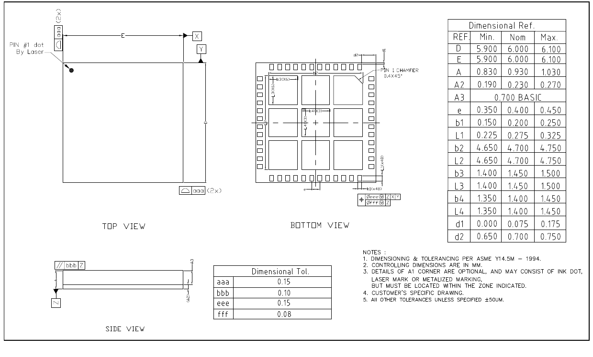

*Figure 7-2. LGA48 (6 × 6 mm) Package*

The LGA48 package is used by the ESP32-C5NF8R2LA only (see [C1.2 Comparison](#c12-comparison)).

## C8 Consolidated Pin Overview

This is the datasheet's one-page summary of every pin (its appendix *ESP32-C5 Consolidated Pin Overview*). For details, see [C2 Pins](#c2-pins). Regarding highlighted cells, see [C2.3.4 Restrictions for GPIOs and LP GPIOs](#c234-restrictions-for-gpios-and-lp-gpios).

**Table C8-1. ESP32-C5 Consolidated Pin Overview**

|Pin No.|Pin Name|Pin Type|Pin Providing Power|At Reset|After Reset|Analog F0|Analog F1|LP IO MUX 0|LP IO MUX 1|LP IO MUX 2|IO MUX F0|Type|IO MUX F1|Type|IO MUX F2|Type|
|---|---|---|---|---|---|---|---|---|---|---|---|---|---|---|---|---|
|1|VDDA6|Power|||||||||||||||
|2|GND|Power|||||||||||||||
|3|VDDA7|Power|||||||||||||||
|4|XTAL_N|Analog|||||||||||||||
|5|XTAL_P|Analog|||||||||||||||
|6|VDDA8|Power|||||||||||||||
|7|CHIP_PU|Analog|VDDPST1||||||||||||||
|8|VDDPST1|Power|||||||||||||||
|9|XTAL_32K_P|IO|VDDPST1|||XTAL_32K_P||LP_GPIO0|LP_UART_DTRN||GPIO0|I/O/T|GPIO0|I/O/T|||
|10|XTAL_32K_N|IO|VDDPST1|||XTAL_32K_N|ADC1_CH0|LP_GPIO1|LP_UART_DSRN||GPIO1|I/O/T|GPIO1|I/O/T|||
|11|MTMS|IO|VDDPST1|IE|IE||ADC1_CH1|LP_GPIO2|LP_UART_RTSN|LP_I2C_SDA|MTMS|I1|GPIO2|I/O/T|FSPIQ|I1/O/T|
|12|MTDI|IO|VDDPST1|IE|IE||ADC1_CH2|LP_GPIO3|LP_UART_CTSN|LP_I2C_SCL|MTDI|I1|GPIO3|I/O/T|||
|13|MTCK|IO|VDDPST1||IE, WPU||ADC1_CH3|LP_GPIO4|LP_UART_RXD||MTCK|I1|GPIO4|I/O/T|FSPIHD|I1/O/T|
|14|MTDO|IO|VDDPST1|IE|IE||ADC1_CH4|LP_GPIO5|LP_UART_TXD||MTDO|O/T|GPIO5|I/O/T|FSPIWP|I1/O/T|
|15|GPIO6|IO|VDDPST1|IE|IE||ADC1_CH5|LP_GPIO6|||GPIO6|I/O/T|GPIO6|I/O/T|FSPICLK|I1/O/T|
|16|GPIO7|IO|VDDPST1|IE|IE||||||SDIO_DATA1|I1/O/T|GPIO7|I/O/T|FSPID|I1/O/T|
|17|GPIO8|IO|VDDPST1||IE|PAD_COMP0|||||SDIO_DATA0|I1/O/T|GPIO8|I/O/T|||
|18|GPIO9|IO|VDDPST1||IE|PAD_COMP1|||||SDIO_CLK|I1|GPIO9|I/O/T|||
|19|GPIO10|IO|VDDPST1||IE||||||SDIO_CMD|I1/O/T|GPIO10|I/O/T|FSPICS0|I1/O/T|
|20|U0TXD|IO|VDDPST1||WPU||||||U0TXD|O|GPIO11|I/O/T|||
|21|U0RXD|IO|VDDPST1||IE, WPU||||||U0RXD|I1|GPIO12|I/O/T|||
|22|GPIO13|IO|VDDPST2||IE|USB_D-|||||SDIO_DATA3|I1/O/T|GPIO13|I/O/T|||
|23|GPIO14|IO|VDDPST2|USB_PU|IE, USB_PU|USB_D+|||||SDIO_DATA2|I1/O/T|GPIO14|I/O/T|||
|24|VDDPST2|Power|||||||||||||||
|25|SPICS1/NC|IO|VDD_SPI|WPU|IE, WPU||||||SPICS1|O/T|GPIO15|I/O/T|||
|26|SPICS0/NC|IO|VDD_SPI|WPU|IE, WPU||||||SPICS0|O/T|GPIO16|I/O/T|||
|27|SPIQ/NC|IO|VDD_SPI|WPU|IE, WPU||||||SPIQ|I1/O/T|GPIO17|I/O/T|||
|28|SPIWP/NC|IO|VDD_SPI|WPU|IE, WPU||||||SPIWP|I1/O/T|GPIO18|I/O/T|||
|29|VDD_SPI/NC|Power/IO|—|||VDD_SPI|||||GPIO19|I/O/T|GPIO19|I/O/T|||
|30|SPIHD/NC|IO|VDD_SPI|WPU|IE, WPU||||||SPIHD|I1/O/T|GPIO20|I/O/T|||
|31|SPICLK/NC|IO|VDD_SPI|WPU|IE, WPU||||||SPICLK|O/T|GPIO21|I/O/T|||
|32|SPID/NC|IO|VDD_SPI|WPU|IE, WPU||||||SPID|I1/O/T|GPIO22|I/O/T|||
|33|GPIO23|IO|VDDPST3||IE||||||GPIO23|I/O/T|GPIO23|I/O/T|||
|34|GPIO24|IO|VDDPST3||IE||||||GPIO24|I/O/T|GPIO24|I/O/T|||
|35|GPIO25|IO|VDDPST3|IE|IE||||||GPIO25|I/O/T|GPIO25|I/O/T|||
|36|GPIO26|IO|VDDPST3|IE|IE||||||GPIO26|I/O/T|GPIO26|I/O/T|||
|37|GPIO27|IO|VDDPST3|IE, WPU|IE, WPU||||||GPIO27|I/O/T|GPIO27|I/O/T|||
|38|GPIO28|IO|VDDPST3|IE, WPU|IE, WPU||||||GPIO28|I/O/T|GPIO28|I/O/T|||
|39|VDDPST3|Power|||||||||||||||
|40|VDDA1|Power|||||||||||||||
|41|VDDA2|Power|||||||||||||||
|42|ANT_2G|Analog|||||||||||||||
|43|GND|Power|||||||||||||||
|44|VDDA3|Power|||||||||||||||
|45|VDDA4|Power|||||||||||||||
|46|VDDA5|Power|||||||||||||||
|47|GND|Power|||||||||||||||
|48|ANT_5G|Analog|||||||||||||||

Sources disagree: this overview lists the LP IO MUX functions in the order LP GPIO, LP UART, LP I2C under the headings 0, 1 and 2, while Table 2-5 *LP IO MUX Functions* puts LP_UART_* in F0, LP_GPIOn in F1 and LP_I2C_* in F3. For register programming, follow Table 2-5 and the TRM chapter *IO MUX and GPIO Matrix*.

## C9 Datasheet Versioning and Glossary

### C9.1 Datasheet Versioning

| Datasheet Version | Status | Watermark | Definition |
|---|---|---|---|
| v0.1 ~ v0.5 (excluding v0.5) | Draft | Confidential | This datasheet is under development for products in the design stage. Specifications may change without prior notice. |
| v0.5 ~ v1.0 (excluding v1.0) | Preliminary release | Preliminary | This datasheet is actively updated for products in the verification stage. Specifications may change before mass production, and the changes will be documented in the datasheet's Revision History. |
| v1.0 and higher | Official release | — | This datasheet is publicly released for products in mass production. Specifications are finalized, and major changes will be communicated via Product Change Notifications (PCN). |
| Any version | — | Not Recommended for New Design (NRND)¹ | This datasheet is updated less frequently for products not recommended for new designs. |
| Any version | — | End of Life (EOL)² | This datasheet is no longer maintained for products that have reached end of life. |

1. Watermark will be added to the datasheet title page only when all the product variants covered by this datasheet are not recommended for new designs.
2. Watermark will be added to the datasheet title page only when all the product variants covered by this datasheet have reached end of life.

This reference transcribes **datasheet v1.5**, an official release.

### C9.2 Glossary

| Term | Definition |
|---|---|
| module | A self-contained unit integrated within the chip to extend its capabilities, such as cryptographic modules, RF modules |
| peripheral | A hardware component or subsystem within the chip to interface with the outside world |
| in-package flash | Flash integrated directly into the chip's package, and external to the chip die |
| off-package flash | Flash external to the chip's package |
| SPI boot mode | A boot mode in which users load and execute the existing code from SPI flash |
| joint download boot mode | A boot mode in which users can download code into flash via the UART or other interfaces (see Table 3-3 *Chip Boot Mode Control* > Note), and load and execute the downloaded code from the flash or SRAM |
| eFuse | A one-time programmable (OTP) memory which stores system and user parameters, such as MAC address, chip revision number, flash encryption key, etc. Value 0 indicates the default state, and value 1 indicates the eFuse has been programmed |

## C10 Related Documentation and Resources

### C10.1 Related Documentation

- [ESP32-C5 Technical Reference Manual](https://www.espressif.com/documentation/esp32-c5_technical_reference_manual_en.pdf) – Detailed information on how to use the ESP32-C5 memory and peripherals. Its transcription as Part T of this reference is pending (see the header).
- [ESP32-C5 Hardware Design Guidelines](https://docs.espressif.com/projects/esp-hardware-design-guidelines/en/latest/esp32c5/) – Guidelines on how to integrate the ESP32-C5 into your hardware product.
- [ESP32-C5 Series SoC Errata](https://www.espressif.com/documentation/esp32-c5_errata_en.pdf) – Descriptions of known errors in ESP32-C5 series of SoCs.
- Technical Reference Manual LaTeX sources – Public repository containing the LaTeX sources for Espressif chip TRMs: <https://github.com/espressif/esp-technical-reference-manual-latex>
- Certificates: <https://documentation.espressif.com/en/documentList?t=Certificate&eol=false>
- ESP32-C5 Product/Process Change Notifications (PCN): <https://documentation.espressif.com/en/documentList?t=PCN&s=ESP32-C5>
- ESP32-C5 Advisories – Information on security, bugs, compatibility, component reliability: <https://documentation.espressif.com/en/documentList?t=Advisory&s=ESP32-C5>
- Documentation Updates and Update Notification Subscription: <https://documentation.espressif.com/en/documentList?eol=false>

### C10.2 Developer Zone

- [ESP-IDF Programming Guide for ESP32-C5](https://docs.espressif.com/projects/esp-idf/en/latest/esp32c5/) – Extensive documentation for the ESP-IDF development framework.
- ESP-IDF and other development frameworks on GitHub: <https://github.com/espressif>
- ESP32 BBS Forum – Engineer-to-Engineer (E2E) Community for Espressif products: <https://esp32.com/>
- ESP-FAQ – A summary document of frequently asked questions released by Espressif: <https://espressif.com/projects/esp-faq/en/latest/index.html>
- The ESP Journal – Best Practices, Articles, and Notes from Espressif folks: <https://blog.espressif.com/>
- SDKs and demos: <https://espressif.com/en/support/download/sdks-demos>

### C10.3 Products

- ESP32-C5 Series SoCs: <https://espressif.com/en/products/socs?id=ESP32-C5>
- ESP32-C5 Series Modules: <https://espressif.com/en/products/modules?id=ESP32-C5>
- ESP32-C5 Series DevKits: <https://espressif.com/en/products/devkits?id=ESP32-C5>
- ESP Product Selector: <https://products.espressif.com/#/product-selector?language=en>
- Contact: <https://espressif.com/en/contact-us/sales-questions>
